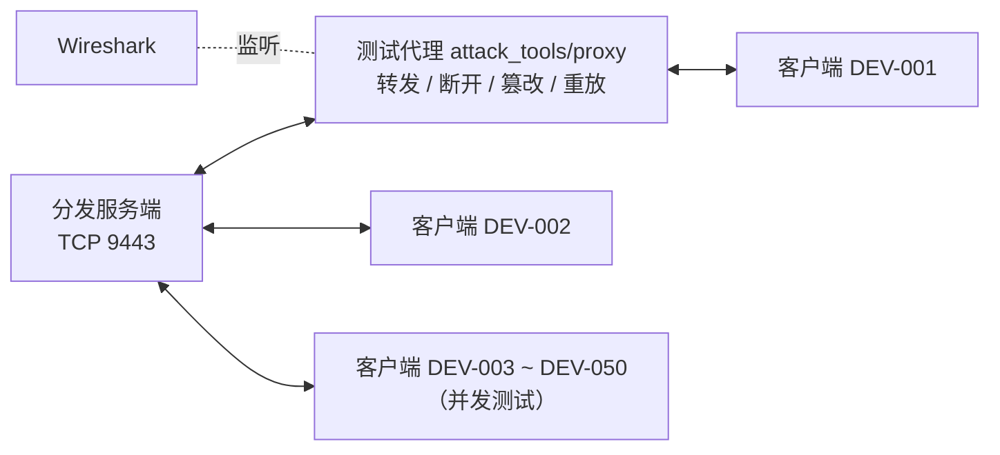

# 工业固件安全升级分发系统 —— 测试报告

| 项 | 内容 |
|---|---|
| 文档版本 | v0.5（开发阶段：第三批性能、异常、自启守护用例在云端实测并回填，汇总依赖真机的部分） |
| 当前状态 | 2026-11-18 在云端 Linux 容器里分三批执行：第一批 46 条（通信、证书、固件验签、下发、回滚等）；第二批补测灰度发布、互锁、二次确认、紧急停止、事件补传对账、降级运行、审计日志防篡改、时钟偏差，并补齐第一批部分通过的 4 条；部署与打包用例按部署 PR #19 的云端演练回填；第三批补测性能（50 个真实客户端进程）、异常（非法帧、坏 JSON、非法输入、磁盘满）和开机自启、进程守护（两台 systemd-nspawn 模拟主机）。目前 78 条中通过 74 条、部分通过 4 条（FT-17 ~ FT-19、FT-22），无未过、无待测，结果见各表和第 8 节。云端结果不能代替真机证据，所有依赖真机的内容按准备的环境分组列在 8.2 节 |
| 依据 | [设计文档](系统设计说明书.md) v0.2、[通信协议文档](通信协议文档.md) v0.2、任务书检查项 |

本文对应《资料大模板》的“测试报告（分为功能测试和安全测试）”。每条用例标明对应的需求编号或任务书检查项，测试时产生的证据进入证据包，供自查表引用。

## 1. 测试环境与工具

| 项 | 配置 |
|---|---|
| 主机 | 2 台 PC（服务端、客户端各一台），其中至少 1 台为未装过开发环境的干净机器 |
| 系统与运行库 | Windows 10/11，Qt 6.5+，OpenSSL 3.x |
| 测试数据 | 全部为模拟数据：设备 DEV-001 ~ DEV-050，账号 op1、mt1、au1 |
| 测试固件 | `fw_v2.0.0_sv4`（当前）、`fw_v2.1.0_sv5`（正常升级，10 MB）、`fw_v1.9.0_sv3`（降级用）、`fw_v2.2.0_selftest_fail`（回滚用）、`fw_model_other`（型号不符） |
| 测试证书 | 自建 CA 签发的正常证书，以及过期、已吊销、名称不符、由其他 CA 签发的证书各一张 |

| 工具 | 用途 |
|---|---|
| GoogleTest | 单元测试 |
| Wireshark | 抓包，确认协议版本、套件和内容不可读 |
| `openssl s_client` | 探测服务端接受的协议版本和套件、不带证书连接 |
| `attack_tools/proxy` | 断网、翻转字节、重放记录 |
| `attack_tools/tamper_fwpkg`、`fake_signer` | 篡改固件包、用攻击者密钥签名 |
| `attack_tools/fake_device` | 用异常证书或伪造登录信息接入 |
| `attack_tools/flood` | 连接洪泛、超大长度、慢速握手、登录暴力尝试 |
| gitleaks | 全仓库（含历史提交）秘密扫描 |
| cppcheck、clang-tidy | 静态代码扫描 |
| SQLite 浏览器、十六进制编辑器 | 检查存储值、篡改本地文件 |

## 2. 策略与证据

- **层次**：单元测试（密码封装用标准测试向量）→ 集成测试（服务端 + 单客户端）→ 系统测试（多客户端 + 测试代理）；修复缺陷后重跑相关用例；
- **通过准则**：单元测试全部通过；功能测试全部通过；安全测试中所有攻击被拦截且服务端有对应日志，“篡改任意字节”检测率 100%；性能达到设计指标；静态扫描和秘密扫描无高危项；
- **缺陷等级**：致命（安全机制被绕过、设备变砖）、严重（核心流程失败）、一般、轻微；
- **执行状态标注**：“通过（云端）”表示在云端容器里用真实进程实测通过；只写“通过”表示由单元测试（GoogleTest，部分走真实 TLS 连接）验证；“部分通过”写明哪一部分还依赖未实现的功能；“待真机”表示正式证据要在 Windows 真机上补做；
- **证据**：每条用例执行时保存截图、日志片段、抓包文件或工具报告，放入 `evidence/`，文件名为 `<检查项编号>_<用例编号>_<简述>.<扩展名>`，例如 `4-1_ST-01_无证书连接被拒.pcapng`。没有对应检查项的用例用需求编号。证据只来自本组提交的系统，不含真实数据。

### 2.1 云端测试环境（2026-11-18）

第 1 节的环境是正式测试（真机）用的。开发阶段先在云端容器里把已实现的功能测一遍，环境如下：

| 项 | 配置 |
|---|---|
| 系统与运行库 | Ubuntu 24.04 容器，Qt 6.4.2，OpenSSL 3.0.13，GCC，Ninja |
| 单元测试 | 第一批 `fwds-tests` 共 300 条（新增 1 条 ST-19 用例）全部通过；第二批 336 条（新增 FT-15 服务端重启用例，ChunkDownload 增加在途请求检查）全部通过，约 41 秒 |
| 联调方式 | 三台（第二批四台）真实的 `fwds-client --headless` 进程 + 服务端；第二批 FT-08 ~ FT-10 的客户端用界面模式跑在虚拟显示（Xvfb）上截图。服务端是一个只用于取证的脚本化程序：与 `fwds-server` 的 `main.cpp` 组装完全相同的业务层、网络层和主窗口（无显示器渲染），按脚本调用 `AdminService` 完成建账号、注册设备、导入固件、打开开关、下发（与界面操作走同一个入口，带权限检查），并截取主窗口。纯网络攻击类用例直接用 `fwds-server --headless` |
| 证书与固件 | 用 `fwds-signer` 现场生成：自建 CA、服务端和 DEV-001 ~ DEV-003 证书、FSK，`make-image` + `sign-fw` 生成第 1 节列出的五种测试固件；另用 `openssl` 建一个“其他 CA”签发假的服务端和设备证书。口令为每次随机生成，经环境变量注入，不落盘 |
| 攻击工具 | `tests/attack_tools/`（测试代理 `tls_proxy.py`、洪泛 `flood.py`、抓包明文搜索 `pcap_grep.py`）、`openssl s_client / s_server`、`tcpdump` + `tshark` |
| 静态与秘密扫描 | cppcheck 2.13、clang-tidy 18；gitleaks 在容器里无法下载，改用 git 命令对全部历史做等价扫描 |
| 第三批（性能、异常、自启守护） | 单元测试 374 条全部通过（新增 BUG-006 ~ 009 的回归用例 6 条、ET-01 用例 1 条），约 47 秒。性能：同一台 4 核容器上 50 个 `fwds-client --headless` 进程 + 脚本化服务端（另做一组服务端绑定 1 个核、客户端绑定其余 3 个核的对照）；服务端加了采样（在线数、处理器、内存、事件循环停顿）和上报延迟统计（设备事件里的毫秒时间戳 → 设备表该行实际重绘）。异常：自写的 `et-peer` 用真实证书和许可证登录后发送非法帧和坏消息体；磁盘满用挂在设备数据目录上的小容量 tmpfs，配合测试代理限速 2 MB/s 在下载中途写满。自启守护：用 debootstrap 建 Ubuntu 24.04 根文件系统，`systemd-nspawn` 起两台带完整 systemd 的模拟主机，按 `deploy/install.sh` 装成系统服务；强杀容器的 PID 1 模拟断电 |
| 证据位置 | 第一批：项目文件 `evidence/cloud-20261118/`（含 23 MB 抓包）；第二批：`evidence/cloud-20261118-2/`（抓包只保留紧急停止前后的片段）；部署演练：`evidence/cloud-20261118-deploy/`；第三批：`evidence/cloud-20261118-3/`。都不进仓库，文件名按第 2 节规则 |

云端与真机的差别：系统是 Linux 不是 Windows；界面截图是无显示器渲染（`QWidget::grab()`），字体与真机不同；两端在同一台机器上走回环地址。所以云端结果用来确认功能和安全机制本身没有问题，提交用的截图、抓包按第 8 节在真机上补做。

## 3. 检查项与用例对照

| 任务书检查项 | 覆盖用例 |
|---|---|
| 1-1 控制指令明文下发 | ST-06 |
| 1-2 口令明文或裸哈希 | ST-13 |
| 1-3 密钥硬编码或进仓库 | ST-15、ST-16 |
| 1-4 / 4-3 带认证加密 | ST-05、ST-07、UT-04 |
| 1-5 / 第 6 类 断网数据落盘、补传、对账 | FT-08、FT-09、UT-09 |
| 1-6 / 7-3 不扰扫描周期 | 不设用例：不轮询 PLC，1-6 填通过、7-3 填不适用（见设计文档 9.3 节） |
| 1-7 / 4-7 脱敏 | ST-17 |
| 1-8 / 8-4 升级回滚 | FT-13、FT-14、FT-20、FT-21 |
| 第 3 类 架构与部署、8-1 干净环境安装 | FT-17 |
| 4-1 双向证书认证 | ST-01、ST-02 |
| 4-2 完整证书校验 | ST-03、ST-04 |
| 4-4 随机数唯一性 | UT-05 |
| 4-5 抗重放 | ST-08、ST-09、UT-09 |
| 4-6 上下文绑定 | ST-10、ST-11 |
| 第 5 类 角色权限、轮换吊销 | ST-12、ST-14、ST-04 |
| 7-1 只读优先、7-2 互锁 | ST-24、ST-25 |
| 7-4 降级运行 | FT-10 |
| 7-5 明文协议隔离 | 不适用（见设计文档 9.3 节） |
| 7-6 功能安全优先、紧急停止 | ST-26、FT-13、FT-14 |
| 8-2 自启、8-3 守护 | FT-18、FT-19 |
| 8-5 日志 | FT-16、ST-17 |
| 8-6 时钟同步 | FT-22 |
| 指令控制类附加要求 | ST-06、ST-23 ~ ST-27 |

题目与课程要求的对照：FR-1 → FT-05 ~ FT-07；FR-2 → ST-18 ~ ST-22；FR-3 → FT-11、FT-12；FR-4 → FT-04、PT-03；FR-5 → FT-13、FT-14；FR-6 → FT-01、FT-02、FT-16；软件保护 → ST-31、ST-32。

---

# 第一部分 功能测试

### 4.1 单元测试

| 编号 | 用例 | 步骤 | 预期结果 | 结果 |
|---|---|---|---|---|
| UT-01 | 分帧：半包 | 一帧分 3 次送入 FrameCodec | 前两次返回“数据不足”，第 3 次解析出一帧 | 通过 |
| UT-02 | 分帧：粘包与超长 | ① 3 帧拼在一起送入；② Length = 0xFFFFFFFF | ① 依次解析出 3 帧；② 立即报“帧过长”，不分配内存 | 通过 |
| UT-03 | RSA-PSS 签名验签 | 签名后验签；改 1 比特后验签；用另一把公钥验签 | 第一次通过，后两次失败 | 通过 |
| UT-04 | AES-256-GCM | 加解密；分别翻转密文、标签、关联数据 1 比特后解密 | 第一次得到原文，其余返回失败且无明文输出 | 通过 |
| UT-05 | 随机数唯一性抽样 | 连续生成 10 000 个 12 字节 nonce 和 16 字节盐；同一私钥连续封装 100 次 | 无重复；100 个文件的 nonce、盐各不相同；`RAND_bytes` 返回值均被检查 | 通过 |
| UT-06 | 口令派生 | 同一口令创建两个账号；验证正确和错误口令 | 两个存储值不同；正确通过、错误拒绝；单次派生耗时在 100 毫秒量级 | 通过（单次派生约 170 ms） |
| UT-07 | manifest 先验签后解析 | 签名正确、签名错误、签名正确但 JSON 损坏三组数据 | 签名错误时不调用 JSON 解析；损坏 JSON 返回解析错误 | 通过 |
| UT-08 | 防降级边界 | 本地最小安全版本 5、版本 2.0.0；输入 sv = 4、5、6 和 version = 1.9.0、2.0.0、2.1.0 | sv = 4 拒绝；version 不高于当前拒绝；其余通过 | 通过 |
| UT-09 | 事件序号与去重 | outbox 写入 10 条后模拟重启再写 5 条；服务端重复收到第 3 条，乱序收到第 7、6 条 | 序号 1 ~ 15 连续；重复条不入库；确认序号只在补齐后推进 | 通过 |
| UT-10 | 断点位图 | 标记第 0、5、159 片后序列化、反序列化 | 位图一致，下一个缺失片为 1 | 通过 |
| UT-11 | Bootloader 决策 | 无 pending；pending + 验签失败；pending + 自检失败；boot_attempts = 4 | 分别为：启动 active；回滚；回滚；回滚 | 通过 |
| UT-12 | 审计哈希链 | 写入 100 条日志，修改第 37 条后校验 | 校验失败并定位到第 37 条 | 通过 |
| UT-13 | 证书与 CRL 校验函数 | 分别输入正常、过期、名称不符、已吊销、其他 CA 签发的证书；输入签名被改的 CRL | 仅正常证书通过；被改的 CRL 拒绝加载 | 通过 |
| UT-14 | SecureBuffer 清零 | 写入已知数据后析构，检查原内存 | 已清零 | 通过 |

### 4.2 业务功能

前置条件：服务端已初始化；DEV-001、DEV-002 已注册并运行 v2.0.0；“允许下发”开关已打开。

| 编号 | 用例 | 步骤 | 预期结果 | 结果 |
|---|---|---|---|---|
| FT-01 | 设备上线显示 | 启动 DEV-001 | 设备表出现 DEV-001：在线、已登录、IP、版本，最后心跳每 5 秒刷新 | 通过（云端）；界面截图待真机 |
| FT-02 | 心跳超时离线 | 强制结束 DEV-001 进程 | 15 秒内标记离线，写 `HB` 日志 | 通过（云端，冻结后 10.7 秒离线） |
| FT-03 | 固件导入验签 | 导入正常包；导入被篡改的包 | 正常包导入成功并显示 manifest；篡改包被拒并告警 | 通过（云端） |
| FT-04 | 正常升级全流程 | 向 DEV-001 推送 v2.1.0 | 两端依次显示 NOTIFIED → DOWNLOADING → VERIFYING → WRITING → REBOOTING → SUCCESS；版本变为 2.1.0，active 分区切换 | 通过（云端）；进度截图待真机 |
| FT-05 | 分片正确性 | 升级后比较分区内固件与原始镜像的 SHA-256 | 一致 | 通过（云端） |
| FT-06 | 断点续传 | 经代理下载，约 47% 时断开，10 秒后恢复 | 自动重连和登录，从断点继续（日志中 from_index > 0），最终成功；总下载量不超过固件大小加一个窗口 | 通过（云端，从 74/160 片续传） |
| FT-07 | 续传时缓存被改 / 固件被更换 | ① 断网期间改 `.part` 中已完成的一片；② 断网期间服务端改推另一个包 | ① 只重下该片，最终成功；② 丢弃旧进度重新下载 | 通过（单元与联调测试） |
| FT-08 | 断网期间事件落盘 | 升级中断开网络，让设备继续完成本地阶段；随后强制结束并重启客户端 | outbox 文件持续增长且时间戳连续；重启后未确认事件仍在 | 通过（云端） |
| FT-09 | 恢复后补传对账 | 接 FT-08，恢复网络 | 事件按序号补传；服务端该设备事件序号连续、无重复；outbox 清空 | 通过（云端，46 条事件序号 1 ~ 46 连续、无重复） |
| FT-10 | 降级运行 | 客户端运行中关闭服务端，5 分钟后再启动 | 客户端界面可操作并显示“离线运行”，当前固件照常运行；服务端恢复后自动重连、登录、补传 | 通过（云端，服务端关闭 5 分钟） |
| FT-11 | 灰度发布正常推进 | DEV-001 标记为 canary，新建发布 | 只有 DEV-001 收到升级；成功并稳定 30 秒后进入“待确认全量”；确认后其余设备开始升级 | 通过（云端） |
| FT-12 | 灰度失败自动暂停 | 向金丝雀组推送自检失败固件 | DEV-001 回滚，发布自动“已暂停”，其余设备不推送 | 通过（云端） |
| FT-13 | 自检失败自动回滚 | 推送 `selftest_fail` 固件 | 重启后自动切回原分区，版本仍为 2.0.0，上报 ROLLED_BACK，设备继续在线 | 通过（云端） |
| FT-14 | 写入中断电 | WRITING 50% 时强制结束客户端后重启 | 从原分区正常启动，可重新升级 | 通过（单元测试）；真机演示待做 |
| FT-15 | 服务端重启恢复 | 发布进行中重启服务端 | 发布恢复为“已暂停”，设备重连后状态正确 | 通过（云端，修复 BUG-004 后回归） |
| FT-16 | 日志检索与定位 | 按设备、时间、分类、关键字检索；由未参与开发的同学根据日志定位一次预设故障 | 能检索到对应记录；能定位到故障模块和原因 | 通过（组内判定）：macOS 真机上做了一次预设故障（向 DEV-003 下发自检失败的 2.2.0），只用界面检索就能定位：运行日志页按关键字 `3007` 找到唯一一条 “device DEV-003 upgrade ROLLED_BACK code 3007 自检失败：固件报告自检不通过”；审计日志页按 `ROLLED_BACK` 找到 “升级结果 ROLLED_BACK，发布 #5，包 …，错误码 3007”，同一页按时间能看到下发 → 开始下载 → 断开 → 重新登录 → 回滚的完整过程，设备、时间、模块和原因都写在记录里。检索功能另由单元测试 `RunLogSearch.*`、`AuditSearch.*`、`Audit.SearchDoesNotAffectVerify` 验证。**说明：用例要求的“由未参与开发的同学现场定位”没有做**，是否可读由组内判断（答辩前时间不够，2026-11-18 决定）。证据：`mac-20261118/A7_FT-16_日志检索_运行日志_3007.png`、`A7_FT-16_日志检索_审计日志_ROLLED_BACK.png`、`A7_FT-16_日志检索_审计日志_DEV-003全过程.png`、`A7_FT-16_他人定位故障_准备.md` |

### 4.3 部署与运维

| 编号 | 用例 | 步骤 | 预期结果 | 结果 |
|---|---|---|---|---|
| FT-17 | 干净环境安装 | 在未装开发环境的机器上只按 README 和 `deploy/install` 操作；服务端和客户端分处两台机器 | 两端启动成功，设备登录成功；过程中不需要手工改源码或写死地址 | 部分通过（云端 Linux 单机，部署 PR #19）；两台机器、Windows 待真机 |
| FT-18 | 开机自启与断电恢复 | 升级进行中直接断电重启两台主机 | 两端自动启动；设备自动登录；发布为“已暂停”，继续后升级完成 | 部分通过（云端）：两台用 systemd-nspawn 模拟的 Linux 主机按 `deploy/install.sh` 安装（真实 systemd 单元），下载中强杀主机的 PID 1 模拟断电：开机后两端服务自动启动，设备 1.5 秒内登录，从第 48 / 160 片续传并成功；服务端主机断电后审计链校验正常。“发布已暂停、继续后完成”由 FT-15 验证。Windows 任务计划、macOS launchd 和真实断电待真机（8.2 节） |
| FT-19 | 进程守护 | 分别强制结束服务端、客户端进程 | 1 分钟内自动拉起并恢复连接 | 部分通过（云端）：同 FT-18 的模拟主机上对服务端、客户端分别 `kill -9` 和发 SIGSEGV，systemd 约 5 秒后拉起，设备 5.3 ~ 7.0 秒内重新登录。Windows（任务计划 + `run.ps1` 循环）和 macOS（launchd）待真机 |
| FT-20 | 系统升级演练 | 按设计文档 8.4 节用 `deploy/upgrade` 把服务端从旧版本升到新版本 | 备份生成；冒烟检查通过；设备、固件、日志数据完整 | 通过（云端，部署 PR #19） |
| FT-21 | 系统回滚演练 | 接 FT-20，执行 `deploy/rollback` | 回到旧版本；数据库与备份一致；设备重连并补传事件，序号连续 | 通过（云端，部署 PR #19） |
| FT-22 | 时钟同步 | 检查两台主机的 NTP 配置；把客户端主机时间调快 5 分钟 | 正常时偏差小于 1 秒；调快后登录被拒（`2002`）并有告警 | 部分通过（云端）：时钟快 5 分钟登录被拒 2002 并有安全日志；NTP 配置与偏差待真机 |

### 4.4 性能

| 编号 | 用例 | 步骤 | 预期结果 | 结果 |
|---|---|---|---|---|
| PT-01 | 并发在线 | 50 个客户端在线 30 分钟 | 无掉线，心跳正常，界面流畅 | 通过（云端）：50 个真实客户端进程在线 30 分钟，每秒采样 1800 次都是 50 台在线，0 次离线；服务端处理器平均 1.7%、内存约 72 MB。“界面流畅”要人在真机上看（8.2 节 A8） |
| PT-02 | 并发下载 | 20 台同时下载 10 MB 固件 | 全部成功；记录总耗时、吞吐量、服务端处理器和内存占用 | 通过（云端）：20 台全部 SUCCESS，从开始灰度到全部成功 4.8 秒（约 200 MB，约 42 MB/s），服务端处理器峰值 66%、内存峰值约 117 MB。发现并修复 BUG-006、BUG-009（修复前 11.3 秒）。回环地址，局域网数据待真机（8.2 节 C3） |
| PT-03 | 状态上报延迟 | 用两端毫秒时间戳统计 PROGRESS 发出到界面刷新的时间差 | 平均 < 1 秒；记录最大值 | 通过（云端）：单台升级 35 条进度平均 24 毫秒、最长 56 毫秒；20 台并发 700 条平均 0.38 秒、最长 1.01 秒（出现在 20 台同时重启、重新登录的那一刻）。修复 BUG-006 前并发时平均 1.2 秒 |
| PT-04 | 单设备下载基线 | 局域网下载 10 MB 固件 | 记录耗时 | 通过（云端）：从开始灰度到 SUCCESS 2.5 秒，其中下载约 0.2 秒，其余是验签、写分区、重启自检和重新登录。回环地址，局域网耗时待真机（8.2 节 C3） |

### 4.5 异常

| 编号 | 用例 | 步骤 | 预期结果 | 结果 |
|---|---|---|---|---|
| ET-01 | 非法帧 | 登录后发送 Magic 错误、版本为 9 的帧 | 断开并记录 | 通过（云端）：Magic 错回 1001、版本 9 回 1002，随后断开，各记一条 SECURITY；服务端继续运行，其他设备不受影响。单元测试 `Network.BadHeaderAfterLoginClosesConnection` |
| ET-02 | 非法 JSON | 登录后发送格式错误的消息体 | 返回 ERROR，不崩溃 | 通过（云端）：心跳、进度、分片请求的坏 JSON 和字段类型错误都回 1005，连接保持可用，服务端不崩溃。发现并修复 BUG-007（坏心跳原来被当作正常心跳应答）。单元测试 `Network.MalformedHeartbeatGetsBadJsonAndIsNotCounted` |
| ET-03 | 界面非法输入 | 设备 ID 为空或含特殊字符；端口超范围；导入非 .fwpkg 文件 | 提示错误，不提交 | 通过（云端）：导入文本、空文件、随机字节、截断的包，注册非法证书、非法型号或标签，都提示原因且库不变；配置里端口 0 / 70000 / abc、设备 ID 为空或含特殊字符、签发工具的非法名称都拒绝启动并给出原因。真机界面截图待补 |
| ET-04 | 磁盘空间不足 | 设备目录所在盘空间不足时升级 | 状态 FAILED，原分区继续运行 | 通过（云端）：开始前空间不够时立即 FAILED 3011“升级需要 20.0 MB，可用 5.7 MB”，不写任何文件；下载中途写满时 FAILED 3011 并删除下载了一半的文件，空间归还。两种情况都仍运行 2.0.0。发现并修复 BUG-008。单元测试 `ResumeStoreTest.NotEnoughSpace*`、`ResumeNeedsSpaceOnlyForTheRest` |

---

# 第二部分 安全测试

每条用例除预期结果外，统一检查：攻击未造成固件写入；服务端或客户端有对应的安全日志或告警。

### 5.1 通信安全（任务书第 4 类、红线 1-1、1-4）

| 编号 | 检查项 | 用例 | 步骤 | 预期结果 | 结果 |
|---|---|---|---|---|---|
| ST-01 | 4-1 | 客户端不出示证书 | `openssl s_client` 不带证书连接服务端 | 握手失败，服务端记录 | 通过（云端） |
| ST-02 | 4-1 | 伪造服务端 | 用其他 CA 签发的证书运行假服务端，客户端指向它 | 客户端握手失败并告警，不接受任何推送 | 通过（云端） |
| ST-03 | 4-2 | 证书链、有效期、名称 | `fake_device` 分别使用其他 CA 签发、已过期、名称与设备 ID 不符的证书 | 三种情况全部被拒，日志写明原因 | 通过 |
| ST-04 | 4-2、第 5 类 | 吊销演练 | 维护员停用 DEV-002，签发工具吊销其证书并导入新 CRL；DEV-002 重新连接 | 现有连接立即断开；重连被拒；其他设备不受影响 | 通过（云端） |
| ST-05 | 4-3、1-4 | 协议版本与套件 | `openssl s_client` 分别用 TLS 1.2、非 GCM 套件连接；Wireshark 查看正常连接的握手 | 低版本和其他套件握手失败；正常连接为 TLS 1.3 + `TLS_AES_256_GCM_SHA384`；附配置截图 | 通过（云端）；配置截图待真机 |
| ST-06 | 1-1 | 抓包不可读 | 抓取一次完整升级（含 UPDATE_NOTIFY 和 UPDATE_CANCEL）；在抓包中搜索 JSON 字段名、设备 ID、固件中的已知字符串 | 搜索不到任何明文；逐包标出指令所在的 TLS 记录 | 通过（云端，补抓 UPDATE_CANCEL 并逐包标注）；Wireshark 截图待真机 |
| ST-07 | 1-4 | 篡改密文被拒 | 代理翻转一条 TLS 记录中的 1 比特 | 接收方标签校验失败并断开；重连后续传成功 | 通过（云端，修复 BUG-002 后回归） |
| ST-08 | 4-5 | 重放 TLS 记录 | 代理把一条已转发的记录原样再发一次；录制整次会话后在新连接中回放 | 两种情况都被拒并断开 | 通过（云端） |
| ST-09 | 4-5 | 应用层重放 | 用合法证书的测试客户端重复发送同一帧序号；重发已确认过的事件；发送时间戳为 10 分钟前的 LOGIN | 分别返回 `1007`、事件不重复入库、`2002` | 通过（云端 + 单元测试） |
| ST-10 | 4-6 | 设备 ID 与证书不符 | 用 DEV-002 的证书登录，LOGIN 中填 DEV-001 | `2003`，断开并告警 | 通过 |
| ST-11 | 4-6 | 越权与越界请求 | 登录前发送 CHUNK_REQ；登录后请求未下发给自己的包 | 前者 `1004` 并断开；后者 `3009` | 通过 |

### 5.2 身份、授权与密钥（任务书第 5 类、红线 1-2、1-3、1-7）

| 编号 | 检查项 | 用例 | 步骤 | 预期结果 | 结果 |
|---|---|---|---|---|---|
| ST-12 | 第 5 类 | 角色权限 | 用操作员、维护员、审计员账号分别尝试对方专属功能 | 界面不提供入口；绕过界面直接调用业务接口也被拒并记录 | 通过（云端）；界面截图待真机 |
| ST-13 | 1-2 | 口令存储 | 导出账号表截图；两个账号设置相同口令 | 字段中无明文和单次哈希；两个存储值不同；附派生函数源码片段 | 通过（云端）；截图待真机 |
| ST-14 | 第 5 类 | 登录锁定 | 同一账号连续输错 5 次口令 | 锁定 10 分钟并记录 | 通过 |
| ST-15 | 1-3 | 秘密扫描 | 对全仓库和全部历史提交运行 gitleaks；对可执行文件和安装包搜索 PEM 头 | 无私钥、口令、固定密钥；只有公钥和根证书 | 通过（git 全历史扫描）；gitleaks 报告待真机 |
| ST-16 | 1-3 | 私钥文件保护与注入 | 不提供口令直接解析私钥文件；检查注入点和文件权限；改动私钥文件 1 字节后启动 | 无法得到私钥；口令只在仓库外的受限文件中；被改动的文件解密失败并告警 | 通过（云端，修复 BUG-001 后回归） |
| ST-17 | 1-7、4-7、8-5 | 日志与证据自检 | 在全部日志和证据文件中搜索私钥头、口令、随机数、完整报文和真实标识 | 无命中 | 通过（云端） |

### 5.3 固件可信（题目考核项）

| 编号 | 用例 | 步骤 | 预期结果 | 结果 |
|---|---|---|---|---|
| ST-18 | 篡改 manifest | 修改 manifest 中 1 字节，绕过服务端导入检查直接推送 | 客户端验签失败（`3001`），不下载，服务端红色告警 | 通过（云端） |
| ST-19 | 篡改镜像任意字节 | 对镜像随机取 100 个偏移（含首字节、末字节、分片边界），每次翻转 1 比特后推送 | 100 次全部被检测（`3004` 或 `3005`），无一次写入 | 通过（100/100 被 3004 拦截，无一次写入） |
| ST-20 | 伪造或缺失签名 | 用攻击者密钥签名；删除签名；换成另一个合法包的签名 | 全部验签失败 | 通过 |
| ST-21 | 降级与型号不符 | 推送签名合法的 `fw_v1.9.0_sv3`；推送其他型号固件 | 分别被 `3003`、`3002` 拒绝 | 通过（云端） |
| ST-22 | 分区固件被改 | 手工修改分区中的 firmware.bin 后重启 | Bootloader 验签失败，切换到另一分区或恢复模式 | 通过（云端，进入恢复模式） |

已知局限：本机管理员可以改写 `boot.json` 中的最小安全版本号，原型无法防御，已列入设计文档 9.3 节放弃项，不作为用例。

### 5.4 指令控制（任务书第 7 类及指令控制类附加要求）

| 编号 | 用例 | 步骤 | 预期结果 | 结果 |
|---|---|---|---|---|
| ST-23 | 指令留痕与二次确认 | 执行一次开始灰度和确认全量；确认时输错口令一次 | 输错时不执行；审计日志含操作者、时间、来源、确认记录 | 通过（云端） |
| ST-24 | 默认不下发 | “允许下发”关闭时尝试开始灰度 | 被拒并提示；只有维护员能打开开关 | 通过（云端） |
| ST-25 | 互锁冲突注入 | ① 同一型号同时开始两个发布；② 对升级中的设备再次推送；③ 跳过灰度直接全量 | 三种冲突全部被服务端拒绝并记录 | 通过（云端） |
| ST-26 | 紧急停止 | 多台设备分别处于下载、校验、写入阶段时点击紧急停止 | 发布变为“已终止”；写入前的设备放弃升级并保留旧固件；写入中的设备完成或回滚后仍可启动 | 通过（云端，修复 BUG-003 后回归） |
| ST-27 | 断网不盲发 | 全量阶段 DEV-002 离线，稍后上线 | 上线后不自动推送，显示“待确认”；操作员确认后才开始升级 | 通过（云端） |

### 5.5 拒绝服务

| 编号 | 用例 | 步骤 | 预期结果 | 结果 |
|---|---|---|---|---|
| ST-28 | 连接洪泛 | 单 IP 发起 100 个连接；总计发起 300 个连接 | 单 IP 超过 5 个被拒，总数超过 200 被拒；在线设备不受影响 | 通过（云端） |
| ST-29 | 慢速握手与超大长度 | 连接后不发数据或每秒 1 字节；登录后发送 Length = 0x7FFFFFFF 的帧头 | 10 秒后断开；超长帧立即断开，内存无明显增长 | 通过（云端，10.3 秒断开） |
| ST-30 | 登录暴力尝试 | 同一设备 ID 5 分钟内登录失败 6 次 | 第 5 次后锁定 10 分钟并告警 | 通过 |

### 5.6 软件保护、审计与静态扫描

| 编号 | 用例 | 步骤 | 预期结果 | 结果 |
|---|---|---|---|---|
| ST-31 | 客户端程序被修改 | 修改 `fwds-client` 可执行文件 1 字节 | 启动时自校验失败，拒绝运行 | 通过（云端 Linux，部署 PR #19）；Windows 待真机 |
| ST-32 | 许可证拷贝与加壳 | 把 DEV-001 的许可证拷到另一台机器；用反汇编工具对比加壳前后 | 硬件指纹不符，拒绝运行；加壳后看不到明文字符串 | 通过（云端 Linux，部署 PR #19）；Windows 待真机 |
| ST-33 | 审计日志篡改 | 用 SQLite 工具修改和删除各一条审计日志 | “校验日志完整性”定位到被改位置 | 通过（云端） |
| ST-34 | 静态扫描 | 对全部源码运行 cppcheck 和 clang-tidy | 无高危告警；中低危有处理说明 | 通过（无高危，中低危有说明） |

---

## 6. 结果汇总（2026-11-18 云端，开发阶段）

| 部分 | 类别 | 用例数 | 通过 | 部分通过 | 未过 | 待测 |
|---|---|---|---|---|---|---|
| 功能测试 | 单元测试 | 14 | 14 | 0 | 0 | 0 |
| 功能测试 | 业务功能 | 16 | 15 | 1 | 0 | 0 |
| 功能测试 | 部署与运维 | 6 | 2 | 4 | 0 | 0 |
| 功能测试 | 性能 | 4 | 4 | 0 | 0 | 0 |
| 功能测试 | 异常 | 4 | 4 | 0 | 0 | 0 |
| 安全测试 | 通信安全 | 11 | 11 | 0 | 0 | 0 |
| 安全测试 | 身份、授权与密钥 | 6 | 6 | 0 | 0 | 0 |
| 安全测试 | 固件可信 | 5 | 5 | 0 | 0 | 0 |
| 安全测试 | 指令控制 | 5 | 5 | 0 | 0 | 0 |
| 安全测试 | 拒绝服务 | 3 | 3 | 0 | 0 | 0 |
| 安全测试 | 软件保护、审计与静态扫描 | 4 | 4 | 0 | 0 | 0 |
| **合计** | | **78** | **73** | **5** | **0** | **0** |

“通过”里的大部分是“通过（云端）”，还要按 8.2 节在真机上补截图、抓包或测量。部署与打包的 FT-17、FT-20、FT-21、ST-31、ST-32 依据部署 PR #19（已合并）的云端演练。“部分通过”的 4 条：FT-17 只在云端 Linux 单机上装过，两台机器和 Windows 待真机；FT-18、FT-19 在模拟主机上用 Linux systemd 验证了自启、断电后续传和守护，Windows、macOS 和真实断电待真机；FT-22 时钟偏差被拒已验证，NTP 配置待真机。性能 4 条判为“通过（云端）”，但两端在同一台机器上走回环地址，局域网数据要在两台机器上补测（8.2 节 C3）。正式结论以真机测试为准。

## 7. 缺陷记录

| 编号 | 发现用例 | 描述 | 等级 | 原因 | 修复方式 | 回归结果 |
|---|---|---|---|---|---|---|
| BUG-001 | ST-16 | 私钥口令经环境变量注入、程序读取后删除了变量，但 Linux 上 `/proc/<pid>/environ` 仍能读到口令原文（同一账户或 root 可读） | 一般 | `unsetenv` 只把变量从环境表里摘掉，进程初始环境块中的原字符串没有清除 | `takePassphraseFromEnv`（`common/security/key_store.cpp`）删除变量前先用 `OPENSSL_cleanse` 抹掉 `getenv` 返回的原始字节；服务端、设备、签发工具共用这个函数 | 通过：服务端运行中 `/proc/<pid>/environ` 不再含该变量，也搜不到口令原文 |
| BUG-002 | ST-07 | 登录后的 TLS 记录被篡改或重放时，接收方能正确断开并重连，但只记了一条普通网络警告（`fwds.net` WARN），没有安全日志，不满足第二部分开头的“统一检查” | 轻微 | 服务端 Session 和设备 TcpClient 只把握手阶段的 TLS 错误按安全事件记录 | 握手之后出现的 `SslInternalError`（记录认证失败）记为 `[SECURITY] TLS record rejected`（`server/net/session.cpp`、`client/net/tcp_client.cpp`） | 通过：ST-07 两个方向和 ST-08 记录重放各复测一次，接收方都有一条 SECURITY 日志，随后自动重连、登录成功 |
| BUG-003 | ST-26 | 紧急停止时，经慢速链路正在下载的设备在收到 UPDATE_CANCEL 之前已经发出的 CHUNK_REQ 到达服务端，服务端回 3009，同时记了一条“device … requested a package not assigned to it”的 SECURITY 日志。这是正常的先后顺序，不是越权，会让值班人员误判 | 轻微 | 取消下发后分片服务立即删掉下发记录，无法区分“刚取消的包”和“从没下发过的包” | `ChunkService` 记住每台设备最近一次被取消的包（`server/business/chunk_service.cpp`）；对这个包的请求照常回 3009，只记普通日志。单元测试 `ChunkDownload.ServerRejectsUnassignedAndOutOfRangeRequests` 增加检查 | 通过：场景 D 重跑，同样的在途请求只记 “requested a chunk of the package just cancelled, ignored”，SECURITY 日志 0 条；越权请求仍记安全日志（ST-11） |
| BUG-004 | FT-15 | 发布推送中服务端重启：发布正确地变成“已暂停”，但操作员点“继续”后，重启前已通知、下载到一半的设备再也收不到通知，停在 DOWNLOADING，发布一直卡在灰度中 | 严重 | 下发记录只在分片服务的内存里，重启后清空；“继续”只推送排队中的设备，状态仍是“已通知”的设备被跳过 | `RolloutManager::resume` 继续时检查“已通知、还没有结果”的设备：分片服务里没有它的下发记录（即服务端重启过）就重新发一次 UPDATE_NOTIFY，设备按断点续传接着下载；不在线的记为“待确认”（`server/business/rollout_manager.cpp`，设计 4.2 节补一句）。新增单元测试 `Rollout.ServerRestartPausesAndResumeContinuesDownload` | 通过：场景 D 重跑，继续后 DEV-002 从 32 / 160 片续传，成功，发布进入观察期；单元测试修复前失败、修复后通过 |
| BUG-005 | FT-08 | 设备客户端界面模式启动后，“当前固件”一栏总是显示“恢复模式：没有可启动的固件”、“A/B 分区”显示活动分区 a、最小安全版本号 0，与实际运行的固件不符（升级一次之后才刷新）。演示时会被误认为设备变砖 | 一般 | `client/main.cpp` 先创建界面、后执行 Bootloader 上电，界面构造时读到的是上电前的空状态，上电不触发状态变化信号 | 改为先上电、再创建界面 | 通过：场景 F 重跑，客户端重启后显示 2.4.0（安全版本号 5）、活动分区 b，修复前后截图都在证据包 |
| BUG-006 | PT-02、PT-03 | 20 台同时升级时服务端界面明显卡顿：进度从设备发出到设备表刷新平均 1.2 秒、最长 3.1 秒，事件循环最长停顿 2.6 秒，20 台全部完成用了 11.3 秒 | 一般 | 设备表列宽设为 `QHeaderView::ResizeToContents`，每条进度更新都让 Qt 把整列重新测量一遍；用 gdb 抽样 40 次，31 次停在 `sizeHintForColumn` | 设备表改为手动列宽，进度更新后最多每秒按内容调整一次；进度列仍拉伸（`server/ui/device_page.cpp`，设计第 6 节补一句）。新增单元测试 `DevicePage.ProgressUpdatesRefitColumnsOnceInsteadOfEveryTime` | 通过：同样负载下平均 0.64 秒、最长 1.6 秒，总耗时 5.4 秒；单元测试修复前失败、修复后通过 |
| BUG-007 | ET-02 | 登录后发送格式错误的 HEARTBEAT（不是 JSON、字段类型不对）时，服务端照常回心跳应答并刷新“最后心跳”，没有报错。坏设备可以一直显示为正常在线 | 一般 | 服务端收到 HEARTBEAT 只看类型不看内容 | 新增 `parseHeartbeat`（`common/update_messages.cpp`）检查 state、progress、uptime；不合格回 1005、不应答、不计入心跳（`server/net/session.cpp`、`heartbeat_monitor.cpp`）。协议 5.3 节写明必填字段。新增单元测试 `Network.MalformedHeartbeatGetsBadJsonAndIsNotCounted`、`UpdateMessages.HeartbeatParse` | 通过：ET-02 重跑，坏心跳回 1005，连接保持，正常设备不受影响；单元测试修复前失败、修复后通过 |
| BUG-008 | ET-04 | 设备磁盘空间不足时，升级要到下载中途写不进去才失败（3011），下载了一半的文件留在盘上占满空间；空间恰好够下载、不够写分区时，下载完成后在写入阶段失败（3006），分区 b 留下半个镜像 | 一般 | 开始下载前不检查剩余空间；写分片失败后没有删除临时文件 | 开始下载前检查空间：需要“还没下载的部分 + 一整个镜像”（写分区用），不够立即 3011 并提示需要和可用的大小，不创建任何文件（`client/storage/resume_store.cpp`）；下载中写失败时删除临时文件（`client/business/downloader.cpp`）。设计 4.3 节改为“先查空间”。新增单元测试 2 条 | 通过：ET-04 三种空间各测一次，结果见 8.7 节；原分区始终运行 |
| BUG-009 | PT-02 | 灰度发布页打开时 20 台同时升级，服务端一个处理器核跑满（102%），事件循环最长停顿 1.4 秒，总耗时 6.9 秒 | 一般 | 灰度发布页、固件库页每收到一次发布状态变化（每条进度都会发）就重填整张表，列宽也是 `ResizeToContents` | 发布状态变化合并成最多每 500 毫秒重填一次；列宽在重填后按内容调整一次（`server/ui/release_page.cpp`、`firmware_page.cpp`）。本页按钮触发的操作仍立即刷新。新增单元测试 `Rollout.ReleaseAndFirmwarePagesCoalesceRefreshes` | 通过：同样负载下处理器峰值 55%，最长停顿 0.67 秒，总耗时 4.7 秒；单元测试修复前失败、修复后通过 |

## 8. 云端执行明细与待真机取证（2026-11-18）

第一批（8.1 节）的证据在项目文件 `evidence/cloud-20261118/`，第二批（8.4 节）在 `evidence/cloud-20261118-2/`，部署演练在 `evidence/cloud-20261118-deploy/`，第三批（8.7 节）在 `evidence/cloud-20261118-3/`。`00_UT-FT-ST_单元测试对照.txt` 列出每条用例对应的 GoogleTest 用例和本次运行结果，`00_gtest全量结果.xml` 是原始输出。

### 8.1 第一批真实进程实测

| 用例 | 做法 | 实测结果 | 证据文件 |
|---|---|---|---|
| FT-01 | 三台设备进程登录 | 设备表显示在线、已登录、IP、版本、分组、证书到期，最后心跳每 5 秒刷新 | `FR-6_FT-01_设备上线.png` |
| FT-02 | 用 SIGSTOP 冻结 DEV-003（不发心跳、TCP 不断） | 10.7 秒后标记离线，写 `[HB] device DEV-003 offline: 心跳超时`；强制结束进程时连接立即断开、立即离线 | `FR-6_FT-02_心跳超时离线.png`、`场景A_服务端日志.log`、`场景A_测试操作记录.log` |
| FT-03 | 导入正常包和中间翻转 1 比特的包 | 正常包入库；篡改包被拒：“第 79 片的哈希与 manifest 不符”，记 SECURITY 日志和审计 | `FT-03_固件库与下发记录.png`、`场景A_服务端日志.log` |
| FT-04、FT-05 | 操作员向 DEV-001 下发 10 MB 的 v2.1.0 | 设备表从 DOWNLOADING 到 SUCCESS，版本 2.1.0（sv 5），活动分区 a → b；分区 b 镜像 SHA-256 与原始镜像一致 | `FR-4_FT-04_升级进行中.png`、`FR-4_FT-04_升级结束.png`、`FT-05_分区镜像比对.txt` |
| FT-06 | DEV-001 经测试代理，下载到约 4.9 MB（46%）时断网 10 秒 | 设备按退避重连 4 次，恢复后自动登录，日志 `resume download … chunks done 74 / 160`，最终 SUCCESS；两次连接合计约 10.59 MB，超出部分小于一个窗口 | `FR-1_FT-06_断点续传.log` |
| FT-13 | 向 DEV-002 下发自检失败的 v2.2.0 | 写入分区 b → 重启自检失败 → 回到 2.0.0，结果 ROLLED_BACK 3007，设备继续在线 | `FR-4_FT-04_升级结束.png`、`场景A_DEV-002.log` |
| ST-21 | 向 DEV-003 下发签名合法的 v1.9.0（sv 3）；再下发 PLC-Y300 型号的包 | 设备 FAILED 3003（安全版本号 3 低于 4），不下载；型号不符在服务端下发时就被拒并记审计 | 同上、`场景A_DEV-003.log` |
| ST-06 | 场景 A 全程 tcpdump | 9 个 TLS 流全部是 TLS 1.3 + `TLS_AES_256_GCM_SHA384`；证书报文不可见，不发 SNI；22 个字段名 / 设备 ID / 型号和 5 段镜像片段在抓包中命中 0 次，同一脚本对 .fwpkg 能命中 | `1-1_ST-06_升级全程.pcap`、`1-1_ST-06_明文搜索结果.txt` |
| ST-01、ST-03、ST-05 | `openssl s_client`：不带证书；其他 CA 签发的 DEV-001 证书；只给 TLS 1.2；只给 AES-128-GCM 或 ChaCha20 | 全部握手失败，服务端各记一条 SECURITY 日志（“did not present any certificate”“issuer certificate … could not be found”“no shared cipher”“unsupported protocol”）；默认套件列表时服务端选中 `TLS_AES_256_GCM_SHA384` | `4-1_4-3_ST-01_ST-03_ST-05_openssl探测.txt`、`场景B_服务端日志_修复前.log` |
| ST-02 | `openssl s_server` 用其他 CA 的证书冒充服务端 | 设备每次握手都报证书不受信任（SECURITY），按退避重试，假服务端收不到任何应用数据 | `4-1_ST-02_伪造服务端被拒.log` |
| ST-04 | DEV-001、DEV-002 在线时用 `fwds-signer revoke` 吊销 DEV-002，替换服务端 CRL，DEV-002 重连 | 服务端自动重载 CRL（number 2），DEV-002 每次重连都被拒（certificate revoked），DEV-001 全程在线 | `4-2_ST-04_吊销演练.log` |
| ST-07 | 测试代理翻转一条加密记录中的 1 比特：握手阶段两个方向、登录后两个方向 | 接收方都报 `bad record mac` 并断开，下一次连接正常登录 | `1-4_ST-07_篡改密文被拒.log` |
| ST-08 | 握手阶段和登录后各重放一条记录；录下整次会话的客户端字节，在新连接里原样回放 | 前两种接收方 `bad record mac` 断开；整段回放时服务端握手失败，不返回任何数据 | `4-5_ST-08_重放记录被拒.log` |
| ST-10 | 配置 device_id=DEV-001、证书用 DEV-003 的 | 设备程序启动自检就拒绝运行；服务端一侧的 2003 由单元测试用自制客户端验证 | `4-6_ST-10_ID与证书不符.log` |
| ST-13 | 读联调后的数据库 | 账号表只有 `pbkdf2-hmac-sha256`、60 万次、16 字节盐、32 字节派生值；整个库里搜不到口令原文和单次 SHA-256 | `1-2_ST-13_账号表存储值.txt` |
| ST-15 | git 全历史扫描私钥头、密钥类文件、口令赋值、长常量；扫描三个可执行文件 | 无私钥、口令、固定密钥；命中项逐条说明（PEM 格式字符串、公开测试向量） | `1-3_ST-15_秘密扫描.txt` |
| ST-16 | 不给口令、错误口令、私钥文件改 1 字节分别启动服务端；查看文件格式、权限、环境块 | 三种情况都拒绝启动（退出码 3）；私钥文件是 `FWKY` 封装格式，openssl 无法解析；密钥文件和数据库权限 600；修复 BUG-001 后环境块中没有口令 | `1-3_ST-16_私钥保护.txt` |
| ST-19 | 新增单元测试：100 个偏移（首末字节、8 个分片边界两侧、其余固定种子随机）各翻转 1 比特，每次一台新设备完整走一遍 | 100 次全部 FAILED 3004，无一次进入 WRITING，分区 b 无文件，仍运行 2.0.0；整包阶段的 3005 由已有用例覆盖；服务端导入篡改包也被拒（见 FT-03） | `FR-2_ST-19_100次篡改结果.csv` |
| ST-22 | 改动已运行的 DEV-001 分区 b 镜像 1 比特后启动 | “active slot b cannot boot: 第 11 片的哈希与 manifest 不符”；分区 a 的安全版本号 4 低于下限 5 也不能启动，进入恢复模式等服务端推送 | `FR-2_ST-22_分区固件被改.log` |
| ST-28 | 单 IP 一次开 100 个连接；60 个 IP 各 5 个共 300 个，DEV-001 同时在线 | 单 IP 只保留 5 个，其余 95 个被拒；总数到 200（含 DEV-001）后其余 101 个被拒；两轮共 196 条 2008 拒绝记录（SECURITY）；DEV-001 全程在线 | `ST-28_ST-29_洪泛与慢速连接.txt` |
| ST-29 | 一个连接什么都不发，另一个每秒 1 字节 | 两个都在 10.3 秒时被关闭（握手超时）；超长帧头由单元测试验证 | 同上 |
| ST-34 | cppcheck、clang-tidy | 无高危；cppcheck 1 条误报，clang-tidy 20 条中低危，逐条有处理说明 | `ST-34_cppcheck.txt`、`ST-34_clang-tidy.txt` |

其余用例（UT 全部、FT-07、FT-14、ST-09、ST-11、ST-12、ST-14、ST-18、ST-20、ST-30）由单元测试验证，对照见 `00_UT-FT-ST_单元测试对照.txt`。ST-30 没有在真实进程里做：设备程序启动时自检证书名称，用正常客户端无法反复发起冒充登录；且锁定同时按设备 ID 和来源 IP 计数，本机多开时会把同一 IP 的其他设备一起锁住，单元测试里分开验证了这两种计数。

### 8.2 依赖真机的部分（汇总，2026-11-18 第三批之后）

78 条用例在云端都已执行过（第三批之后没有“待测”）。下面是云端做不到、必须在真机上补的全部内容，按要准备的环境分组。每组写明涉及的用例、为什么云端不行、怎么做、要留的证据。做完后把自查表里的“通过（云端）/ 部分通过（云端）”改成“通过”或“未过”。脚本在 `tests/attack_tools/` 和 `deploy/`，云端的做法和截图在各批证据包里，可以照着做。

**A. 一台电脑就能做（macOS 或 Windows，服务端和设备在同一台）**

A 组已于 2026-11-18 在 macOS 真机上做完 A1 ~ A6、A8、A9，结果见 8.8 节；A7 做了预设故障和界面检索，组内判定通过，没有请未参与开发的同学现场做。

| # | 内容 | 用例 | 为什么云端不行 | 做法 | 证据 |
|---|---|---|---|---|---|
| A1 | 界面截图 | FT-01 ~ FT-04、FT-11 ~ FT-13、ST-12、ST-13、ST-18、ST-23、ST-24、ST-26、ST-27、ST-33、ET-03 | 云端截图是无显示器渲染，字体、窗口外观与真机不同，不宜直接作正式证据 | 按 README“本机联调”注册 DEV-001 ~ DEV-003、导入固件、下发，截设备监控页、固件库页、灰度发布页；操作员、维护员、审计员分别登录各截一张（按钮按角色显示）；审计员点“校验日志完整性”截结果；用 SQLite 浏览器打开数据库截账号表；固件库导入一个 .txt 截错误提示（ET-03） | 每个用例一张截图，命名按第 2 节 |
| A2 | Wireshark 抓包 | ST-05、ST-06 | 云端只有 tcpdump，没有 Wireshark 界面可截图 | 抓一次含紧急停止的升级：截 ServerHello（TLS 1.3、`TLS_AES_256_GCM_SHA384`）；在“分组字节”里搜 `device_id`、`DEV-001`、`UPDATE_CANCEL` 截无结果；按 `1-1_ST-06_UPDATE_CANCEL标注.txt` 标出 UPDATE_NOTIFY、UPDATE_CANCEL 所在记录 | `.pcapng` + 3 张截图 |
| A3 | 配置截图 | ST-05 | 只是截代码和配置 | 截 `common/security/tls_channel.cpp` 只允许 TLS 1.3 和 AES-256-GCM 的几行、配置模板 | 2 张截图 |
| A4 | gitleaks | ST-15 | 云端下载 gitleaks 被网络策略拦截，用的是 git 命令等价扫描 | 仓库根目录 `gitleaks detect --log-opts="--all" -r gitleaks报告.json` | 报告 JSON |
| A5 | 写入中断电演示 | FT-14 | 功能已由单元测试和云端验证，缺演示截图 | 设备显示 WRITING 时用任务管理器 / 活动监视器结束 `fwds-client`，再启动 | 截图“仍运行 2.0.0、可重新升级” |
| A6 | 断网与降级运行 | FT-08 ~ FT-10 | 云端界面是 Xvfb 截图，正式证据要真机窗口 | 设备经 `tls_proxy.py … gate <文件>` 连接，下载完成时断网：截“待上报事件”增长、重启后仍在、恢复后清零；关服务端 5 分钟，截“离线运行”且窗口可操作 | 4 张截图 |
| A7 | 日志定位故障 | FT-16 | 要求未参与开发的同学现场操作 | 预设一个故障（例如下发自检失败的 v2.2.0），请同学只用“运行日志”和“审计日志”页按设备、时间、关键字找到原因 | 检索界面截图 + 一句话记录（谁、用了多久、找到的原因） |
| A8 | 界面流畅度 | PT-01 | 云端 50 台在线 30 分钟零掉线、服务端处理器 1.7%，但“流畅”要人看真机窗口 | 本机开 50 个 `fwds-client --headless`（README 有循环示例），服务端界面开 30 分钟，期间切换页面、滚动设备表 | 开始和 30 分钟后各一张截图，任务管理器里服务端的处理器和内存 |
| A9 | macOS 钥匙串 | FT-17、ST-16 的 macOS 部分 | 云端是 Linux | `deploy/install.sh` 在 Mac 上安装，确认口令存进钥匙串 `fwds-key-passphrase`、配置和磁盘上都没有口令 | 钥匙串访问截图 |

**B. 需要 Windows 电脑**

| # | 内容 | 用例 | 为什么云端不行 | 做法 | 证据 |
|---|---|---|---|---|---|
| B1 | Windows 构建与单元测试 | UT 全部 | 云端没有 Windows；Qt 下载站被拦截 | 按 README Windows 一节构建，运行 `fwds-tests` | 结果截图 |
| B2 | Windows 部署脚本 | FT-17、FT-20、FT-21、ST-31、ST-32 | 云端安装 PowerShell 被拦截，`.ps1` 一次都没运行过 | 按 `deploy/README.md` 末尾“实机验证”表跑 `install.ps1`、`upgrade.ps1`、`rollback.ps1`、`package.ps1`；口令进 DPAPI（`secrets\<实例>.dpapi`） | 每个脚本的输出、安装目录截图 |
| B3 | 开机自启与守护 | FT-18、FT-19 | Linux systemd 已在云端模拟主机上验证；Windows 用任务计划 + `run.ps1` 循环，没跑过 | 安装后重启电脑，确认两端自动启动、设备自动登录；任务管理器结束 `fwds-server`、`fwds-client`，计时到重新登录（要求 1 分钟内） | 任务计划截图、日志片段、计时 |

**C. 需要两台电脑（局域网，最好一台是干净机器）**

| # | 内容 | 用例 | 为什么云端不行 | 做法 | 证据 |
|---|---|---|---|---|---|
| C1 | 干净机器安装 | FT-17 | 云端是同一台机器的干净目录，不是没装过开发环境的电脑 | 在干净机器上只按 README 和 `deploy/install` 安装客户端，服务端在另一台；全程不改源码、不写死地址 | 安装过程截图、设备上线截图 |
| C2 | 真实断电 | FT-18 | 云端用强杀容器 PID 1 模拟断电，没有真正掉电（磁盘缓存、文件系统日志的行为不完全一样） | 两台都装成开机自启，升级下载中直接拔电源（笔记本可长按电源键强制关机），开机后等两端自动起来；服务端端看发布“已暂停”，点继续后完成 | 前后截图、`fwds-server --check` 输出（审计链 ok） |
| C3 | 局域网性能 | PT-02、PT-03、PT-04 | 云端两端在同一台机器上走回环地址，吞吐和延迟比真实网络好 | 服务端一台，另一台开 20 个客户端，同时下发 10 MB 固件；记录总耗时、服务端处理器和内存；单台下发一次记耗时。PT-03 的延迟统计在两台机器时钟同步（C4）后用日志里的毫秒时间戳算 | 任务管理器截图、日志、表格 |
| C4 | 时钟同步 | FT-22 | 云端容器不能改系统时钟和 NTP，时钟偏差是用 faketime 模拟的 | 截两台的 NTP 配置和偏差（Windows `w32tm /query /status`，macOS `sntp -t 1 time.apple.com`）；把客户端时间调快 5 分钟，截登录被拒 2002 和服务端告警 | 3 张截图 |

建议顺序：先做 A 组（一台 Mac 就够，半天），再借一台 Windows 做 B 组，最后两台一起做 C 组。

### 8.3 第一批部分通过的 4 条（第二批已补齐）

- **ST-06**：第二批场景 D 在紧急停止时抓到两条 UPDATE_CANCEL（发给校验中的 DEV-003 和经慢速代理下载中的 DEV-002），按时间和长度逐条对应到服务端日志，抓包里搜不到 `UPDATE_CANCEL`、`emergency_stop` 等任何字段，见 `1-1_ST-06_UPDATE_CANCEL标注.txt`。
- **ST-09**：场景 F 断网期间 46 条事件全部补传，服务端序号 1 ~ 46、无重复；再把已确认过的 46 条放回设备 outbox 后重启，服务端仍是 46 行（登录时 event_ack = 46，设备直接丢弃，不再发送）。“服务端重复收到同一序号不入库”由单元测试 `EventStore.DeduplicatesAndAdvancesAckOnlyWhenContiguous` 验证。
- **ST-12**：审计员能查看和校验审计日志，不能开关下发、新建发布、紧急停止；操作员、维护员不能校验审计日志；每次被拒都写审计日志。
- **ST-18**：脚本化服务端把 manifest 改 1 字节后绕过固件库导入检查直接推送给 DEV-004：设备 3001 拒绝、不下载，上报 ALERT，服务端设备行标红并在告警栏显示“device DEV-004 security alert 3001 manifest 签名验证失败”。
- 第一批记下的“结果回写”问题（升级成功后设备每次重新登录都再收到一次 UPDATE_NOTIFY）随事件上报一起解决：结果经 RESULT 事件入库后服务端删掉下发记录，之后不再重发。升级后重启、重新登录的那一刻仍会收到一次（RESULT 在登录成功之后才发出，服务端此时还没有结果），设备按协议 5.4 节忽略，见场景 C、F 的设备日志。

### 8.4 第二批真实进程实测

| 用例 | 做法 | 实测结果 | 证据文件 |
|---|---|---|---|
| ST-24 | 服务端启动后“允许下发”默认关闭，操作员新建发布并开始灰度；操作员尝试打开开关 | 开始灰度被拒：“‘允许下发’开关没有打开，当前只监控（需要维护员打开）”；操作员开开关被拒“当前角色（操作员）没有这项权限”；维护员打开后才能开始 | `7-1_ST-24_默认不下发.png`、`场景C_灰度发布_服务端日志.log` |
| ST-23 | 开始灰度、确认全量各输错一次口令，再输对 | 输错时“口令不正确，操作未执行”，发布仍为草稿 / 待确认全量；审计日志逐条记着操作者、时间、来源主机、`confirmed=password`，失败的确认也有 WARN 记录 | `10-2_ST-23_审计日志.png`、`场景C_灰度发布_服务端日志.log` |
| FT-11 | 4 台设备，DEV-001 为金丝雀，并发 2 | 只有 DEV-001 收到升级；成功后进入观察期 30 秒，期满进入“待确认全量”；确认后其余设备升级，发布“已完成”，4 台都运行 2.1.0 | `FR-3_FT-11_灰度中.png`、`…_观察期.png`、`…_待确认全量.png`、`…_全量完成.png`、`…_下发记录.png`、`…_设备版本.png` |
| ST-25 | ① 发布 #1 灰度中时对同型号新建发布 #2 并开始；② 对升级中的 DEV-001 单台下发；③ 灰度中、观察期各点一次确认全量 | ① ② 都被拒：“型号 PLC-X200 已有进行中的发布 #1（灰度中）”；③ 被拒：“还没有通过灰度（当前：灰度中 / 观察期），不能确认全量”；每次都写审计日志 | `场景C_灰度发布_服务端日志.log`、`10-2_ST-23_审计日志.png` |
| ST-27 | 确认全量前强制结束 DEV-002，确认后 DEV-002 重新上线并等待 10 秒，再点“推送待确认设备” | DEV-002 记为“待确认”（设备不在线），其余设备照常升级；上线 10 秒内没有任何推送；操作员确认后才升级成功 | `10-6_ST-27_离线设备待确认.png`、`10-6_ST-27_上线后仍待确认.png`、`场景C_测试操作记录.log` |
| ST-12 | 审计员、操作员、维护员分别调用不属于自己的功能 | 审计员不能关开关、新建发布、紧急停止；操作员、维护员不能校验审计日志、维护员不能开始灰度，全部“当前角色（…）没有这项权限”并记审计；审计员校验通过 | `场景C_灰度发布_服务端日志.log` |
| FT-12 | 向金丝雀 DEV-001 推送自检失败的 2.2.0 | DEV-001 回滚（3007），发布自动“已暂停”：“金丝雀设备有 1 台升级失败或回滚”；其余 3 台未推送；“继续”被拒，只能终止 | `FR-3_FT-12_灰度暂停.png`、`场景D_服务端日志.log` |
| ST-18 | manifest 改 1 字节后绕过导入检查直接推送给 DEV-004 | 见 8.3 节 | `FR-2_ST-18_告警.png`、`场景D_DEV-004.log` |
| ST-26 | 200 MB 固件，DEV-002 经限速代理（1 MB/s）停在下载阶段，DEV-003 直连；DEV-003 进入 VERIFYING 时紧急停止。再单独推给 DEV-003，进入 WRITING 时紧急停止 | 第一次：发布“已终止”，两台都放弃升级（3012），仍运行 2.0.0，未推的 2 台“已取消”。第二次：DEV-003 照常写完、重启、自检通过，运行 2.4.0（写入阶段的取消按协议 5.4 节不处理，由 A/B 分区保证可回退），发布仍为“已终止”。四台设备都能正常启动、保持在线（DEV-003 只在模拟重启时短暂断开） | `7-6_ST-26_紧急停止_下载和校验中.png`、`7-6_ST-26_紧急停止后设备.png`、`7-6_ST-26_紧急停止_写入中.png`、`场景D_DEV-002.log`、`场景D_DEV-003.log` |
| ST-06 | 场景 D 全程 tcpdump | 14 个 TLS 流全部 TLS 1.3 + `TLS_AES_256_GCM_SHA384`；UPDATE_CANCEL 逐条标注；明文搜索全部 0 次（阳性对照 .fwpkg 命中 12 次）；场景 F 的 408 MB 抓包同样 0 次 | `1-1_ST-06_UPDATE_CANCEL标注.txt`、`1-1_ST-06_紧急停止片段.pcap` |
| FT-15 | DEV-002 经限速代理下载到约 20% 时结束服务端进程，4 秒后重启 | 发布 #4 改为“已暂停”（服务端重启），DEV-002 重连后不自动推送；“允许下发”重启后为关闭，继续被拒；维护员打开、操作员继续后 DEV-002 从 32 / 160 片续传，成功，发布进入观察期。修复 BUG-004 前继续后卡住 | `FT-15_重启后已暂停.png`、`FT-15_继续后完成.png`、`场景D_DEV-002.log`、`BUG-004_修复前_*.log` |
| FT-08 | DEV-001（界面模式）经受控断网代理下载 200 MB 固件，下载完成瞬间断网；设备离线完成校验、写入、重启；随后 `kill -9` 客户端并在断网中重启 | outbox 从 23 条增到 46 条，每条带序号和毫秒时间戳；重启后日志 “outbox: last event_seq 46 , 46 unconfirmed”，界面“46 条未确认”，运行 2.4.0、活动分区 b | `1-5_FT-08_outbox增长记录.txt`、`1-5_FT-08_断网中客户端.png`、`1-5_FT-08_重启后留存.png`、`1-5_FT-08_重启后outbox.txt`、`6-2_outbox样本.jsonl` |
| FT-09 | 接 FT-08 恢复网络 | 自动重连登录，按序补传，两次确认后 outbox 清空；服务端 `device_event` 中 DEV-001 共 46 行，序号 1 ~ 46、无重复，event_ack = 46；发布记为成功 | `1-5_FT-09_服务端事件表.txt`、`1-5_FT-09_补传后客户端.png`、`1-5_FT-09_服务端设备状态.png` |
| ST-09 | 把断网时的 outbox 快照（已被确认的 46 条）放回设备后重启 | 服务端仍是 46 行、event_ack = 46，没有重复入库 | `4-5_ST-09_重发已确认事件.txt` |
| FT-10 | 客户端运行中关闭服务端 5 分钟再启动 | 客户端显示“离线运行（已断开，等待重连）”，按 1 → 30 秒退避重连；期间两次改变窗口大小，界面随之重绘，当前固件照常显示；服务端恢复后 13 秒内自动重连、登录 | `7-4_FT-10_服务端关闭后客户端.png`、`…_关闭期间界面可操作.png`、`…_关闭5分钟.png`、`…_恢复后客户端.png`、`…_服务端恢复后.png` |
| ST-33 | 122 条审计日志（检查点在第 122 条），分别：用 sqlite3 改第 37 条内容；删第 80 条；删末尾 3 条，再由审计员校验 | 原始：“哈希链完整，与检查点一致”；改一条：“第 37 条的内容与它的哈希不符”；删中间：“第 81 条之前缺少记录（期望序号 80）”；删末尾：“检查点记录的第 122 条已经不存在”；每次校验结果本身也写进审计日志 | `ST-33_审计日志_原始.png`、`ST-33_改动一条.png`、`ST-33_删除中间一条.png`、`ST-33_删除末尾.png`、`场景G_审计篡改_服务端日志.log` |
| FT-22 | 用 faketime 让 DEV-001 的时钟快 5 分钟，DEV-002 正常 | DEV-001 每次登录都被拒 2002，服务端记 SECURITY “LOGIN ts out of window”；DEV-002 正常在线 | `8-6_FT-22_时间偏差被拒.png`、`场景H_*.log` |
| ST-17 | 扫描三批证据里的全部文本文件 | 私钥、口令、本轮随机口令原文、完整报文、邮箱、手机号、非回环地址均 0 次；唯一命中是第一批 ST-13 按用例要求导出的账号表盐值（公开存储值） | `1-7_ST-17_证据自检结果.txt` |
| FT-17、FT-20、FT-21、ST-31、ST-32 | 部署 PR #19 的演练脚本 `tests/deploy_drill.sh` | 干净目录安装、升级 0.2.0 → 0.2.1、坏包自动回滚、回滚恢复数据库；打包后改 1 字节或删签名拒绝运行，换机许可证不符拒绝运行，加壳后搜不到明文字符串。云端没有 systemd，开机自启和守护未验证 | `evidence/cloud-20261118-deploy/说明.md` |

单元测试对照见 `00_UT-FT-ST_单元测试对照.txt`（第二批，336 条），UT-09、UT-12 的结果取自这里。

### 8.5 真机验证记录（macOS，2026-11-18）

组员在 macOS 真机上按 README 构建并运行：`fwds-tests` 336 条中当时的 335 条全部通过（第二批新增的 1 条尚未在真机上跑）；服务端界面 + 一台设备联调上线正常（FT-01）；一次正常升级 2.0.0 → 2.1.0，活动分区 a → b（FT-04）。截图待补进证据包。构建时发现 Homebrew 的 openssl@4 不能用，要装 openssl@3。

### 8.6 其他发现

- **日志检索条件不全（FT-16）**：第二批测试时审计日志页只能按分类筛选。之后 PR #18 加了服务端“运行日志”页，支持按设备、级别、模块、关键字、时间段检索；审计日志页随后也加了按设备、时间段、关键字检索（与分类可组合）。FT-16 已在真机上按预设故障做了界面检索并判为通过（组内判定，未请他人现场做），见 8.8 节。
- **刚登录的设备进灰度会被记成待确认**：设备登录后第一个心跳（5 秒）到达之前开始灰度，金丝雀会因“登录后还没有上报状态”记为“待确认”，需要操作员再点一次“推送待确认设备”。这是设计上的保守裁决（状态未知不推），不算缺陷；演示时等设备上线 5 秒以上再开始。
- **“待确认”设备上线后，说明栏仍写“设备不在线”**：这是它当初被记为待确认的原因，不随设备状态刷新，属于显示细节。

### 8.7 第三批真实进程实测

| 用例 | 做法 | 实测结果 | 证据文件 |
|---|---|---|---|
| PT-01 | 50 个 `fwds-client --headless` 进程登录后在线 30 分钟，服务端每秒采样 | 1800 个采样全部 50 台在线，离线事件 0；服务端处理器平均 1.7%，内存约 72 MB，事件循环最长停顿 372 毫秒（在截图那一刻）；50 个客户端进程合计约 1.57 GB 内存 | `PT-01_50台在线_开始.png`、`PT-01_50台在线_30分钟后.png`、`PT-01_PT-02_服务端采样.csv`、`客户端进程采样.csv` |
| PT-04、PT-03 | 向 DEV-050 单独发布 10 MB 的 v2.1.0 | 2.5 秒 SUCCESS；下载约 0.2 秒；35 条进度上报平均 24 毫秒、最长 56 毫秒 | `PT-03_单台_上报延迟.csv`、`服务端日志.log` |
| PT-02、PT-03 | 20 台同时升级 10 MB（同时推送数 20） | 全部 SUCCESS，4.8 秒；处理器峰值 66%，内存峰值约 117 MB；700 条进度平均 0.38 秒、最长 1.01 秒；事件循环最长停顿 0.57 秒 | `PT-02_20台并发下载完成.png`、`PT-03_20台并发_上报延迟.csv` |
| PT-02（对照） | 修复前同样负载；服务端绑 1 个核、客户端绑 3 个核；灰度发布页打开时 | 修复前 11.3 秒、延迟平均 1.2 秒、最长 3.1 秒，gdb 抽样定位到设备表列宽（BUG-006）；绑核时 5.3 秒；灰度发布页打开时修复前 6.9 秒、处理器 102%（BUG-009），修复后 4.7 秒、55% | `对照_*` 子目录、`BUG-006_gdb抽样.txt` |
| ET-01 | `et-peer` 用 DEV-049 的证书和许可证登录后发 Magic 错误的帧，重新登录后发版本 9 的帧 | 分别回 1001、1002 后断开，各一条 SECURITY “frame error”；服务端继续运行，同时在线的正常设备 DEV-048 不受影响 | `ET-01_ET-02_非法帧后设备监控.png`、`et-peer输出.log`、`服务端日志.log` |
| ET-02 | 登录后发不是 JSON 的心跳、进度、分片请求，以及字段类型错误的心跳、进度 | 全部回 1005，连接保持可用（之后的正常心跳照常应答），服务端不崩溃；修复 BUG-007 前坏心跳被正常应答 | 同上 |
| ET-03 | 固件库导入文本、空文件、随机字节、截断的包、不存在的路径；注册非法证书、空型号、特殊字符和超长标签；服务端和设备配置写非法端口、地址、设备 ID；签发工具用非法名称 | 导入和注册都给出原因、库不变；配置非法时退出码 2（设备 ID 与许可证不符时 8），签发工具退出码 1“证书名称不合法”，没有生成任何文件 | `ET-03_导入非法文件后固件库.png`、`ET-03_配置与签发非法输入.txt`、`inputs/` |
| ET-04 | 设备数据目录挂 6 MB、16 MB、40 MB 的 tmpfs 升级 10 MB 固件；再用 24 MB 加 2 MB/s 限速代理，下载中途写满 | 6 MB、16 MB：立即 3011“升级需要 20.0 MB，可用 5.7 MB / 15.7 MB”，没有写任何文件；40 MB 成功；中途写满：3011“写入分片 45 失败”，临时文件被删除、空间归还。全部情况仍运行 2.0.0（活动分区 a），客户端继续在线 | `ET-04_*.png`、`ET-04_数据目录.txt`、`测试代理_下载途中被写满.log` |
| FT-19 | 模拟主机上 `deploy/install.sh` 装成 systemd 服务后，分别 `kill -9` 和发 SIGSEGV 给服务端、客户端 | 四次都在 5.0 ~ 5.1 秒后被 systemd 拉起（`Restart=always`），设备 5.3 ~ 7.0 秒后重新登录；journal 有 “Scheduled restart job” | `8-3_FT-19_进程拉起.log`、`8-2_安装记录_*.log` |
| FT-18 | 服务端主机断电：强杀主机 B 的 PID 1 再开机 | 断电后没有残留进程；开机后两个服务都是 active，设备在开机 1.5 秒后登录；`fwds-server --check` 审计链正常 | `8-2_FT-18_服务端主机断电重启.log` |
| FT-18 | 设备主机断电：DEV-045 经 1 MB/s 代理下载中，强杀主机 A 的 PID 1 再开机 | 开机后服务自动启动、自动登录，日志 “resume download … chunks done 48 / 160”，随后 SUCCESS，活动分区 b，最小安全版本号 5 | `8-2_FT-18_设备主机断电重启.log`、`8-2_FT-18_设备主机断电后升级完成.png`、`8-2_FT-18_下发记录.png` |

模拟主机的做法：`debootstrap --components=main,universe noble` 建根文件系统，装 Qt 运行库，`systemd-nspawn --boot` 起完整的 systemd；两台之间走宿主的回环网络。这比真机少了两样：真正掉电（磁盘缓存来不及写）和 Windows / macOS 的自启机制，所以 FT-18、FT-19 判为部分通过。

### 8.8 macOS 真机取证（A 组，2026-11-18）

环境：组员的 MacBook（Apple 芯片，macOS 26），Homebrew Qt 6.12 + OpenSSL 4，`build/dev` 构建，374 条单元测试全过。演示用一套单独的脱敏环境 `local/ev/`（自建 CA、FSK、DEV-001 ~ DEV-050 的证书和许可证，口令全部随机生成、不落仓库），服务端监听 127.0.0.1:19543；三个演示账号 maint01（维护员）、op01（操作员）、aud01（审计员）。界面截图用 `screencapture -l <窗口号>` 按窗口截取（不含桌面和其他程序）；界面操作由脚本通过 macOS 辅助功能完成，截图前把窗口提到最前（macOS 不重绘被遮住的窗口）。证据在 `evidence/mac-20261118/`，两个超过 10 MB 的抓包只放项目文件。电脑主机名在审计日志截图的“来源”列里出现，已打码。

| # | 用例 | 做法 | 结果 | 证据文件 |
|---|---|---|---|---|
| A1 | FT-01、FT-03、FT-04、ET-03 | 注册 DEV-001 ~ DEV-003，导入 2.1.0 / 2.2.0 / 1.9.0 / 2.4.0，导入一个改名为 .fwpkg 的文本文件；操作员向 DEV-001 下发 2.1.0 | 三台在线、心跳刷新；四个包“验签与哈希通过”；文本文件“没有导入，固件库不变。原因：不是 .fwpkg 固件包”（系统文件框本身也不让选 .txt）；DEV-001 升级成功，2.0.0（sv 4）→ 2.1.0（sv 5），分区 a → b | `A1_FT-01_*.png`、`A1_FT-03_固件库与下发记录_审计员.png`、`A1_ET-03_导入非法文件提示.png`、`A1_FT-04_*.png` |
| A1 | ST-12、ST-13 | 三个角色分别登录；sqlite3 导出账号表 | 维护员有“注册设备”“导入固件包”“账号管理”和“允许下发”开关；操作员有“下发到设备”和灰度发布按钮，开关灰显，没有账号管理；审计员只读，多一个“审计日志”页。账号表三行都是 `pbkdf2-hmac-sha256`、60 万次、16 字节盐、32 字节派生值，库里搜不到 5 个演示口令的原文和单次 SHA-256 | `A1_ST-12_维护员界面.png`、`A1_ST-12_操作员界面.png`、`A1_ST-12_审计员界面_审计日志.png`、`A1_ST-13_*` |
| A1 | ST-23、ST-24、ST-33 | 维护员打开“允许下发”；操作员下发前输口令；审计员点“校验日志完整性” | 打开开关要再确认一次；下发弹“当前账号口令”框，审计日志记 `confirmed=password`；校验结果“哈希链完整，共 52 条” | `A1_ST-24_维护员打开允许下发确认.png`、`A1_ST-23_下发前口令二次确认.png`、`A1_ST-33_审计员校验日志完整性.png` |
| A1 | FT-11、ST-26 | 新建发布 #3（2.4.0，金丝雀 DEV-001，DEV-003 在全量批），DEV-001 经 2 MB/s 限速代理；金丝雀下载到 15% 时紧急停止 | 灰度中只有 DEV-001 升级，DEV-003 排队；紧急停止确认后发布“已终止”，DEV-001 “失败 3012 服务端取消升级：emergency_stop”，仍运行 2.1.0，DEV-003 “已取消，发布终止，未推送” | `A1_FT-11_灰度中_金丝雀下载.png`、`A1_ST-26_*.png` |
| A2 | ST-05、ST-06 | 全程 `tshark -i lo0 -f "tcp port 19543"`：一份是单台升级 2.1.0，一份是上面的灰度加紧急停止 | 两份共 5 次握手，ServerHello 全部 TLS 1.3（0x0304）+ `TLS_AES_256_GCM_SHA384`（0x1302），密钥交换 x25519；Wireshark 过滤 `frame contains "device_id" / "DEV-001" / "PLC-X200" / "UPDATE_NOTIFY" / "UPDATE_CANCEL" / "emergency_stop"` 显示 0 个分组；`pcap_grep.py` 字节级搜索 0 次（阳性对照 .fwpkg 命中 11 次）；UPDATE_CANCEL 是第 4035 帧里一条 145 字节的应用数据记录，按时间和长度对应到服务端日志 | `A2_ST-06_单台升级2.1.0.pcapng`、`A2_ST-06_灰度与紧急停止.pcapng`（项目文件）、`A2_ST-05_Wireshark_ServerHello_TLS1.3_AES256GCM.png`、`A2_ST-06_Wireshark_*.png`、`A2_ST-06_明文搜索结果.txt`、`A2_ST-06_UPDATE_CANCEL标注.txt` |
| A3 | ST-05 | 截 `tls_channel.h/.cpp` 里协议版本、套件、双向认证、握手后复查几段，和 prod 模板的 `[tls]` 节 | 只设 `QSsl::TlsV1_3`、只启用 `TLS_AES_256_GCM_SHA384`、`VerifyPeer`、不调用 `ignoreSslErrors()`；握手后再查一次协议和套件 | `A3_ST-05_TLS配置源码.png`、`A3_ST-05_TLS配置源码摘录.txt` |
| A4 | ST-15 | gitleaks 8.30.1：`gitleaks detect --source . --log-opts="--all"` 扫仓库全部分支和历史；`gitleaks dir` 扫本证据包 | 36 个提交约 5.3 MB、证据包约 44.5 MB，都是 “no leaks found”，报告为空数组 | `A4_ST-15_gitleaks报告.txt`、`A4_ST-15_gitleaks报告.json` |
| A5 | FT-14 | 操作员向 DEV-002 下发 200 MB 的 2.4.0；设备日志出现 “writing 2.4.0 to slot b” 时截图并 `kill -9` 客户端（等同于强制退出），再启动 | 断电时分区 b 只写了 170917888 / 200000000 字节、没有 manifest，boot.json 仍指向 a；重启后运行 2.0.0（sv 4）、在线；随后服务端重发通知，设备用下载缓存（3052 / 3052 片，没有重新下载）重新写入、自检通过，运行 2.4.0 | `A5_FT-14_设备端写入中_断电前.png`、`A5_FT-14_断电重启后设备端.png`、`A5_FT-14_续写完成*.png`、`A5_FT-14_写入中断电记录.txt` |
| A6 | FT-08、FT-09 | DEV-001 经 `tls_proxy.py gate` 连接，单台下发 2.4.0，下载完成瞬间断网；断网中 `kill -9` 再启动；之后恢复网络 | 断网中设备离线完成校验、写入、重启，切到 2.4.0；“待上报事件 46 条未确认（最新序号 77，服务端已确认到 31）”；重启后日志 “outbox: last event_seq 77 , 46 unconfirmed”；恢复网络 3 秒后重连（设备当时在 8 秒的退避等待里），补传后 outbox 清空；服务端 `device_event` 中 DEV-001 共 77 行、序号 1 ~ 77、无重复 | `A6_FT-08_*.png`、`A6_FT-08_断网outbox记录.txt`、`A6_FT-09_*.png` |
| A6 | FT-10 | 服务端运行中 SIGTERM，5 分 4 秒后再启动 | 设备端显示“离线运行（已断开，等待重连）”，按 1 → 30 秒退避重连；关闭期间改变窗口大小，界面随之重绘；服务端恢复 28 秒后自动登录 | `A6_FT-10_*.png`、`A6_FT-10_服务端关闭5分钟记录.txt` |
| A7 | FT-16 | 审计员 aud01 登录；操作员先向 DEV-003 下发自检失败的 2.2.0 作为预设故障；在运行日志页按关键字 `3007`、审计日志页按 `ROLLED_BACK` 检索 | 运行日志找到 1 条：DEV-003 ROLLED_BACK 3007 自检失败；审计日志找到 1 条：发布 #5 升级结果 ROLLED_BACK、错误码 3007，按时间看得到下发到回滚的全过程。组内判定通过；**未请未参与开发的同学现场做**，准备好的流程和记录表留作备用 | `A7_FT-16_日志检索_*.png`、`A7_FT-16_他人定位故障_准备.md`（末尾附这次的服务端日志） |
| A8 | PT-01 | DEV-001 ~ DEV-003 带界面、DEV-004 ~ DEV-050 `--headless`，共 50 个进程在线 30 分钟；期间切换服务端各页、滚动设备表；每 5 秒采样服务端处理器和内存 | 17:45:39 ~ 18:16:03 共 359 个采样，每个采样都是 50 个客户端进程、50 条已建立连接；服务端日志在这段时间没有任何离线记录；状态栏始终“在线 50 / 已注册 50”，最后心跳逐台刷新；每 5 分钟切换一遍各页并上下滚动设备表 5 轮，界面切换和滚动没有可见卡顿。服务端处理器平均 2.8%、最高 13.3%（`ps %cpu`，macOS 上是衰减平均），内存 101 ~ 193 MB；50 个客户端进程合计约 1.5 GB | `A8_PT-01_50台在线_开始.png`、`A8_PT-01_滚动设备表.png`、`A8_PT-01_50台在线_30分钟后.png`、`A8_PT-01_服务端采样.csv` |
| A9 | FT-17、ST-16 | 用 `deploy/package.sh` 打包、`deploy/install.sh --no-service` 把 DEV-003 装到 `local/ev/inst`，口令由脚本存进登录钥匙串；再由 `run.sh` 从钥匙串取口令启动 | 钥匙串里有服务名 `fwds-key-passphrase`、账户 `<安装目录>:DEV-003` 的条目；安装目录和生成的配置里搜不到口令；运行中进程 `ps -E` 看到的 `FWDS_KEY_PASSPHRASE=` 值为空，搜不到口令原文 | `A9_FT-17_ST-16_macOS钥匙串.txt` |
| ST-17 | 证据自检 | 扫描本证据包全部文件（含抓包和截图的原始字节） | 本轮 9 个随机口令、私钥头、本机用户名路径、主机名、邮箱均 0 次 | `ST-17_证据自检结果.txt` |

其他记录：

- 紧急停止时，设备在取消指令到达前已经发出下一个分片请求（限速代理里排着已发出的分片，取消晚到约 0.6 秒），服务端日志 “requested a chunk of the package just cancelled, ignored” 并回 3009，设备此时已记为 3012 失败，不影响结果。属预期行为。
- `tests/attack_tools/pcap_grep.py` 的镜像片段偏移固定取到 5 MiB，镜像小于 5 MiB 时取到空串、对任何文件都“命中”，本次改为跳过超出镜像长度的偏移（只影响测试工具）。
- 仍待做的 A 组内容：口令派生源码截图（自查表 1-2 列出）。FT-16 的“他人现场定位”没有做，见 A7 行。
