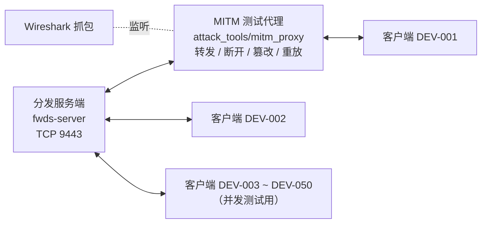

# 工业固件安全升级分发系统 —— 测试验证报告

| 项 | 内容 |
|---|---|
| 文档版本 | v0.1（设计阶段：测试方案与用例） |
| 当前状态 | 系统处于设计阶段，本版定义测试环境、方法和全部用例及预期结果；“实际结果”栏在第 11–12 周测试阶段填写 |
| 依据 | 《系统设计说明书》v0.1、《网络安全实践项目》任务书第 3 题及考核标准 |

> 说明：任务书安排第 11–12 周进行功能、性能和渗透测试，第 13–16 周提交最终报告。本版在设计阶段先确定“怎么证明系统是安全、可靠的”，每条用例都对应到需求编号（FR/SR/NFR，见设计说明书第 2 章）和威胁（设计说明书 6.2 节 STRIDE 表），保证每一项安全设计都有可执行的验证手段。

---

## 1. 测试范围

| 范围 | 内容 |
|---|---|
| 单元测试 | 分帧/拆包、密码学封装、manifest 校验、防降级、断点位图、Bootloader 决策、审计哈希链 |
| 功能测试 | 设备上线与心跳、固件导入、升级全流程、断点续传、灰度发布、回滚 |
| 安全与渗透测试 | 篡改、伪造、重放、中间人、降级、身份伪造、窃听、DoS、本地篡改、软件保护 |
| 性能测试 | 并发在线、并发下载、状态上报延迟 |
| 异常测试 | 非法输入、非法帧、磁盘错误、服务端重启 |

不在范围内：真实嵌入式硬件、真实 Flash 写入（按任务书要求以模拟方式实现）。

## 2. 测试环境

### 2.1 拓扑

- 正常功能测试：客户端直连服务端；
- 断网、篡改、重放、中间人测试：客户端经过 MITM 测试代理连接服务端，代理可按指令断开连接、翻转指定字节、记录并重放报文、替换握手公钥。

### 2.2 软硬件

| 项 | 配置 |
|---|---|
| 主机 | 2 台 PC（服务端 / 客户端各一台），或单机多进程 |
| 操作系统 | Windows 10/11 |
| 运行库 | Qt 6.5+、OpenSSL 3.x |
| 测试固件 | 由签名工具生成：`fw_v2.0.0_sv4.fwpkg`（当前版本）、`fw_v2.1.0_sv5.fwpkg`（正常升级包，10 MB）、`fw_v1.9.0_sv3.fwpkg`（旧版本，用于降级测试）、`fw_v2.2.0_selftest_fail.fwpkg`（签名合法但自检失败，用于回滚测试）、`fw_model_other.fwpkg`（其他型号） |

### 2.3 测试工具

| 工具 | 用途 |
|---|---|
| GoogleTest | 单元测试 |
| Wireshark | 验证传输内容为密文 |
| `attack_tools/mitm_proxy` | 断网、比特翻转、报文重放、握手公钥替换 |
| `attack_tools/tamper_fwpkg` | 修改固件包指定偏移或随机偏移的字节 |
| `attack_tools/fake_signer` | 用攻击者自己的 RSA 密钥签名固件 |
| `attack_tools/fake_device` | 用未注册 ID、错误私钥、伪造许可证接入 |
| `attack_tools/flood` | 连接洪泛、超大 Length、慢速握手、认证暴力尝试 |
| 十六进制编辑器（HxD） | 手工篡改固件包、下载缓存、日志数据库 |
| cppcheck / clang-tidy | 静态代码扫描 |
| strings / 文本搜索 | 检查可执行文件和配置中是否存在明文密钥 |

## 3. 测试策略

### 3.1 测试层次

1. **单元测试**：每个公共模块独立测试，密码学模块使用 RFC 官方测试向量；
2. **集成测试**：服务端 + 单客户端，验证协议和业务流程；
3. **系统测试**：服务端 + 多客户端 + MITM 代理，按用例执行功能、安全、性能测试；
4. **回归测试**：每次修复缺陷后重跑全部单元测试和相关用例。

### 3.2 通过准则

| 级别 | 准则 |
|---|---|
| 单元测试 | 100% 通过 |
| 功能测试 | 全部 P0 用例通过；升级成功率 100%（任务书考核项） |
| 安全测试 | 全部攻击用例被拦截，且服务端有对应安全日志；“篡改任意字节”用例 100% 被检测 |
| 性能测试 | 达到设计说明书 NFR 指标 |
| 静态扫描 | 无高危告警 |

### 3.3 缺陷等级

| 等级 | 定义 | 示例 |
|---|---|---|
| 致命 | 安全机制可被绕过，或设备变砖 | 篡改固件被写入、回滚失败 |
| 严重 | 核心流程失败 | 断点续传失败、灰度无法推进 |
| 一般 | 功能可用但有错误 | 进度显示不准 |
| 轻微 | 界面或提示问题 | 文字错误 |

## 4. 需求与测试追踪矩阵

| 需求 | 内容 | 覆盖用例 |
|---|---|---|
| FR-1 | 分片传输、断点续传 | UT-08, FT-05, FT-06, FT-07 |
| FR-2 | RSA 签名、验签失败禁止写入 | UT-03, UT-06, FT-03, ST-01 ~ ST-05 |
| FR-3 | 灰度发布 | FT-09, FT-10, FT-11 |
| FR-4 | 实时进度上报 | FT-04, PT-03 |
| FR-5 | 失败回滚不变砖 | UT-09, FT-12, FT-13 |
| FR-6 | 服务端显示在线、心跳、登录状态 | FT-01, FT-02 |
| FR-7 | 日志与告警 | 所有 ST 用例的“日志”检查项, ST-21 |
| FR-9 | 操作员登录与操作记录 | FT-14 |
| SR-1 | 固件完整性、来源可信 | ST-01 ~ ST-05, ST-18 |
| SR-2 | 防降级 | UT-07, ST-06 |
| SR-3 | 双向认证 | ST-11 ~ ST-15 |
| SR-4 | 通信机密性与完整性 | UT-04, ST-03, ST-16 |
| SR-5 | 防重放 | ST-08 ~ ST-10 |
| SR-6 | 审计日志防篡改 | UT-10, ST-21 |
| SR-7 | 抵御 DoS | ST-24 ~ ST-27 |
| SR-8 | 无硬编码密钥、安全随机数 | ST-22, ST-23 |
| SR-9 | 软件保护 | ST-19, ST-20 |
| NFR-1 | 并发 | PT-01, PT-02 |
| NFR-2 | 实时性 < 1 秒 | PT-03 |
| NFR-3 | 断网、断电可靠性 | FT-06, FT-13 |

## 5. 测试用例

用例中“实际结果”“结论”两栏在测试阶段填写，当前统一为“待测”。

### 5.1 单元测试

| 编号 | 用例 | 输入 / 步骤 | 预期结果 | 实际结果 |
|---|---|---|---|---|
| UT-01 | 分帧：半包 | 一帧数据分 3 次、每次 1~10 字节送入 FrameCodec | 前两次返回“数据不足”，第 3 次解析出完整一帧 | 待测 |
| UT-02 | 分帧：粘包与超长 | ① 3 帧拼在一个缓冲区送入；② 构造 Length = 0xFFFFFFFF 的帧头 | ① 依次解析出 3 帧，缓冲区清空；② 立即返回“帧过长”错误，不分配内存 | 待测 |
| UT-03 | RSA-PSS 签名验签 | 签名后验签；修改数据 1 比特后验签；用另一把公钥验签 | 第一次通过，后两次失败 | 待测 |
| UT-04 | AES-256-GCM | 加密后解密；分别翻转密文、标签、AAD 中 1 比特后解密 | 第一次得到原文，其余均返回失败、无明文输出 | 待测 |
| UT-05 | X25519 + HKDF | 使用 RFC 7748 和 RFC 5869 官方测试向量 | 输出与测试向量完全一致 | 待测 |
| UT-06 | manifest 先验签后解析 | 传入签名正确 / 签名错误 / 签名正确但 JSON 损坏 的三组数据 | 签名错误时不调用 JSON 解析；签名正确的损坏 JSON 返回解析错误 | 待测 |
| UT-07 | 防降级边界 | 本地 min_security_version = 5、版本 2.0.0，分别输入 sv = 4、5、6 以及 version = 1.9.0、2.0.0、2.1.0 | sv = 4 拒绝；version 不高于当前拒绝；sv ≥ 5 且版本更新才通过 | 待测 |
| UT-08 | 断点位图 | 标记第 0、5、159 片完成后序列化、反序列化，查询下一个缺失片 | 位图一致，下一个缺失片为 1 | 待测 |
| UT-09 | Bootloader 决策 | 构造 boot.json 各种组合：无 pending；pending + 验签失败；pending + 自检失败；boot_attempts = 4 | 分别得到：启动 active；回滚；回滚；回滚 | 待测 |
| UT-10 | 审计哈希链 | 写入 100 条日志，修改第 37 条内容后校验 | 校验失败并定位到第 37 条 | 待测 |
| UT-11 | 安全随机数 | 连续生成 1000 个 32 字节随机数 | 无重复；`RAND_bytes` 返回值均被检查 | 待测 |
| UT-12 | SecureBuffer 清零 | 写入已知密钥后析构，检查原内存 | 内存已被清零 | 待测 |

### 5.2 功能测试

前置条件：服务端已初始化并登录；DEV-001、DEV-002 已注册并运行 v2.0.0。

| 编号 | 用例 | 步骤 | 预期结果 | 实际结果 |
|---|---|---|---|---|
| FT-01 | 设备上线显示 | 启动 DEV-001 | 服务端设备表出现 DEV-001：在线、已登录、IP、版本 2.0.0，最后心跳每 5 秒刷新 | 待测 |
| FT-02 | 心跳超时离线 | 强制结束 DEV-001 进程（不发送断开消息） | 15 秒内服务端标记为离线，写 `HB` 日志 | 待测 |
| FT-03 | 固件导入验签 | 导入正常固件包；导入被篡改的固件包 | 正常包导入成功并显示 manifest；篡改包被拒绝并告警 | 待测 |
| FT-04 | 正常升级全流程 | 向 DEV-001 推送 v2.1.0 | 客户端依次显示 NOTIFIED → DOWNLOADING(0~100%) → VERIFYING → WRITING → REBOOTING → SUCCESS，服务端同步显示；升级后版本为 2.1.0，active 分区切换 | 待测 |
| FT-05 | 分片正确性 | 升级完成后比较 slot 中固件与原始 image.bin 的 SHA-256 | 完全一致 | 待测 |
| FT-06 | 断点续传 | 经 MITM 代理下载，进度约 47% 时代理断开连接，10 秒后恢复 | 客户端自动重连、重新认证，从断点继续（日志显示 from_index > 0），最终成功，总下载量不超过固件大小 + 一个窗口 | 待测 |
| FT-07 | 续传时本地缓存被篡改 | 断网期间手工修改 `.part` 中已完成的某一片 | 恢复时检测到该片哈希不符，只重新下载该片，最终成功 | 待测 |
| FT-08 | 下载中固件被更换 | 断网期间服务端改推另一个固件包 | 客户端发现 manifest 哈希变化，丢弃旧进度重新下载 | 待测 |
| FT-09 | 灰度发布正常推进 | DEV-001 打 `canary` 标签，新建发布选择 canary 组 | 只有 DEV-001 收到升级；成功并稳定 30 秒后状态变为“待确认全量”；确认后 DEV-002 等其余设备开始升级 | 待测 |
| FT-10 | 灰度失败自动暂停 | 金丝雀组推送自检失败固件 | DEV-001 回滚并上报 ROLLED_BACK，发布自动变为“已暂停”，其余设备不推送 | 待测 |
| FT-11 | 离线设备补推 | 全量阶段 DEV-002 离线，稍后上线 | DEV-002 上线后自动收到升级 | 待测 |
| FT-12 | 自检失败自动回滚 | 推送 `selftest_fail` 固件 | 重启后自检失败，自动切回原分区，版本仍为 2.0.0，上报 ROLLED_BACK，设备可正常运行和心跳 | 待测 |
| FT-13 | 写入中断电 | WRITING 50% 时强制结束客户端进程后重新启动 | 从原 active 分区正常启动，版本 2.0.0，可重新升级 | 待测 |
| FT-14 | 操作员与操作记录 | 错误口令登录；正确登录后创建发布 | 错误口令被拒；发布操作日志记录操作员账号和时间 | 待测 |
| FT-15 | 服务端重启恢复 | 发布进行中重启服务端 | 发布恢复为“已暂停”，设备重连后状态正确 | 待测 |

### 5.3 安全与渗透测试

每条用例除“预期结果”外，统一检查：**客户端不写入 Flash、服务端有对应安全日志或告警**。

**(1) 固件完整性与来源（对应 STRIDE：T、S）**

| 编号 | 用例 | 步骤 | 预期结果 | 实际结果 |
|---|---|---|---|---|
| ST-01 | 篡改 manifest 任意字节 | `tamper_fwpkg` 修改 manifest.json 中 1 字节（例如把 version 2.1.0 改为 2.1.1），绕过服务端导入检查直接推送 | 客户端验签失败（SIG_INVALID），不下载，服务端红色告警 | 待测 |
| ST-02 | 篡改镜像任意字节（批量） | 对镜像随机抽取 100 个偏移（含第一个字节、最后一个字节、分片边界），每次只翻转 1 比特并推送 | 100 次全部被检测（CHUNK_TAMPERED 或 IMAGE_TAMPERED），检测率 100%，无一次写入 | 待测 |
| ST-03 | 传输中翻转比特 | MITM 代理在 CHUNK_DATA 帧中翻转 1 比特 | GCM 认证失败，连接断开并记录；重连后续传成功（证明攻击不能注入数据） | 待测 |
| ST-04 | 伪造签名固件 | `fake_signer` 用攻击者密钥签名一个固件并推送 | 验签失败，拒绝 | 待测 |
| ST-05 | 去掉签名 / 签名替换 | 删除 manifest.sig，或换成另一个合法包的签名 | 验签失败，拒绝 | 待测 |
| ST-06 | 降级攻击 | 推送签名合法的 `fw_v1.9.0_sv3` | 防降级拒绝（ROLLBACK_ATTEMPT），告警 | 待测 |
| ST-07 | 型号不符 | 推送签名合法的其他型号固件 | 拒绝（MODEL_MISMATCH） | 待测 |

**(2) 重放（对应 SR-5）**

| 编号 | 用例 | 步骤 | 预期结果 | 实际结果 |
|---|---|---|---|---|
| ST-08 | 会话内重放 | MITM 代理把客户端发出的一个 PROGRESS 帧原样再发一次 | 服务端检测到 Seq 不连续，断开连接并记录“重放” | 待测 |
| ST-09 | 跨会话重放 | 录制一次完整会话，断开后在新连接中原样回放 | 握手阶段即失败（服务端随机数不同，回放的 AUTH 签名无效） | 待测 |
| ST-10 | 篡改序号 | 修改帧头 Seq 后转发 | GCM 认证失败（Seq 在 AAD 和 nonce 中） | 待测 |

**(3) 身份认证与中间人（对应 STRIDE：S、E）**

| 编号 | 用例 | 步骤 | 预期结果 | 实际结果 |
|---|---|---|---|---|
| ST-11 | 中间人替换公钥 | MITM 代理替换 HELLO_ACK 中的服务端临时公钥 | 客户端验证服务端签名失败，断开并告警 | 待测 |
| ST-12 | 伪造服务端 | 用攻击者密钥运行一个假服务端，客户端指向它 | 客户端拒绝连接，不接受任何推送 | 待测 |
| ST-13 | 未注册设备 | `fake_device` 用未注册 ID 接入 | 认证失败，服务端告警“未注册设备” | 待测 |
| ST-14 | 冒用设备 ID | `fake_device` 使用 DEV-001 的 ID 但用其他私钥 | 设备签名验证失败，拒绝 | 待测 |
| ST-15 | 认证前越权 | 握手完成前直接发送 CHUNK_REQ、UPDATE 等业务消息 | 服务端直接断开，不返回任何数据 | 待测 |

**(4) 机密性与本地安全（对应 STRIDE：I、T）**

| 编号 | 用例 | 步骤 | 预期结果 | 实际结果 |
|---|---|---|---|---|
| ST-16 | 抓包分析 | Wireshark 抓取完整升级过程，搜索固件镜像中的已知字符串和 JSON 关键字 | 握手后全部为密文，搜索不到明文 | 待测 |
| ST-17 | 本地 boot.json 被篡改 | 手工把 min_security_version 改小后尝试降级 | 已知局限：模拟环境中拥有本机管理员权限的攻击者可以改写该文件，原型无法防御。真实设备中该值存于安全芯片的单调计数器或一次性熔丝，本项在报告中作为局限说明，不计为失败 | 待测 |
| ST-18 | 槽位固件被篡改 | 手工修改 slot 中 firmware.bin 后重启 | Bootloader 启动前验签失败，切换到另一分区或恢复模式 | 待测 |
| ST-19 | 客户端程序被修改 | 用十六进制编辑器修改 fwds-client.exe 中 1 字节 | 启动时自校验失败，拒绝运行 | 待测 |
| ST-20 | 许可证拷贝 | 把 DEV-001 的 device.lic 拷到另一台机器使用 | 硬件指纹不符，拒绝运行 | 待测 |
| ST-21 | 审计日志篡改 | 用 SQLite 工具修改或删除一条审计日志 | “校验日志完整性”定位到被改的记录 | 待测 |
| ST-22 | 硬编码密钥扫描 | 对源码、可执行文件、配置文件搜索 PEM 头、长十六进制串 | 只存在公钥和口令加密后的私钥，无明文私钥 | 待测 |
| ST-23 | 私钥文件保护 | 尝试不输入口令直接读取私钥文件 | 无法得到私钥 | 待测 |

**(5) 拒绝服务（对应 STRIDE：D）**

| 编号 | 用例 | 步骤 | 预期结果 | 实际结果 |
|---|---|---|---|---|
| ST-24 | 连接洪泛 | 单 IP 发起 100 个连接；多 IP 发起 300 个连接 | 单 IP 超过 5 个被拒，总数超过 200 被拒；已在线设备不受影响 | 待测 |
| ST-25 | 超大长度字段 | 发送 Length = 0x7FFFFFFF 的帧头 | 立即断开，服务端内存无明显增长 | 待测 |
| ST-26 | 慢速握手 | 建立连接后不发送或每秒只发 1 字节 | 10 秒后断开 | 待测 |
| ST-27 | 认证暴力尝试 | 同一设备 ID 5 分钟内认证失败 6 次 | 第 5 次后锁定 10 分钟并告警 | 待测 |

**(6) 静态代码扫描**

| 编号 | 用例 | 步骤 | 预期结果 | 实际结果 |
|---|---|---|---|---|
| ST-28 | 静态扫描 | 对全部源码运行 cppcheck 和 clang-tidy | 无高危告警；中低危告警有记录和处理说明 | 待测 |

### 5.4 性能测试

| 编号 | 用例 | 步骤 | 预期结果 | 实际结果 |
|---|---|---|---|---|
| PT-01 | 并发在线 | 启动 50 个客户端实例保持在线 30 分钟 | 无掉线，心跳正常，服务端界面流畅 | 待测 |
| PT-02 | 并发下载 | 20 台同时下载 10 MB 固件 | 全部成功；记录总耗时和服务端吞吐量 | 待测 |
| PT-03 | 状态上报延迟 | 客户端和服务端日志记录毫秒时间戳，统计 PROGRESS 发出到界面刷新的时间差 | 平均 < 1 秒 | 待测 |
| PT-04 | 单设备下载速度 | 局域网下载 10 MB 固件 | 记录耗时，作为基线 | 待测 |

### 5.5 异常测试

| 编号 | 用例 | 步骤 | 预期结果 | 实际结果 |
|---|---|---|---|---|
| ET-01 | 非法 Magic / 版本 | 发送 Magic 错误或版本为 9 的帧 | 断开并记录 | 待测 |
| ET-02 | 非法 JSON | 认证后发送格式错误的 JSON 消息体 | 返回 ERROR，不崩溃 | 待测 |
| ET-03 | 界面非法输入 | 设备 ID 为空、含特殊字符；端口超出范围；导入非 .fwpkg 文件 | 提示错误，不提交 | 待测 |
| ET-04 | 磁盘空间不足 | 设备目录所在盘空间不足时升级 | 状态 FAILED，原分区继续运行 | 待测 |
| ET-05 | 服务端不可达 | 客户端启动时服务端未启动 | 按 1、2、4…30 秒退避重连，界面显示“连接中” | 待测 |

## 6. 测试结果汇总（测试阶段填写）

| 类别 | 用例数 | 通过 | 失败 | 通过率 |
|---|---|---|---|---|
| 单元测试 | 12 | — | — | — |
| 功能测试 | 15 | — | — | — |
| 安全与渗透测试 | 28 | — | — | — |
| 性能测试 | 4 | — | — | — |
| 异常测试 | 5 | — | — | — |
| **合计** | **64** | — | — | — |

## 7. 缺陷记录（测试阶段填写）

| 编号 | 发现用例 | 描述 | 等级 | 原因 | 修复方式 | 回归结果 |
|---|---|---|---|---|---|---|
| BUG-001 | | | | | | |

## 8. 答辩演示脚本（建议）

按“先正常、再攻击、最后可靠性”的顺序，约 8 分钟：

1. **上线**：启动服务端和 2 个客户端，展示设备表中的在线状态、登录状态和心跳（FT-01）；
2. **正常升级**：对 DEV-001 推送 v2.1.0，展示状态和进度实时变化（FT-04）；
3. **断点续传**：下载中点“模拟断网”，恢复后从断点继续（FT-06）；
4. **篡改固件**：推送被改了 1 个字节的固件，客户端拒写，服务端红色告警（ST-02）；
5. **降级攻击**：推送旧版本被拒（ST-06）；
6. **重放与中间人**：用 MITM 代理重放报文、替换公钥，连接被拒并记录（ST-08、ST-11）；
7. **抓包**：Wireshark 展示全部为密文（ST-16）；
8. **回滚**：推送自检失败固件，设备自动回滚，仍然在线（FT-12）；
9. **灰度**：展示金丝雀失败导致发布自动暂停（FT-10）；
10. **日志**：打开安全日志，演示篡改一条日志后完整性校验定位（ST-21）。
