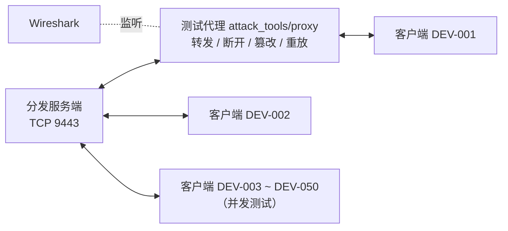

# 工业固件安全升级分发系统 —— 测试报告

| 项 | 内容 |
|---|---|
| 文档版本 | v0.3（开发阶段：已实现部分在云端容器实测并回填结果） |
| 当前状态 | 2026-11-18 在云端 Linux 容器里执行了已实现功能对应的 46 条用例（UT 除 UT-09、UT-12，FT-01 ~ 07、FT-13、FT-14，ST-01 ~ 16、ST-18 ~ 22、ST-28 ~ 30、ST-34），结果见各表和第 8 节；灰度、互锁、事件补传、部署打包相关用例仍为“待测”。云端结果不能代替真机证据，需要真机界面截图、Wireshark 抓包的项目在第 8 节列出补做步骤 |
| 依据 | [设计文档](系统设计说明书.md) v0.2、[通信协议文档](通信协议文档.md) v0.2、任务书检查项 |

本文对应《资料大模板》的“测试报告（分为功能测试和安全测试）”。每条用例标明对应的需求编号或任务书检查项，测试时产生的证据进入证据包，供自查表引用。

## 1. 测试环境与工具

| 项 | 配置 |
|---|---|
| 主机 | 2 台 PC（服务端、客户端各一台），其中至少 1 台为未装过开发环境的干净机器 |
| 系统与运行库 | Windows 10/11，Qt 6.5+，OpenSSL 3.x |
| 测试数据 | 全部为模拟数据：设备 DEV-001 ~ DEV-050，账号 op1、mt1、au1 |
| 测试固件 | `fw_v2.0.0_sv4`（当前）、`fw_v2.1.0_sv5`（正常升级，10 MB）、`fw_v1.9.0_sv3`（降级用）、`fw_v2.2.0_selftest_fail`（回滚用）、`fw_model_other`（型号不符） |
| 测试证书 | 自建 CA 签发的正常证书，以及过期、已吊销、名称不符、由其他 CA 签发的证书各一张 |

| 工具 | 用途 |
|---|---|
| GoogleTest | 单元测试 |
| Wireshark | 抓包，确认协议版本、套件和内容不可读 |
| `openssl s_client` | 探测服务端接受的协议版本和套件、不带证书连接 |
| `attack_tools/proxy` | 断网、翻转字节、重放记录 |
| `attack_tools/tamper_fwpkg`、`fake_signer` | 篡改固件包、用攻击者密钥签名 |
| `attack_tools/fake_device` | 用异常证书或伪造登录信息接入 |
| `attack_tools/flood` | 连接洪泛、超大长度、慢速握手、登录暴力尝试 |
| gitleaks | 全仓库（含历史提交）秘密扫描 |
| cppcheck、clang-tidy | 静态代码扫描 |
| SQLite 浏览器、十六进制编辑器 | 检查存储值、篡改本地文件 |

## 2. 策略与证据

- **层次**：单元测试（密码封装用标准测试向量）→ 集成测试（服务端 + 单客户端）→ 系统测试（多客户端 + 测试代理）；修复缺陷后重跑相关用例；
- **通过准则**：单元测试全部通过；功能测试全部通过；安全测试中所有攻击被拦截且服务端有对应日志，“篡改任意字节”检测率 100%；性能达到设计指标；静态扫描和秘密扫描无高危项；
- **缺陷等级**：致命（安全机制被绕过、设备变砖）、严重（核心流程失败）、一般、轻微；
- **执行状态标注**：“通过（云端）”表示在云端容器里用真实进程实测通过；只写“通过”表示由单元测试（GoogleTest，部分走真实 TLS 连接）验证；“部分通过”写明哪一部分还依赖未实现的功能；“待真机”表示正式证据要在 Windows 真机上补做；
- **证据**：每条用例执行时保存截图、日志片段、抓包文件或工具报告，放入 `evidence/`，文件名为 `<检查项编号>_<用例编号>_<简述>.<扩展名>`，例如 `4-1_ST-01_无证书连接被拒.pcapng`。没有对应检查项的用例用需求编号。证据只来自本组提交的系统，不含真实数据。

### 2.1 云端测试环境（2026-11-18）

第 1 节的环境是正式测试（真机）用的。开发阶段先在云端容器里把已实现的功能测一遍，环境如下：

| 项 | 配置 |
|---|---|
| 系统与运行库 | Ubuntu 24.04 容器，Qt 6.4.2，OpenSSL 3.0.13，GCC，Ninja |
| 单元测试 | `fwds-tests` 共 300 条（本次新增 1 条 ST-19 用例），全部通过，约 31 秒 |
| 联调方式 | 三台真实的 `fwds-client --headless` 进程 + 服务端。服务端是一个只用于取证的脚本化程序：与 `fwds-server` 的 `main.cpp` 组装完全相同的业务层、网络层和主窗口（无显示器渲染），按脚本调用 `AdminService` 完成建账号、注册设备、导入固件、打开开关、下发（与界面操作走同一个入口，带权限检查），并截取主窗口。纯网络攻击类用例直接用 `fwds-server --headless` |
| 证书与固件 | 用 `fwds-signer` 现场生成：自建 CA、服务端和 DEV-001 ~ DEV-003 证书、FSK，`make-image` + `sign-fw` 生成第 1 节列出的五种测试固件；另用 `openssl` 建一个“其他 CA”签发假的服务端和设备证书。口令为每次随机生成，经环境变量注入，不落盘 |
| 攻击工具 | `tests/attack_tools/`（测试代理 `tls_proxy.py`、洪泛 `flood.py`、抓包明文搜索 `pcap_grep.py`）、`openssl s_client / s_server`、`tcpdump` + `tshark` |
| 静态与秘密扫描 | cppcheck 2.13、clang-tidy 18；gitleaks 在容器里无法下载，改用 git 命令对全部历史做等价扫描 |
| 证据位置 | 项目文件 `evidence/cloud-20261118/`（含 23 MB 抓包，不进仓库），文件名按第 2 节规则 |

云端与真机的差别：系统是 Linux 不是 Windows；界面截图是无显示器渲染（`QWidget::grab()`），字体与真机不同；两端在同一台机器上走回环地址。所以云端结果用来确认功能和安全机制本身没有问题，提交用的截图、抓包按第 8 节在真机上补做。

## 3. 检查项与用例对照

| 任务书检查项 | 覆盖用例 |
|---|---|
| 1-1 控制指令明文下发 | ST-06 |
| 1-2 口令明文或裸哈希 | ST-13 |
| 1-3 密钥硬编码或进仓库 | ST-15、ST-16 |
| 1-4 / 4-3 带认证加密 | ST-05、ST-07、UT-04 |
| 1-5 / 第 6 类 断网数据落盘、补传、对账 | FT-08、FT-09、UT-09 |
| 1-6 / 7-3 不扰扫描周期 | 不设用例：不轮询 PLC，1-6 填通过、7-3 填不适用（见设计文档 9.3 节） |
| 1-7 / 4-7 脱敏 | ST-17 |
| 1-8 / 8-4 升级回滚 | FT-13、FT-14、FT-20、FT-21 |
| 第 3 类 架构与部署、8-1 干净环境安装 | FT-17 |
| 4-1 双向证书认证 | ST-01、ST-02 |
| 4-2 完整证书校验 | ST-03、ST-04 |
| 4-4 随机数唯一性 | UT-05 |
| 4-5 抗重放 | ST-08、ST-09、UT-09 |
| 4-6 上下文绑定 | ST-10、ST-11 |
| 第 5 类 角色权限、轮换吊销 | ST-12、ST-14、ST-04 |
| 7-1 只读优先、7-2 互锁 | ST-24、ST-25 |
| 7-4 降级运行 | FT-10 |
| 7-5 明文协议隔离 | 不适用（见设计文档 9.3 节） |
| 7-6 功能安全优先、紧急停止 | ST-26、FT-13、FT-14 |
| 8-2 自启、8-3 守护 | FT-18、FT-19 |
| 8-5 日志 | FT-16、ST-17 |
| 8-6 时钟同步 | FT-22 |
| 指令控制类附加要求 | ST-06、ST-23 ~ ST-27 |

题目与课程要求的对照：FR-1 → FT-05 ~ FT-07；FR-2 → ST-18 ~ ST-22；FR-3 → FT-11、FT-12；FR-4 → FT-04、PT-03；FR-5 → FT-13、FT-14；FR-6 → FT-01、FT-02、FT-16；软件保护 → ST-31、ST-32。

---

# 第一部分 功能测试

### 4.1 单元测试

| 编号 | 用例 | 步骤 | 预期结果 | 结果 |
|---|---|---|---|---|
| UT-01 | 分帧：半包 | 一帧分 3 次送入 FrameCodec | 前两次返回“数据不足”，第 3 次解析出一帧 | 通过 |
| UT-02 | 分帧：粘包与超长 | ① 3 帧拼在一起送入；② Length = 0xFFFFFFFF | ① 依次解析出 3 帧；② 立即报“帧过长”，不分配内存 | 通过 |
| UT-03 | RSA-PSS 签名验签 | 签名后验签；改 1 比特后验签；用另一把公钥验签 | 第一次通过，后两次失败 | 通过 |
| UT-04 | AES-256-GCM | 加解密；分别翻转密文、标签、关联数据 1 比特后解密 | 第一次得到原文，其余返回失败且无明文输出 | 通过 |
| UT-05 | 随机数唯一性抽样 | 连续生成 10 000 个 12 字节 nonce 和 16 字节盐；同一私钥连续封装 100 次 | 无重复；100 个文件的 nonce、盐各不相同；`RAND_bytes` 返回值均被检查 | 通过 |
| UT-06 | 口令派生 | 同一口令创建两个账号；验证正确和错误口令 | 两个存储值不同；正确通过、错误拒绝；单次派生耗时在 100 毫秒量级 | 通过（单次派生约 170 ms） |
| UT-07 | manifest 先验签后解析 | 签名正确、签名错误、签名正确但 JSON 损坏三组数据 | 签名错误时不调用 JSON 解析；损坏 JSON 返回解析错误 | 通过 |
| UT-08 | 防降级边界 | 本地最小安全版本 5、版本 2.0.0；输入 sv = 4、5、6 和 version = 1.9.0、2.0.0、2.1.0 | sv = 4 拒绝；version 不高于当前拒绝；其余通过 | 通过 |
| UT-09 | 事件序号与去重 | outbox 写入 10 条后模拟重启再写 5 条；服务端重复收到第 3 条，乱序收到第 7、6 条 | 序号 1 ~ 15 连续；重复条不入库；确认序号只在补齐后推进 | 待测（事件补传开发中） |
| UT-10 | 断点位图 | 标记第 0、5、159 片后序列化、反序列化 | 位图一致，下一个缺失片为 1 | 通过 |
| UT-11 | Bootloader 决策 | 无 pending；pending + 验签失败；pending + 自检失败；boot_attempts = 4 | 分别为：启动 active；回滚；回滚；回滚 | 通过 |
| UT-12 | 审计哈希链 | 写入 100 条日志，修改第 37 条后校验 | 校验失败并定位到第 37 条 | 待测（审计哈希链未实现） |
| UT-13 | 证书与 CRL 校验函数 | 分别输入正常、过期、名称不符、已吊销、其他 CA 签发的证书；输入签名被改的 CRL | 仅正常证书通过；被改的 CRL 拒绝加载 | 通过 |
| UT-14 | SecureBuffer 清零 | 写入已知数据后析构，检查原内存 | 已清零 | 通过 |

### 4.2 业务功能

前置条件：服务端已初始化；DEV-001、DEV-002 已注册并运行 v2.0.0；“允许下发”开关已打开。

| 编号 | 用例 | 步骤 | 预期结果 | 结果 |
|---|---|---|---|---|
| FT-01 | 设备上线显示 | 启动 DEV-001 | 设备表出现 DEV-001：在线、已登录、IP、版本，最后心跳每 5 秒刷新 | 通过（云端）；界面截图待真机 |
| FT-02 | 心跳超时离线 | 强制结束 DEV-001 进程 | 15 秒内标记离线，写 `HB` 日志 | 通过（云端，冻结后 10.7 秒离线） |
| FT-03 | 固件导入验签 | 导入正常包；导入被篡改的包 | 正常包导入成功并显示 manifest；篡改包被拒并告警 | 通过（云端） |
| FT-04 | 正常升级全流程 | 向 DEV-001 推送 v2.1.0 | 两端依次显示 NOTIFIED → DOWNLOADING → VERIFYING → WRITING → REBOOTING → SUCCESS；版本变为 2.1.0，active 分区切换 | 通过（云端）；进度截图待真机 |
| FT-05 | 分片正确性 | 升级后比较分区内固件与原始镜像的 SHA-256 | 一致 | 通过（云端） |
| FT-06 | 断点续传 | 经代理下载，约 47% 时断开，10 秒后恢复 | 自动重连和登录，从断点继续（日志中 from_index > 0），最终成功；总下载量不超过固件大小加一个窗口 | 通过（云端，从 74/160 片续传） |
| FT-07 | 续传时缓存被改 / 固件被更换 | ① 断网期间改 `.part` 中已完成的一片；② 断网期间服务端改推另一个包 | ① 只重下该片，最终成功；② 丢弃旧进度重新下载 | 通过（单元与联调测试） |
| FT-08 | 断网期间事件落盘 | 升级中断开网络，让设备继续完成本地阶段；随后强制结束并重启客户端 | outbox 文件持续增长且时间戳连续；重启后未确认事件仍在 | 待测 |
| FT-09 | 恢复后补传对账 | 接 FT-08，恢复网络 | 事件按序号补传；服务端该设备事件序号连续、无重复；outbox 清空 | 待测 |
| FT-10 | 降级运行 | 客户端运行中关闭服务端，5 分钟后再启动 | 客户端界面可操作并显示“离线运行”，当前固件照常运行；服务端恢复后自动重连、登录、补传 | 待测 |
| FT-11 | 灰度发布正常推进 | DEV-001 标记为 canary，新建发布 | 只有 DEV-001 收到升级；成功并稳定 30 秒后进入“待确认全量”；确认后其余设备开始升级 | 待测 |
| FT-12 | 灰度失败自动暂停 | 向金丝雀组推送自检失败固件 | DEV-001 回滚，发布自动“已暂停”，其余设备不推送 | 待测 |
| FT-13 | 自检失败自动回滚 | 推送 `selftest_fail` 固件 | 重启后自动切回原分区，版本仍为 2.0.0，上报 ROLLED_BACK，设备继续在线 | 通过（云端） |
| FT-14 | 写入中断电 | WRITING 50% 时强制结束客户端后重启 | 从原分区正常启动，可重新升级 | 通过（单元测试）；真机演示待做 |
| FT-15 | 服务端重启恢复 | 发布进行中重启服务端 | 发布恢复为“已暂停”，设备重连后状态正确 | 待测 |
| FT-16 | 日志检索与定位 | 按设备、时间、分类、关键字检索；由未参与开发的同学根据日志定位一次预设故障 | 能检索到对应记录；能定位到故障模块和原因 | 待测 |

### 4.3 部署与运维

| 编号 | 用例 | 步骤 | 预期结果 | 结果 |
|---|---|---|---|---|
| FT-17 | 干净环境安装 | 在未装开发环境的机器上只按 README 和 `deploy/install` 操作；服务端和客户端分处两台机器 | 两端启动成功，设备登录成功；过程中不需要手工改源码或写死地址 | 待测 |
| FT-18 | 开机自启与断电恢复 | 升级进行中直接断电重启两台主机 | 两端自动启动；设备自动登录；发布为“已暂停”，继续后升级完成 | 待测 |
| FT-19 | 进程守护 | 分别强制结束服务端、客户端进程 | 1 分钟内自动拉起并恢复连接 | 待测 |
| FT-20 | 系统升级演练 | 按设计文档 8.4 节用 `deploy/upgrade` 把服务端从旧版本升到新版本 | 备份生成；冒烟检查通过；设备、固件、日志数据完整 | 待测 |
| FT-21 | 系统回滚演练 | 接 FT-20，执行 `deploy/rollback` | 回到旧版本；数据库与备份一致；设备重连并补传事件，序号连续 | 待测 |
| FT-22 | 时钟同步 | 检查两台主机的 NTP 配置；把客户端主机时间调快 5 分钟 | 正常时偏差小于 1 秒；调快后登录被拒（`2002`）并有告警 | 待测 |

### 4.4 性能

| 编号 | 用例 | 步骤 | 预期结果 | 结果 |
|---|---|---|---|---|
| PT-01 | 并发在线 | 50 个客户端在线 30 分钟 | 无掉线，心跳正常，界面流畅 | 待测 |
| PT-02 | 并发下载 | 20 台同时下载 10 MB 固件 | 全部成功；记录总耗时、吞吐量、服务端处理器和内存占用 | 待测 |
| PT-03 | 状态上报延迟 | 用两端毫秒时间戳统计 PROGRESS 发出到界面刷新的时间差 | 平均 < 1 秒；记录最大值 | 待测 |
| PT-04 | 单设备下载基线 | 局域网下载 10 MB 固件 | 记录耗时 | 待测 |

### 4.5 异常

| 编号 | 用例 | 步骤 | 预期结果 | 结果 |
|---|---|---|---|---|
| ET-01 | 非法帧 | 登录后发送 Magic 错误、版本为 9 的帧 | 断开并记录 | 待测 |
| ET-02 | 非法 JSON | 登录后发送格式错误的消息体 | 返回 ERROR，不崩溃 | 待测 |
| ET-03 | 界面非法输入 | 设备 ID 为空或含特殊字符；端口超范围；导入非 .fwpkg 文件 | 提示错误，不提交 | 待测 |
| ET-04 | 磁盘空间不足 | 设备目录所在盘空间不足时升级 | 状态 FAILED，原分区继续运行 | 待测 |

---

# 第二部分 安全测试

每条用例除预期结果外，统一检查：攻击未造成固件写入；服务端或客户端有对应的安全日志或告警。

### 5.1 通信安全（任务书第 4 类、红线 1-1、1-4）

| 编号 | 检查项 | 用例 | 步骤 | 预期结果 | 结果 |
|---|---|---|---|---|---|
| ST-01 | 4-1 | 客户端不出示证书 | `openssl s_client` 不带证书连接服务端 | 握手失败，服务端记录 | 通过（云端） |
| ST-02 | 4-1 | 伪造服务端 | 用其他 CA 签发的证书运行假服务端，客户端指向它 | 客户端握手失败并告警，不接受任何推送 | 通过（云端） |
| ST-03 | 4-2 | 证书链、有效期、名称 | `fake_device` 分别使用其他 CA 签发、已过期、名称与设备 ID 不符的证书 | 三种情况全部被拒，日志写明原因 | 通过 |
| ST-04 | 4-2、第 5 类 | 吊销演练 | 维护员停用 DEV-002，签发工具吊销其证书并导入新 CRL；DEV-002 重新连接 | 现有连接立即断开；重连被拒；其他设备不受影响 | 通过（云端） |
| ST-05 | 4-3、1-4 | 协议版本与套件 | `openssl s_client` 分别用 TLS 1.2、非 GCM 套件连接；Wireshark 查看正常连接的握手 | 低版本和其他套件握手失败；正常连接为 TLS 1.3 + `TLS_AES_256_GCM_SHA384`；附配置截图 | 通过（云端）；配置截图待真机 |
| ST-06 | 1-1 | 抓包不可读 | 抓取一次完整升级（含 UPDATE_NOTIFY 和 UPDATE_CANCEL）；在抓包中搜索 JSON 字段名、设备 ID、固件中的已知字符串 | 搜索不到任何明文；逐包标出指令所在的 TLS 记录 | 部分通过：云端抓包无明文；UPDATE_CANCEL 待紧急停止实现后补抓，逐包标注待真机 Wireshark |
| ST-07 | 1-4 | 篡改密文被拒 | 代理翻转一条 TLS 记录中的 1 比特 | 接收方标签校验失败并断开；重连后续传成功 | 通过（云端，修复 BUG-002 后回归） |
| ST-08 | 4-5 | 重放 TLS 记录 | 代理把一条已转发的记录原样再发一次；录制整次会话后在新连接中回放 | 两种情况都被拒并断开 | 通过（云端） |
| ST-09 | 4-5 | 应用层重放 | 用合法证书的测试客户端重复发送同一帧序号；重发已确认过的事件；发送时间戳为 10 分钟前的 LOGIN | 分别返回 `1007`、事件不重复入库、`2002` | 部分通过：帧序号重放 1007、旧时间戳 2002 已验证；事件去重待补传实现 |
| ST-10 | 4-6 | 设备 ID 与证书不符 | 用 DEV-002 的证书登录，LOGIN 中填 DEV-001 | `2003`，断开并告警 | 通过 |
| ST-11 | 4-6 | 越权与越界请求 | 登录前发送 CHUNK_REQ；登录后请求未下发给自己的包 | 前者 `1004` 并断开；后者 `3009` | 通过 |

### 5.2 身份、授权与密钥（任务书第 5 类、红线 1-2、1-3、1-7）

| 编号 | 检查项 | 用例 | 步骤 | 预期结果 | 结果 |
|---|---|---|---|---|---|
| ST-12 | 第 5 类 | 角色权限 | 用操作员、维护员、审计员账号分别尝试对方专属功能 | 界面不提供入口；绕过界面直接调用业务接口也被拒并记录 | 部分通过：业务接口越权全部被拒并记录；审计员专属功能（日志完整性校验）未实现；界面截图待真机 |
| ST-13 | 1-2 | 口令存储 | 导出账号表截图；两个账号设置相同口令 | 字段中无明文和单次哈希；两个存储值不同；附派生函数源码片段 | 通过（云端）；截图待真机 |
| ST-14 | 第 5 类 | 登录锁定 | 同一账号连续输错 5 次口令 | 锁定 10 分钟并记录 | 通过 |
| ST-15 | 1-3 | 秘密扫描 | 对全仓库和全部历史提交运行 gitleaks；对可执行文件和安装包搜索 PEM 头 | 无私钥、口令、固定密钥；只有公钥和根证书 | 通过（git 全历史扫描）；gitleaks 报告待真机 |
| ST-16 | 1-3 | 私钥文件保护与注入 | 不提供口令直接解析私钥文件；检查注入点和文件权限；改动私钥文件 1 字节后启动 | 无法得到私钥；口令只在仓库外的受限文件中；被改动的文件解密失败并告警 | 通过（云端，修复 BUG-001 后回归） |
| ST-17 | 1-7、4-7、8-5 | 日志与证据自检 | 在全部日志和证据文件中搜索私钥头、口令、随机数、完整报文和真实标识 | 无命中 | 待测 |

### 5.3 固件可信（题目考核项）

| 编号 | 用例 | 步骤 | 预期结果 | 结果 |
|---|---|---|---|---|
| ST-18 | 篡改 manifest | 修改 manifest 中 1 字节，绕过服务端导入检查直接推送 | 客户端验签失败（`3001`），不下载，服务端红色告警 | 部分通过：设备验签失败不下载（3001）；服务端红色告警待事件上报实现 |
| ST-19 | 篡改镜像任意字节 | 对镜像随机取 100 个偏移（含首字节、末字节、分片边界），每次翻转 1 比特后推送 | 100 次全部被检测（`3004` 或 `3005`），无一次写入 | 通过（100/100 被 3004 拦截，无一次写入） |
| ST-20 | 伪造或缺失签名 | 用攻击者密钥签名；删除签名；换成另一个合法包的签名 | 全部验签失败 | 通过 |
| ST-21 | 降级与型号不符 | 推送签名合法的 `fw_v1.9.0_sv3`；推送其他型号固件 | 分别被 `3003`、`3002` 拒绝 | 通过（云端） |
| ST-22 | 分区固件被改 | 手工修改分区中的 firmware.bin 后重启 | Bootloader 验签失败，切换到另一分区或恢复模式 | 通过（云端，进入恢复模式） |

已知局限：本机管理员可以改写 `boot.json` 中的最小安全版本号，原型无法防御，已列入设计文档 9.3 节放弃项，不作为用例。

### 5.4 指令控制（任务书第 7 类及指令控制类附加要求）

| 编号 | 用例 | 步骤 | 预期结果 | 结果 |
|---|---|---|---|---|
| ST-23 | 指令留痕与二次确认 | 执行一次开始灰度和确认全量；确认时输错口令一次 | 输错时不执行；审计日志含操作者、时间、来源、确认记录 | 待测 |
| ST-24 | 默认不下发 | “允许下发”关闭时尝试开始灰度 | 被拒并提示；只有维护员能打开开关 | 待测 |
| ST-25 | 互锁冲突注入 | ① 同一型号同时开始两个发布；② 对升级中的设备再次推送；③ 跳过灰度直接全量 | 三种冲突全部被服务端拒绝并记录 | 待测 |
| ST-26 | 紧急停止 | 多台设备分别处于下载、校验、写入阶段时点击紧急停止 | 发布变为“已终止”；写入前的设备放弃升级并保留旧固件；写入中的设备完成或回滚后仍可启动 | 待测 |
| ST-27 | 断网不盲发 | 全量阶段 DEV-002 离线，稍后上线 | 上线后不自动推送，显示“待确认”；操作员确认后才开始升级 | 待测 |

### 5.5 拒绝服务

| 编号 | 用例 | 步骤 | 预期结果 | 结果 |
|---|---|---|---|---|
| ST-28 | 连接洪泛 | 单 IP 发起 100 个连接；总计发起 300 个连接 | 单 IP 超过 5 个被拒，总数超过 200 被拒；在线设备不受影响 | 通过（云端） |
| ST-29 | 慢速握手与超大长度 | 连接后不发数据或每秒 1 字节；登录后发送 Length = 0x7FFFFFFF 的帧头 | 10 秒后断开；超长帧立即断开，内存无明显增长 | 通过（云端，10.3 秒断开） |
| ST-30 | 登录暴力尝试 | 同一设备 ID 5 分钟内登录失败 6 次 | 第 5 次后锁定 10 分钟并告警 | 通过 |

### 5.6 软件保护、审计与静态扫描

| 编号 | 用例 | 步骤 | 预期结果 | 结果 |
|---|---|---|---|---|
| ST-31 | 客户端程序被修改 | 修改 `fwds-client` 可执行文件 1 字节 | 启动时自校验失败，拒绝运行 | 待测 |
| ST-32 | 许可证拷贝与加壳 | 把 DEV-001 的许可证拷到另一台机器；用反汇编工具对比加壳前后 | 硬件指纹不符，拒绝运行；加壳后看不到明文字符串 | 待测 |
| ST-33 | 审计日志篡改 | 用 SQLite 工具修改和删除各一条审计日志 | “校验日志完整性”定位到被改位置 | 待测 |
| ST-34 | 静态扫描 | 对全部源码运行 cppcheck 和 clang-tidy | 无高危告警；中低危有处理说明 | 通过（无高危，中低危有说明） |

---

## 6. 结果汇总（2026-11-18 云端，开发阶段）

| 部分 | 类别 | 用例数 | 通过 | 部分通过 | 未过 | 待测 |
|---|---|---|---|---|---|---|
| 功能测试 | 单元测试 | 14 | 12 | 0 | 0 | 2 |
| 功能测试 | 业务功能 | 16 | 9 | 0 | 0 | 7 |
| 功能测试 | 部署与运维 | 6 | 0 | 0 | 0 | 6 |
| 功能测试 | 性能 | 4 | 0 | 0 | 0 | 4 |
| 功能测试 | 异常 | 4 | 0 | 0 | 0 | 4 |
| 安全测试 | 通信安全 | 11 | 9 | 2 | 0 | 0 |
| 安全测试 | 身份、授权与密钥 | 6 | 4 | 1 | 0 | 1 |
| 安全测试 | 固件可信 | 5 | 4 | 1 | 0 | 0 |
| 安全测试 | 指令控制 | 5 | 0 | 0 | 0 | 5 |
| 安全测试 | 拒绝服务 | 3 | 3 | 0 | 0 | 0 |
| 安全测试 | 软件保护、审计与静态扫描 | 4 | 1 | 0 | 0 | 3 |
| **合计** | | **78** | **42** | **4** | **0** | **32** |

“待测”的 32 条依赖还没实现的功能：事件补传对账（UT-09、FT-08、FT-09、FT-10）、灰度发布与互锁、二次确认、紧急停止（FT-11、FT-12、FT-15、ST-23 ~ ST-27）、审计哈希链与日志页（UT-12、FT-16、ST-17、ST-33）、部署脚本与打包保护（FT-17 ~ FT-22、ST-31、ST-32），以及性能和异常两组（PT、ET，排在功能做完之后）。“部分通过”的 4 条见第 8.3 节。正式结论以真机测试为准。

## 7. 缺陷记录

| 编号 | 发现用例 | 描述 | 等级 | 原因 | 修复方式 | 回归结果 |
|---|---|---|---|---|---|---|
| BUG-001 | ST-16 | 私钥口令经环境变量注入、程序读取后删除了变量，但 Linux 上 `/proc/<pid>/environ` 仍能读到口令原文（同一账户或 root 可读） | 一般 | `unsetenv` 只把变量从环境表里摘掉，进程初始环境块中的原字符串没有清除 | `takePassphraseFromEnv`（`common/security/key_store.cpp`）删除变量前先用 `OPENSSL_cleanse` 抹掉 `getenv` 返回的原始字节；服务端、设备、签发工具共用这个函数 | 通过：服务端运行中 `/proc/<pid>/environ` 不再含该变量，也搜不到口令原文 |
| BUG-002 | ST-07 | 登录后的 TLS 记录被篡改或重放时，接收方能正确断开并重连，但只记了一条普通网络警告（`fwds.net` WARN），没有安全日志，不满足第二部分开头的“统一检查” | 轻微 | 服务端 Session 和设备 TcpClient 只把握手阶段的 TLS 错误按安全事件记录 | 握手之后出现的 `SslInternalError`（记录认证失败）记为 `[SECURITY] TLS record rejected`（`server/net/session.cpp`、`client/net/tcp_client.cpp`） | 通过：ST-07 两个方向和 ST-08 记录重放各复测一次，接收方都有一条 SECURITY 日志，随后自动重连、登录成功 |

## 8. 云端执行明细与待真机取证（2026-11-18）

证据文件都在项目文件 `evidence/cloud-20261118/`。`00_UT-FT-ST_单元测试对照.txt` 列出每条用例对应的 GoogleTest 用例和本次运行结果，`00_gtest全量结果.xml` 是原始输出。

### 8.1 真实进程实测

| 用例 | 做法 | 实测结果 | 证据文件 |
|---|---|---|---|
| FT-01 | 三台设备进程登录 | 设备表显示在线、已登录、IP、版本、分组、证书到期，最后心跳每 5 秒刷新 | `FR-6_FT-01_设备上线.png` |
| FT-02 | 用 SIGSTOP 冻结 DEV-003（不发心跳、TCP 不断） | 10.7 秒后标记离线，写 `[HB] device DEV-003 offline: 心跳超时`；强制结束进程时连接立即断开、立即离线 | `FR-6_FT-02_心跳超时离线.png`、`场景A_服务端日志.log`、`场景A_测试操作记录.log` |
| FT-03 | 导入正常包和中间翻转 1 比特的包 | 正常包入库；篡改包被拒：“第 79 片的哈希与 manifest 不符”，记 SECURITY 日志和审计 | `FT-03_固件库与下发记录.png`、`场景A_服务端日志.log` |
| FT-04、FT-05 | 操作员向 DEV-001 下发 10 MB 的 v2.1.0 | 设备表从 DOWNLOADING 到 SUCCESS，版本 2.1.0（sv 5），活动分区 a → b；分区 b 镜像 SHA-256 与原始镜像一致 | `FR-4_FT-04_升级进行中.png`、`FR-4_FT-04_升级结束.png`、`FT-05_分区镜像比对.txt` |
| FT-06 | DEV-001 经测试代理，下载到约 4.9 MB（46%）时断网 10 秒 | 设备按退避重连 4 次，恢复后自动登录，日志 `resume download … chunks done 74 / 160`，最终 SUCCESS；两次连接合计约 10.59 MB，超出部分小于一个窗口 | `FR-1_FT-06_断点续传.log` |
| FT-13 | 向 DEV-002 下发自检失败的 v2.2.0 | 写入分区 b → 重启自检失败 → 回到 2.0.0，结果 ROLLED_BACK 3007，设备继续在线 | `FR-4_FT-04_升级结束.png`、`场景A_DEV-002.log` |
| ST-21 | 向 DEV-003 下发签名合法的 v1.9.0（sv 3）；再下发 PLC-Y300 型号的包 | 设备 FAILED 3003（安全版本号 3 低于 4），不下载；型号不符在服务端下发时就被拒并记审计 | 同上、`场景A_DEV-003.log` |
| ST-06 | 场景 A 全程 tcpdump | 9 个 TLS 流全部是 TLS 1.3 + `TLS_AES_256_GCM_SHA384`；证书报文不可见，不发 SNI；22 个字段名 / 设备 ID / 型号和 5 段镜像片段在抓包中命中 0 次，同一脚本对 .fwpkg 能命中 | `1-1_ST-06_升级全程.pcap`、`1-1_ST-06_明文搜索结果.txt` |
| ST-01、ST-03、ST-05 | `openssl s_client`：不带证书；其他 CA 签发的 DEV-001 证书；只给 TLS 1.2；只给 AES-128-GCM 或 ChaCha20 | 全部握手失败，服务端各记一条 SECURITY 日志（“did not present any certificate”“issuer certificate … could not be found”“no shared cipher”“unsupported protocol”）；默认套件列表时服务端选中 `TLS_AES_256_GCM_SHA384` | `4-1_4-3_ST-01_ST-03_ST-05_openssl探测.txt`、`场景B_服务端日志_修复前.log` |
| ST-02 | `openssl s_server` 用其他 CA 的证书冒充服务端 | 设备每次握手都报证书不受信任（SECURITY），按退避重试，假服务端收不到任何应用数据 | `4-1_ST-02_伪造服务端被拒.log` |
| ST-04 | DEV-001、DEV-002 在线时用 `fwds-signer revoke` 吊销 DEV-002，替换服务端 CRL，DEV-002 重连 | 服务端自动重载 CRL（number 2），DEV-002 每次重连都被拒（certificate revoked），DEV-001 全程在线 | `4-2_ST-04_吊销演练.log` |
| ST-07 | 测试代理翻转一条加密记录中的 1 比特：握手阶段两个方向、登录后两个方向 | 接收方都报 `bad record mac` 并断开，下一次连接正常登录 | `1-4_ST-07_篡改密文被拒.log` |
| ST-08 | 握手阶段和登录后各重放一条记录；录下整次会话的客户端字节，在新连接里原样回放 | 前两种接收方 `bad record mac` 断开；整段回放时服务端握手失败，不返回任何数据 | `4-5_ST-08_重放记录被拒.log` |
| ST-10 | 配置 device_id=DEV-001、证书用 DEV-003 的 | 设备程序启动自检就拒绝运行；服务端一侧的 2003 由单元测试用自制客户端验证 | `4-6_ST-10_ID与证书不符.log` |
| ST-13 | 读联调后的数据库 | 账号表只有 `pbkdf2-hmac-sha256`、60 万次、16 字节盐、32 字节派生值；整个库里搜不到口令原文和单次 SHA-256 | `1-2_ST-13_账号表存储值.txt` |
| ST-15 | git 全历史扫描私钥头、密钥类文件、口令赋值、长常量；扫描三个可执行文件 | 无私钥、口令、固定密钥；命中项逐条说明（PEM 格式字符串、公开测试向量） | `1-3_ST-15_秘密扫描.txt` |
| ST-16 | 不给口令、错误口令、私钥文件改 1 字节分别启动服务端；查看文件格式、权限、环境块 | 三种情况都拒绝启动（退出码 3）；私钥文件是 `FWKY` 封装格式，openssl 无法解析；密钥文件和数据库权限 600；修复 BUG-001 后环境块中没有口令 | `1-3_ST-16_私钥保护.txt` |
| ST-19 | 新增单元测试：100 个偏移（首末字节、8 个分片边界两侧、其余固定种子随机）各翻转 1 比特，每次一台新设备完整走一遍 | 100 次全部 FAILED 3004，无一次进入 WRITING，分区 b 无文件，仍运行 2.0.0；整包阶段的 3005 由已有用例覆盖；服务端导入篡改包也被拒（见 FT-03） | `FR-2_ST-19_100次篡改结果.csv` |
| ST-22 | 改动已运行的 DEV-001 分区 b 镜像 1 比特后启动 | “active slot b cannot boot: 第 11 片的哈希与 manifest 不符”；分区 a 的安全版本号 4 低于下限 5 也不能启动，进入恢复模式等服务端推送 | `FR-2_ST-22_分区固件被改.log` |
| ST-28 | 单 IP 一次开 100 个连接；60 个 IP 各 5 个共 300 个，DEV-001 同时在线 | 单 IP 只保留 5 个，其余 95 个被拒；总数到 200（含 DEV-001）后其余 101 个被拒；两轮共 196 条 2008 拒绝记录（SECURITY）；DEV-001 全程在线 | `ST-28_ST-29_洪泛与慢速连接.txt` |
| ST-29 | 一个连接什么都不发，另一个每秒 1 字节 | 两个都在 10.3 秒时被关闭（握手超时）；超长帧头由单元测试验证 | 同上 |
| ST-34 | cppcheck、clang-tidy | 无高危；cppcheck 1 条误报，clang-tidy 20 条中低危，逐条有处理说明 | `ST-34_cppcheck.txt`、`ST-34_clang-tidy.txt` |

其余用例（UT 全部、FT-07、FT-14、ST-09、ST-11、ST-12、ST-14、ST-18、ST-20、ST-30）由单元测试验证，对照见 `00_UT-FT-ST_单元测试对照.txt`。ST-30 没有在真实进程里做：设备程序启动时自检证书名称，用正常客户端无法反复发起冒充登录；且锁定同时按设备 ID 和来源 IP 计数，本机多开时会把同一 IP 的其他设备一起锁住，单元测试里分开验证了这两种计数。

### 8.2 待真机取证

云端结果确认了机制可用，下面这些正式证据要在 Windows 真机上补做，做法与云端相同，脚本在 `tests/attack_tools/`：

1. **界面截图**（FT-01、FT-02、FT-03、FT-04、FT-13、ST-12、ST-13）：服务端用真实界面登录，按 README“本机联调”注册 DEV-001 ~ DEV-003、导入固件、下发，截设备监控页和固件库页；用操作员、维护员、审计员分别登录各截一张，展示按钮按角色显示；用 SQLite 浏览器打开数据库截账号表。
2. **Wireshark 抓包**（ST-05、ST-06）：抓一次完整升级，截握手的 ServerHello（TLS 1.3、`TLS_AES_256_GCM_SHA384`），在“分组字节”里搜索 `device_id`、`DEV-001`，截无结果的界面；紧急停止实现后补抓一次含 UPDATE_CANCEL 的升级。
3. **配置截图**（ST-05）：截 `common/security/tls_channel.cpp` 中只允许 TLS 1.3 和 AES-256-GCM 的那几行，以及配置模板。
4. **gitleaks**（ST-15）：在仓库根目录运行 `gitleaks detect --log-opts="--all" -r gitleaks报告.json`，把报告放进证据包。
5. **写入中断电演示**（FT-14）：在设备显示 WRITING 时用任务管理器结束 `fwds-client`，再启动，截图“仍运行 2.0.0、可重新升级”。

### 8.3 部分通过与其他发现

- **ST-06**：UPDATE_CANCEL 由紧急停止发出，紧急停止还没实现，这一类指令暂时没有抓到；其余指令（UPDATE_NOTIFY、CHUNK_REQ / CHUNK_DATA、LOGIN、心跳）在抓包中都不可读。
- **ST-09**：重发已确认事件不重复入库，依赖事件补传（UT-09）。
- **ST-12**：审计员的专属功能（查看和校验审计日志）随审计哈希链一起实现，到时补测。
- **ST-18**：设备验签失败后不下载，结果只记在设备日志和界面；服务端的红色告警要等设备事件（ALERT）上报实现。
- **结果回写**：设备升级成功或回滚后，服务端的下发记录仍停在“已通知”，设备每次重新登录服务端都会再发一次 UPDATE_NOTIFY，设备按协议 5.4 节忽略。不影响安全，属于事件上报完成后要收尾的事项，不单列缺陷。
