# 工业固件安全升级分发系统 —— 设计文档（系统设计说明书）

| 项 | 内容 |
|---|---|
| 项目 | 网络安全设计与开发 第 3 题 |
| 文档版本 | v0.2（按《项目落地要求任务书》调整） |
| 架构 | C/S：分发服务端 + 设备客户端 + 离线签发工具 |
| 技术栈 | C++17 / CMake / Qt 6 / OpenSSL 3 / SQLite |
| 配套文档 | [通信协议文档](通信协议文档.md)、[测试验证报告](测试验证报告.md)、[自查表](自查表.md)、[现场基线材料](现场基线材料.md)、[数据来源与脱敏声明](数据来源与脱敏声明.md)、[实施方案](实施方案.md) |

本文对应《资料大模板》的“设计文档（功能设计和安全设计）”：第一部分为功能设计，第二部分为安全设计。文中“检查项 x-y”指任务书的检查项编号。

## 1. 概述

### 1.1 背景与范围

工厂中的嵌入式设备（PLC、网关、控制器）需要由服务端统一推送固件。固件升级是高风险操作，系统要同时做到三点：**可信**（来源可信、未被篡改、不能降级）、**可靠**（断点续传、失败回滚不变砖）、**可控**（灰度发布、实时状态、审计）。

本项目是教学原型：设备由客户端程序模拟，Flash 用本地目录模拟，“写入”“重启”通过界面和日志展示；安全芯片按原理模拟为口令保护的本地密钥文件。所有设备编号、账号、固件内容均为模拟数据（检查项 1-7）。

### 1.2 术语

| 术语 | 说明 |
|---|---|
| 固件包（.fwpkg） | manifest + 签名 + 固件镜像 |
| manifest | 固件元数据清单，含版本、整镜像哈希、分片哈希，被 RSA 签名保护 |
| FSK | 固件签名密钥（RSA-3072），只在离线签发主机上 |
| CA | 自建证书颁发机构，给服务端和每台设备签发证书，发布吊销列表（CRL） |
| security_version | 单调递增的安全版本号，用于防降级 |
| A/B 分区 | 设备上两个固件槽位，一个运行、一个写入新固件 |
| 灰度发布 | 先向金丝雀组少量设备发布，确认无误后再全量推送 |

### 1.3 需求

| 编号 | 需求 | 来源 |
|---|---|---|
| FR-1 | 基于 TCP 的分片传输，支持断点续传 | 题目 |
| FR-2 | RSA 私钥签名固件，客户端验签，失败禁止写入 Flash | 题目 |
| FR-3 | 灰度发布：按设备 ID 分组，先少量后全量 | 题目 |
| FR-4 | 实时上报升级进度：下载中、校验中、写入中、重启成功/失败 | 题目 |
| FR-5 | 升级失败自动保留旧固件并重启，不变砖 | 题目 |
| FR-6 | 服务端界面显示各客户端在线状态、心跳、登录状态；详细日志与告警 | 课程基础要求 |
| FR-7 | 设备、固件库、发布管理；操作员登录，操作留痕 | 业务补充 |
| FR-8 | 断网期间状态数据落盘，恢复后补传并对账 | 任务书第 6 类 |
| SR-1 | 固件完整、来源可信，篡改任意字节被发现并告警；防降级 | 题目 |
| SR-2 | 双向证书认证、完整证书校验、TLS 1.3 带认证加密、抗重放 | 任务书第 4 类 |
| SR-3 | 角色分离与最小权限；口令加盐慢派生；密钥不进仓库，可轮换、可吊销 | 任务书第 5 类 |
| SR-4 | 审计日志防篡改；抵御基本拒绝服务 | 课程基础要求 |
| SR-5 | 至少 2 种软件保护 | 课程基础要求 |
| NFR-1 | ≥ 50 台设备同时在线，≥ 20 台同时下载 | 自定指标 |
| NFR-2 | 状态变化到服务端界面刷新 < 1 秒 | 自定指标 |
| NFR-3 | 干净机器可按文档安装；开机自启、进程守护；系统自身可升级回滚 | 任务书第 8 类 |

---

# 第一部分 功能设计

## 2. 总体架构

### 2.1 组件与部署

三个程序：**离线签发工具**（签固件、签发证书）、**分发服务端**（设备、固件、发布管理）、**设备客户端**（下载、验证、写入、回滚）。

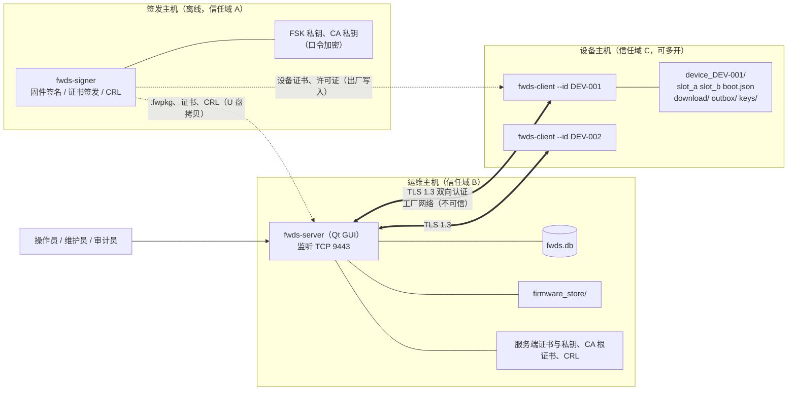

信任边界：

1. 签发主机与服务端之间：FSK 和 CA 私钥不进入服务端，服务端被攻破也签不出合法固件和证书；
2. 服务端与设备之间的工厂网络：视为完全不可信，全部走 TLS 1.3；
3. 设备本地：FSK 公钥、CA 根证书内置于客户端，并受程序自签名校验保护。

演示时三个程序可以同机运行；地址、端口、路径全部来自配置文件（第 8.2 节），不依赖本机回环地址。

### 2.2 数据流

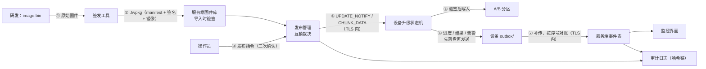

### 2.3 分层

服务端和客户端结构相同，上层只依赖下层接口。

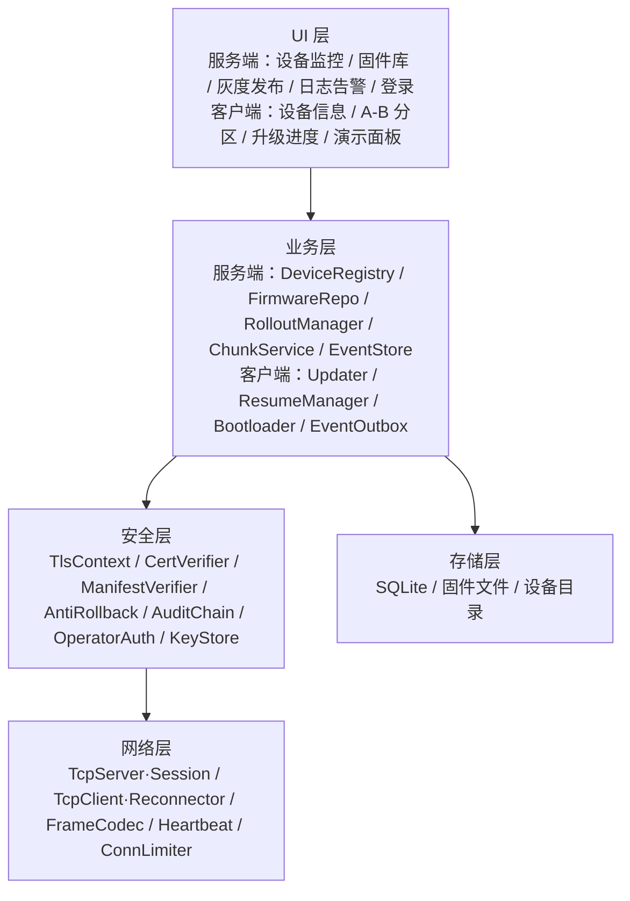

| 层 | 职责 | 不允许做的事 |
|---|---|---|
| UI | 展示数据、接收操作，通过信号槽与业务层交互 | 直接读写 socket、调用 OpenSSL |
| 业务 | 设备、固件、发布、升级状态机、事件补传 | 关心加密和拆包细节 |
| 安全 | TLS 配置与证书校验、签名验签、防降级、口令、密钥加载、审计链 | 关心业务含义 |
| 网络 | 连接管理、分帧拆包、心跳、重连、连接限制 | 理解消息内容 |
| 存储 | 数据库与文件读写（原子写） | — |

两端共用 `common` 库（协议常量、FrameCodec、OpenSSL 封装、Manifest、SecureBuffer），保证帧格式和算法实现一致。

### 2.4 代码目录

```
firmware-distribution-system/
├── common/        protocol.h、frame_codec、manifest、crypto/（secure_buffer、rsa_pss、sha256、aead_gcm、kdf、rand、key_file、x509_util）、security/（tls_channel、cert_verifier、key_store，两端共用）
├── server/        net/ security/ business/ storage/ ui/
├── client/        net/ security/ business/ storage/ ui/
├── signer/        离线签发工具（命令行）
├── attack_tools/  篡改、重放、伪造、断网代理等测试工具
├── tests/         GoogleTest 单元测试
├── deploy/        安装、自启、升级、回滚脚本；config/ 下为 dev、test、prod 配置模板
├── evidence/      证据包（按检查项编号命名）
└── docs/
```

## 3. 模块设计

| 位置 | 模块 | 职责 |
|---|---|---|
| common | FrameCodec | 分帧与拆包：不足一帧则等待；Length 超 1 MB 在分配内存前报错断开 |
| common | crypto::* | OpenSSL EVP 封装：RSA-PSS 签名验签、SHA-256、AES-256-GCM、PBKDF2、`RAND_bytes`、证书与 CRL 解析；每个调用检查返回值 |
| common | SecureBuffer | 存放口令、私钥明文，析构时 `OPENSSL_cleanse` |
| 两端 | TlsContext / CertVerifier | 配置 TLS 1.3 与套件、加载证书；握手后校验对端名称与吊销状态（第 10 章） |
| 两端 | KeyStore | 从部署注入的口令解开私钥文件（第 11.3 节） |
| 服务端 | TcpServer / Session / ConnLimiter | 每连接一个 Session，非阻塞读写；连接数、握手超时、失败锁定 |
| 服务端 | HeartbeatMonitor | 15 秒无心跳判离线，更新设备表并写日志；设备被停用时立即断开其连接；同一设备重复登录时以新连接为准 |
| 服务端 | DeviceRegistry | 设备注册（绑定证书指纹）、在线与登录状态、版本、分组、停用；改动注册表的函数只对 AdminService 开放 |
| 服务端 | LoginHandler / LoginThrottle | 按协议 5.1 节的顺序裁决 LOGIN；登录失败按“证书里的设备 ID”和“对端 IP”计数并锁定（第 14 章）；许可证检查通过 LicenseVerifier 接口接入 |
| 服务端 | AdminService | 管理操作的唯一入口：记录当前登录账号，每个操作先核对角色权限再执行，并写操作记录（第 11.1 节） |
| 服务端 | DispatchGate | 全局“允许下发”开关，每次启动默认关闭，只有维护员经 AdminService 才能改（第 4.2 节，检查项 7-1） |
| 服务端 | FirmwareRepo | 导入 .fwpkg 时服务端也验签一次，拒绝签名错误的包 |
| 服务端 | RolloutManager | 发布状态机、互锁裁决、并发控制、紧急停止（第 4.2 节） |
| 服务端 | ChunkService | 按 CHUNK_REQ 读分片，每次最多 16 片 |
| 服务端 | EventStore | 设备事件按序号去重入库，返回确认序号（第 4.6 节） |
| 服务端 | OperatorAuth | 账号登录、角色权限、口令慢派生存储（第 11 章） |
| 服务端 | AuditService | 审计日志哈希链与完整性校验（第 13 章） |
| 客户端 | TcpClient / Reconnector / Heartbeat | 断线指数退避重连（1、2、4、8、16、30 秒封顶）；每 5 秒心跳 |
| 客户端 | Updater | 升级状态机（第 4.4 节） |
| 客户端 | ResumeManager | 断点位图；续传前重新校验已下载分片 |
| 客户端 | ManifestVerifier / AntiRollback | FSK 公钥验签、型号检查、防降级 |
| 客户端 | Bootloader | 模拟启动：验签、自检、失败计数、A/B 切换 |
| 客户端 | EventOutbox | 进度、结果、告警先落盘再发送，按确认序号清理 |
| 客户端 | SelfIntegrity / LicenseChecker | 启动时校验程序自身签名、许可证与硬件指纹 |
| signer | 子命令 | `sign-fw` 生成 .fwpkg；`sign-exe` 给客户端程序签名；`issue-lic` 签发许可证；`ca-init`、`issue-cert`、`revoke`、`update-crl`、`list-certs` 管理证书和 CRL（第 10.1 节） |

## 4. 业务流程

### 4.1 设备上线、登录与心跳

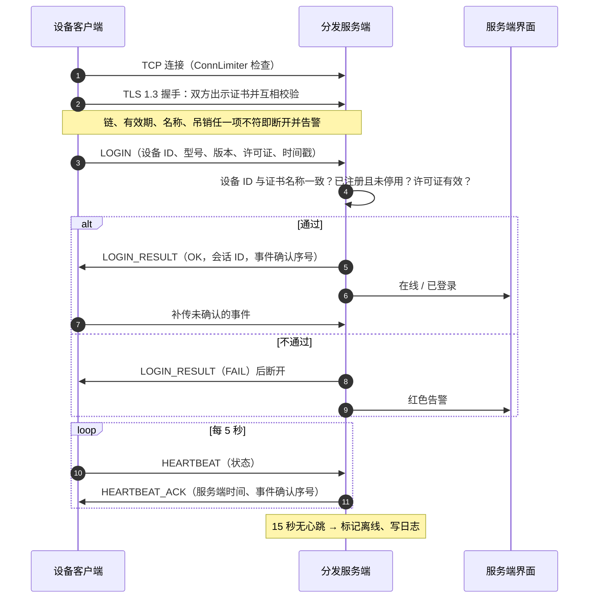

### 4.2 灰度发布

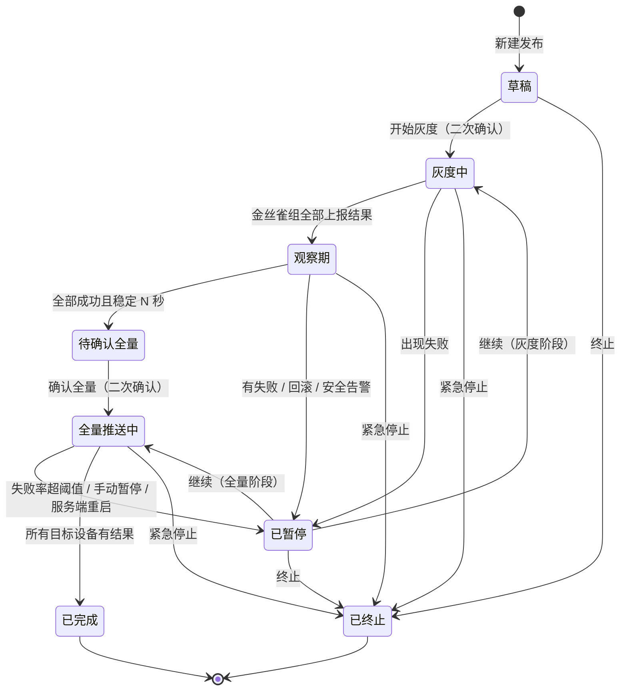

推送固件是对现场设备的写操作，按任务书第 7 类和指令控制类附加要求处理：

- **默认只监控**：全局“允许下发”开关默认关闭，由维护员打开后才能推送（检查项 7-1）；
- **二次确认与留痕**：开始灰度、确认全量、继续、终止都要重新输入口令确认；审计日志记录操作者、时间、来源主机、确认记录；
- **服务端互锁**（检查项 7-2）：同一型号同时只允许一个发布处于推送阶段；一台设备同一时刻只属于一个进行中的发布；设备处于下载到重启之间时拒绝新的推送；未通过灰度不能全量。冲突请求由 RolloutManager 统一拒绝并记录；
- **断网不盲发**：离线设备记为“待确认”，上线后由操作员确认才推送，不自动补推；
- **紧急停止**：一键终止发布，向正在升级的设备发 UPDATE_CANCEL；设备在写入前收到则放弃并保留旧固件，已进入写入的设备由 A/B 机制保证可回退；
- 金丝雀组按分组标签或手动勾选设备 ID；全量阶段并发上限 K（默认 5）。

### 4.3 下载、断点续传与写入

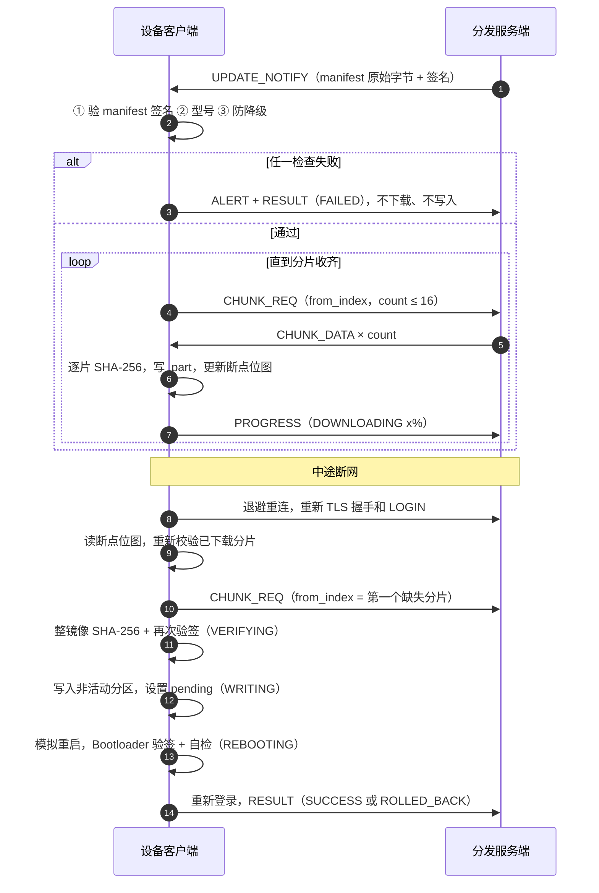

断点记录 `download/<pkg_id>.state.json` 保存 manifest 哈希和已完成分片的**位图**（能处理乱序和单片重传），每完成 16 片原子落盘一次。恢复时若 manifest 哈希变了，说明固件已更换，丢弃旧进度。

### 4.4 设备升级状态机

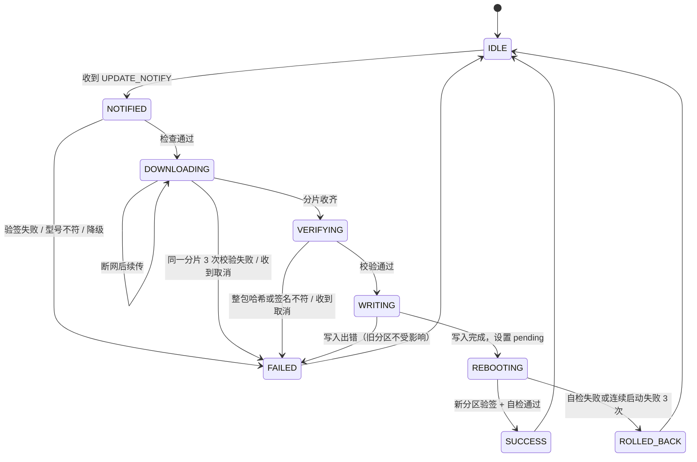

### 4.5 A/B 分区与回滚（防变砖）

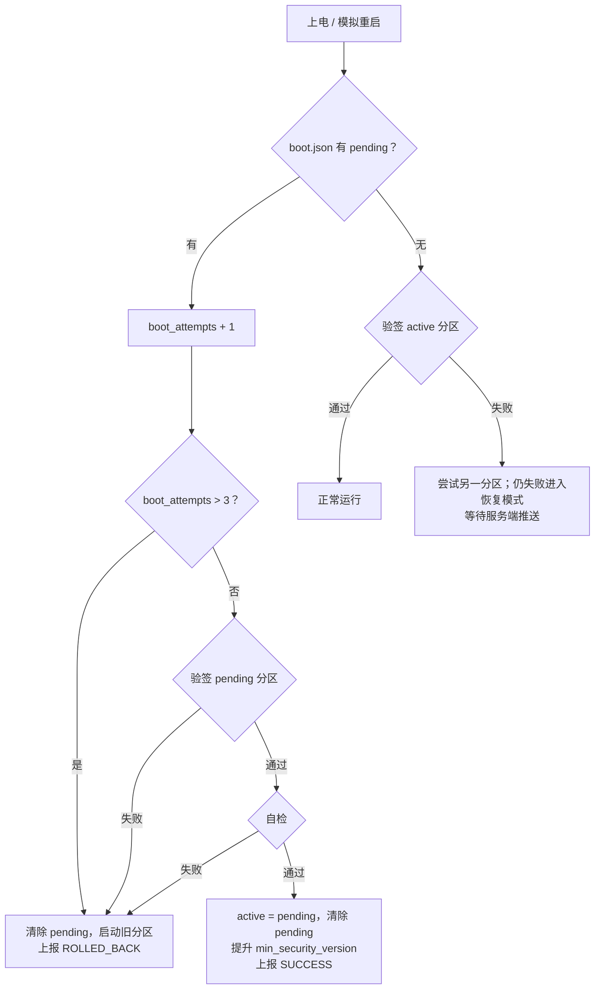

- 新固件只写非活动分区，写入中断电不影响旧分区；
- `boot.json` 一律“写临时文件 → 刷盘 → 重命名”；
- 自检通过后才提升 `min_security_version`，否则回滚后旧固件仍能运行；
- 任何异常都导向安全状态：保留旧固件继续运行（检查项 7-6）；
- 签发工具可生成“签名合法但自检必定失败”的固件，用于演示回滚。

### 4.6 状态数据闭环：落盘、补传、对账

设备产生的进度、结果、告警统称事件，按“产生 → 落盘 → 发送 → 确认 → 清理”处理（任务书第 6 类、检查项 1-5）：

1. 每个事件带设备内单调递增的 `event_seq`、时间戳和设备 ID，先原子追加到 `outbox/events.jsonl` 并刷盘，再尝试发送；`event_seq` 持久化，进程重启和断电后不重复、不回退；
2. 服务端以 `(device_id, event_seq)` 为唯一键入库，重复的直接忽略；在 LOGIN_RESULT 和 HEARTBEAT_ACK 中返回“已连续收到的最大序号”；
3. 客户端删除已确认的事件；重连后按序号从小到大补传全部未确认事件；
4. 结果：不丢（未确认不删除）、不重（唯一键去重）、不乱序（按序号发送和入库）。服务端界面可按设备查看序号是否连续。

服务端数据库使用 WAL 模式并同步刷盘，发布状态、事件、审计日志都不只存在内存里。

### 4.7 降级运行

| 场景 | 行为 |
|---|---|
| 服务端不可达 | 客户端界面显示“离线运行”，不卡死；当前固件继续运行；事件写入 outbox；下载暂停并保留断点；后台退避重连，恢复后自动登录、补传、续传 |
| 设备离线 | 服务端标记离线；不缓存盲发，上线后待操作员确认 |
| 服务端重启 | 进行中的发布恢复为“已暂停”，由操作员继续；设备重连后状态以事件对账结果为准 |

## 5. 数据设计

### 5.1 服务端数据库（SQLite）

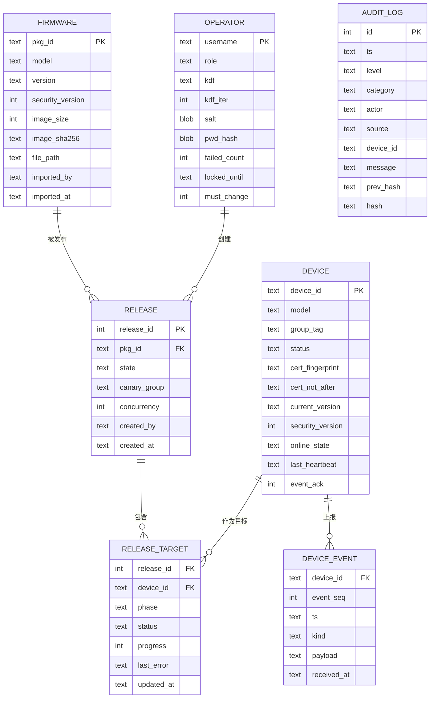

### 5.2 设备端文件

| 文件 | 内容 | 写入方式 |
|---|---|---|
| `boot.json` | active、pending、boot_attempts、min_security_version | 原子写 |
| `slot_a/`、`slot_b/` | firmware.bin + manifest.json + manifest.sig | 只写非活动分区 |
| `download/<pkg_id>.part`、`.state.json` | 下载中的镜像、断点位图 | 按偏移写入；位图原子写 |
| `outbox/events.jsonl`、`outbox/seq` | 未确认事件、事件序号 | 追加并刷盘 |
| `keys/` | 设备证书、加密的设备私钥、许可证 | 出厂初始化时写入 |
| `logs/` | 本地运行日志 | 按大小轮转 |

模拟固件镜像：`"IFW1" 4B | model 16B | version 16B | selftest 1B（0 通过，1 失败）| payload（随机数据）`。

## 6. 界面设计

| 端 | 页面 | 内容 |
|---|---|---|
| 服务端 | 登录 | 账号、口令；登录后按角色显示可用功能；首次运行时创建维护员；初始口令强制修改 |
| 服务端 | 账号管理（仅维护员） | 新建账号、重置口令、解锁、删除；只显示账号名、角色、失败次数和锁定时间 |
| 服务端 | 设备监控 | 设备 ID、IP、在线/离线、登录状态、最后心跳、版本、型号、分组、升级状态、进度条、事件序号、证书到期；离线行灰色，告警行红色；下方为安全告警与操作记录；维护员另有注册设备、停用 / 启用、修改分组；窗口顶部为“允许下发”开关 |
| 服务端 | 固件库 | 导入 .fwpkg，显示 manifest 和验签结果 |
| 服务端 | 灰度发布 | 新建、开始灰度、确认全量、暂停、继续、紧急停止；各目标设备进度；“允许下发”开关 |
| 服务端 | 日志与告警 | 按时间、设备、分类、关键字检索；安全告警置顶；“校验日志完整性”按钮 |
| 客户端 | 主窗口 | 设备信息与连接状态、A/B 分区、升级进度、本地日志 |
| 客户端 | 演示面板 | 模拟断网与恢复、写入时模拟断电、本地篡改下载缓存 |

界面刷新与网络、落盘解耦：哈希计算和写盘放在工作线程，通过信号更新界面。

## 7. 异常处理

| 异常 | 处理 |
|---|---|
| 网络断开、心跳超时 | 客户端退避重连并续传；服务端标记离线 |
| 半包、粘包 | 数据不足则等待，多帧则循环解析 |
| 非法帧（Magic、版本、长度、序号） | 记安全日志并断开 |
| TLS 握手或证书校验失败 | 断开，记安全日志（含失败原因），界面告警 |
| 登录失败 | 返回 FAIL 并断开，计数，达到阈值锁定 |
| 验签失败、降级、型号不符 | 不下载不写入，上报 ALERT |
| 分片哈希不符 | 重下该片，连续 3 次失败中止并告警 |
| 磁盘满、写入失败 | 状态 FAILED，旧分区继续运行 |
| 写入中断电 | pending 未设置，下次仍从旧分区启动 |
| 新固件启动失败 | 自检失败或计数超限自动回滚 |
| 界面非法输入 | 提示错误，不提交 |

## 8. 部署与运维

### 8.1 运行环境

| 项 | 版本 |
|---|---|
| 操作系统 | Windows 10/11（主），Linux 可编译 |
| 编译器 | MSVC 2022 或 MinGW 11+；GCC 11+ |
| 依赖 | Qt 6.5+（Widgets、Network、Sql）、OpenSSL 3.x、CMake 3.20+、GoogleTest |

### 8.2 配置

配置不写死在源码里。`deploy/config/` 提供 `dev.ini`、`test.ini`、`prod.ini` 三份模板，程序用 `--config` 指定；内容包括监听地址和端口、服务端地址、证书与数据目录路径、数据库文件路径（`[server] db_file`）、登录失败锁定参数、证书有效期上限、心跳与超时参数、日志级别。口令和私钥不写入配置文件（第 11.3 节）。

### 8.3 安装、自启与守护

- **干净环境安装**（检查项 8-1）：`deploy/install` 脚本完成依赖检查、目录创建、配置模板拷贝、数据库初始化、证书与密钥口令注入、注册自启任务；安装步骤写入 README，在未装过开发环境的机器上验证；
- **开机自启与守护**（检查项 8-2、8-3）：Windows 用任务计划程序（开机或登录触发，异常退出后 1 分钟内重新拉起），Linux 用 systemd（`Restart=always`）；服务端和客户端都注册；
- **断电恢复**：服务端从数据库恢复设备表和发布状态；客户端从 `boot.json`、断点位图和 outbox 恢复。

### 8.4 系统升级与回滚方案

设备固件的升级回滚由 A/B 分区实现（第 4.5 节）。服务端和客户端程序自身的升级回滚如下（检查项 1-8、8-4）：

| 项 | 内容 |
|---|---|
| 版本标识 | 程序版本 `主.次.修订`、数据库 `schema_version`、协议版本，三者写入“关于”页和启动日志 |
| 备份项 | `fwds.db`、配置文件、证书目录、固件库索引，备份到 `backup/<时间>_<版本>/` |
| 升级步骤 | 暂停进行中的发布 → 停止程序 → 备份 → 新版本装入 `app/<版本>/` → 数据库迁移 → 启动 → 冒烟检查（端口监听、数据库可读、一台设备登录成功） |
| 回滚触发 | 启动失败；冒烟检查失败；升级后 30 分钟内设备登录失败率异常；人工判定 |
| 回滚步骤 | 停止程序 → 切回旧版本目录 → 恢复数据库备份 → 启动 → 冒烟检查 |
| 一致性 | 回滚丢失的服务端事件由设备 outbox 按序号补传；进行中的发布恢复为“已暂停”；设备侧固件状态不受影响 |

脚本为 `deploy/upgrade` 和 `deploy/rollback`，测试阶段各演练一次并留存记录。

### 8.5 日志与时钟

- **日志**（检查项 8-5）：分 DEBUG、INFO、WARN、ERROR、SECURITY 五级；每条含毫秒时间戳（UTC）、模块、设备 ID、错误码；审计日志入库可检索，运行日志按大小轮转。日志中不出现私钥、口令、随机数和完整报文，哈希只记前 8 位；
- **时钟**（检查项 8-6）：服务端和设备主机对同一时间源做 NTP 同步；HEARTBEAT_ACK 携带服务端时间，客户端发现偏差超过 30 秒时告警；证书有效期校验和 LOGIN 时间窗口都依赖时钟一致。

---

# 第二部分 安全设计

## 9. 安全基线

### 9.1 安全属性清单

| 属性 | 保护对象 | 落到哪些功能 |
|---|---|---|
| 机密性 | 升级指令、固件分片、状态数据；各类私钥；操作员口令 | TLS 1.3；私钥口令加密存储、部署注入；口令慢派生 |
| 完整性 | 固件包；通信内容；设备启动配置；审计日志 | manifest 签名 + 分片哈希 + 防降级；TLS 认证加密；Bootloader 验签；审计哈希链 |
| 可用性 | 设备不变砖；服务端不被拖垮；断网可用 | A/B 回滚；连接限制与超时；降级运行、断点续传、事件补传 |
| 可追溯性 | 谁在何时发布了什么；设备发生了什么 | 账号登录与角色；二次确认记录；审计日志；事件序号对账 |

### 9.2 威胁模型（STRIDE）

攻击者假设：能接入工厂网络窃听、篡改、重放、伪造报文；能拿到固件包文件和客户端程序；拿不到离线签发主机上的私钥。

| 类别 | 威胁 | 后果 | 防护 |
|---|---|---|---|
| S 伪造 | 冒充服务端推送恶意固件 | 设备被控制 | 服务端证书由自建 CA 签发，客户端校验链、名称、吊销；固件另有 FSK 签名 |
| S 伪造 | 冒充设备接入，窃取固件或上报假状态 | 固件泄露、状态失真 | 设备证书双向认证；证书指纹与注册表绑定；设备 ID 必须等于证书名称；许可证绑定硬件指纹 |
| T 篡改 | 修改传输中的指令或分片 | 恶意固件写入 | TLS 认证加密；分片 SHA-256；manifest 签名 |
| T 篡改 | 修改固件包文件或本地下载缓存 | 同上 | manifest 签名锁定镜像哈希；续传前重验分片；写入前整包再验 |
| T 篡改 | 用合法的旧固件降级 | 重新引入已知漏洞 | `security_version` 防降级 |
| R 抵赖 | 操作员否认做过发布 | 无法追责 | 账号登录、二次确认、审计哈希链 |
| I 泄露 | 抓包获取指令和固件 | 固件被逆向 | 全程 TLS 1.3，抓包只见密文 |
| I 泄露 | 私钥或口令从磁盘、仓库泄露 | 身份被冒用 | 私钥口令加密、部署注入、不进仓库；口令加盐慢派生 |
| D 拒绝服务 | 连接洪泛、超大长度、慢速握手 | 服务端不可用 | 连接数限制、帧长上限、握手超时、失败锁定 |
| E 提权 | 未登录直接发业务消息；低权限账号执行发布 | 越权操作 | 连接状态机；界面和业务层双重角色检查 |
| 重放 | 重放抓到的报文 | 重复或伪造操作 | TLS 记录序号；应用层帧序号；LOGIN 时间窗口；事件序号去重 |
| 中间人 | 代理冒充双方 | 窃听、篡改 | 双向证书校验，不信任系统证书库，只信任自建 CA |

### 9.3 放弃项声明

| 放弃的目标 | 原因 | 补偿措施 |
|---|---|---|
| 设备私钥和 `min_security_version` 的硬件级保护 | 无真实安全芯片，本机管理员可改写文件 | 私钥口令加密；真实设备应使用安全芯片和单调计数器，文档中说明 |
| 固件镜像单独加密（落盘机密性） | 一期工作量；传输已由 TLS 保护 | 镜像仅含模拟数据；列为可选扩展 |
| 证书在线状态查询（OCSP） | 现场网络封闭 | 使用 CRL，由维护员导入，服务端同时按注册表状态拒绝已停用设备 |
| 采集轮询不扰扫描周期的实测（检查项 1-6、7-3） | 本系统不轮询 PLC，设备为模拟 | 自查表填“不适用”；下载与校验在工作线程并限速，不阻塞设备主循环 |
| 明文协议设备隔离（检查项 7-5） | 系统内没有只支持明文协议的设备 | 自查表填“不适用” |

### 9.4 其余基线材料

任务书第 2 类要求的工况台账、设备协议台账、不可改约束清单见[现场基线材料](现场基线材料.md)。本项目没有真实现场，三份材料基于一套假想现场编写。

## 10. 通信安全

### 10.1 证书体系与双向认证（检查项 4-1）

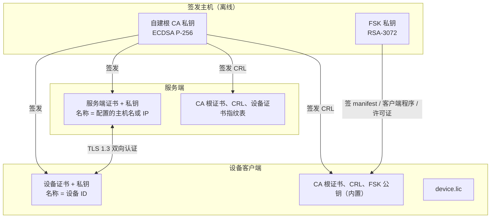

- 服务端和每台设备各有独立证书和私钥，不共用；
- TLS 握手时双方都必须出示证书，任何一方不出示即握手失败；
- 双方只信任自建 CA 根证书，不加载操作系统证书库。

**证书内容**：

| 证书 | 持有者名称 | 关键扩展 |
|---|---|---|
| 根证书 | CA 名称 | `CA:TRUE, pathlen:0`（不能再签下级 CA）；密钥用途仅 `keyCertSign, cRLSign` |
| 服务端证书 | 客户端连接时使用的主机名或 IP，同时写入“使用者可选名称”（DNS 或 IP 条目） | `CA:FALSE`；密钥用途 `digitalSignature`；扩展用途 `serverAuth` |
| 设备证书 | 设备 ID（字母、数字、`-`、`_`，最长 64） | `CA:FALSE`；密钥用途 `digitalSignature`；扩展用途 `clientAuth` |

序列号为 16 字节随机数；签名算法 ECDSA-SHA256。两种叶子证书的扩展用途不同，所以设备证书不能拿来冒充服务端，反之亦然。

**签发工具的证书子命令**（CA 目录只存在于签发主机，含加密的 `ca.key`、`ca.pem`、`crl.pem` 和签发台账 `index.json`）：

| 子命令 | 作用 |
|---|---|
| `ca-init --ca-dir D` | 生成 CA 密钥、自签名根证书和一份空 CRL；目录中已有 CA 时拒绝覆盖 |
| `issue-cert --ca-dir D --type server\|device --name N --out-dir O` | 生成新密钥对并签发证书；输出 `<type>.pem`、加密的 `<type>.key`、`ca.pem`、`crl.pem`，并打印证书指纹（设备注册时使用） |
| `revoke --ca-dir D (--serial S \| --name N)` | 在台账中标记吊销并重新生成 CRL（CRL 序号加 1） |
| `update-crl --ca-dir D` | 吊销名单不变，刷新 CRL 的签发时间和序号（CRL 默认 30 天有效，到期前执行） |
| `list-certs --ca-dir D` | 列出台账 |

CA 口令在终端输入且不回显；脚本环境通过环境变量 `FWDS_CA_PASSPHRASE` 传入。新私钥的口令同理（`FWDS_KEY_PASSPHRASE`）。口令至少 12 个字符。

### 10.2 完整证书校验（检查项 4-2）

| 校验项 | 客户端校验服务端 | 服务端校验设备 | 实现位置 |
|---|---|---|---|
| 签发链 | 必须由自建 CA 直接签发 | 同左 | TLS 握手 + CertVerifier |
| 有效期 | 当前时间在有效期内，且总时长不超过配置的上限 | 同左 | TLS 握手 + CertVerifier |
| 持有者名称 | 证书名称等于配置的服务端主机名或 IP | 证书名称等于 LOGIN 中的设备 ID（不符返回 `2003`），且指纹与注册表一致 | 握手 + CertVerifier + 登录处理 |
| 用途 | 扩展用途为 `serverAuth` | 扩展用途为 `clientAuth` | TLS 握手 + CertVerifier |
| 吊销状态 | 序列号不在 CRL 中 | 序列号不在 CRL 中，且注册表状态不是“停用” | CertVerifier |

任一项不符即断开，不发送任何业务数据，并记安全日志。校验不可通过配置关闭，代码中不调用 `ignoreSslErrors()`。

- **两道检查**：握手阶段由 Qt/OpenSSL 校验链、有效期、用途和服务端名称；握手成功后 CertVerifier 用只含自建 CA 和 CRL 的信任库对对端证书再做一次完整校验（`X509_verify_cert`，开启 `X509_V_FLAG_CRL_CHECK`），并复查协商结果确实是 TLS 1.3 和 `TLS_AES_256_GCM_SHA384`。两道都通过才开始收发 FWDS 帧；
- **CRL**：加载时验证签发者、CA 签名、签发时间和“下次更新”时间，过期的 CRL 拒绝加载；CRL 带序号，序号比当前使用的小的拒绝加载（防止用旧 CRL 让已吊销的证书重新可用）；没有可用 CRL 时一律拒绝连接，而不是视为“未吊销”。CRL 文件被替换后，下一次握手前自动重新加载，新文件不合格则继续使用原 CRL 并告警；
- **有效期上限**：配置项 `[tls] max_ca_cert_days`（默认 365）和 `max_cert_days`（默认 90）。签发工具不签发超过上限的证书，两端也不接受有效期总时长超过上限的证书。课程规定的上限确定后只需修改配置（TBD-2）；
- **启动自检**：程序启动时检查本端证书与私钥匹配、证书在有效期内，设备端另查证书名称等于配置的设备 ID；不合格则不启动网络。

### 10.3 带认证加密（检查项 4-3、1-4）

- 协议版本只允许 TLS 1.3；
- 套件只启用 `TLS_AES_256_GCM_SHA384`：AES-256 的伽罗瓦计数器模式，加密同时生成 16 字节认证标签，密文或关联数据被改动时标签校验失败，TLS 立即断开；
- 密钥交换为 X25519 临时密钥，具备前向安全；
- 落盘加密同样使用带认证模式：私钥文件用 AES-256-GCM 封装（第 11.3 节），不使用无认证的 CBC、ECB、CTR。

### 10.4 随机数唯一性（检查项 4-4）

| 用途 | 来源与唯一性 |
|---|---|
| TLS 记录加密的 nonce | TLS 1.3 由握手派生的 IV 与 64 位记录序号运算得到，同一密钥下不重复；每次连接重新协商密钥 |
| 私钥文件加密的 nonce 和盐 | 每次写文件时由 `RAND_bytes` 新生成 12 字节 nonce 和 16 字节盐，随文件保存 |
| RSA-PSS 签名盐、口令盐、会话 ID | `RAND_bytes` |

全项目禁止 `rand()`；`RAND_bytes` 返回失败直接终止。测试阶段做抽样检查（见测试报告）。

### 10.5 抗重放（检查项 4-5）

| 层 | 机制 | 有效期窗口 |
|---|---|---|
| TLS | 每条记录有隐式序号并受认证标签保护，重放、乱序、截断都会导致解密失败；不启用 0-RTT | 单次连接 |
| 应用帧 | 每方向帧序号从 1 开始严格加 1，不符即断开并记“疑似重放” | 单次连接 |
| 登录 | LOGIN 带时间戳，服务端只接受 ±60 秒内的请求 | 60 秒 |
| 事件 | `(device_id, event_seq)` 唯一，重复事件不入库 | 永久 |

旧连接抓到的密文在新连接中无法解密，因为每次握手的密钥不同。

### 10.6 上下文绑定（检查项 4-6）

| 绑定对象 | 绑定字段 |
|---|---|
| 身份与信道 | 设备 ID = 证书名称 = 注册表记录；服务端名称 = 证书名称 |
| 会话 | 会话密钥由本次握手派生；LOGIN_RESULT 下发会话 ID，日志和事件按会话 ID 关联 |
| 升级指令 | UPDATE_NOTIFY 带目标设备 ID、发布号、包 ID；设备只接受发给自己的通知；CHUNK_REQ 的包 ID 必须是服务端当前下发给该设备的包 |
| 固件 | manifest 绑定型号、版本、安全版本号、整镜像与分片哈希 |
| 许可证 | 绑定设备 ID 和硬件指纹 |

### 10.7 脱敏（检查项 4-7、1-7）

系统中的设备 ID、账号、固件内容全部是模拟数据，不接入真实生产数据。传输内容受 TLS 保护；日志只记设备 ID、错误码、哈希前 8 位。证据包中的截图、抓包、日志在提交前逐文件自检。

## 11. 身份、授权与密钥

### 11.1 角色与权限

| 功能 | 操作员 | 维护员 | 审计员 |
|---|---|---|---|
| 查看设备与发布状态 | ✓ | ✓ | ✓ |
| 新建发布、开始灰度、确认全量、暂停、继续 | ✓ | | |
| 紧急停止 | ✓ | ✓ | |
| 设备注册与停用、导入固件、导入 CRL、“允许下发”开关、账号管理 | | ✓ | |
| 查看与导出审计日志、校验日志完整性 | | | ✓ |

权限在界面和业务层各检查一次；每次操作写审计日志。

- **界面**：登录后按角色显示功能入口，没有权限的按钮和页签不出现；
- **业务层**：所有管理操作只能经 `AdminService` 调用，它记着当前登录的账号，每个操作先查上表再执行；`DeviceRegistry`、`DispatchGate` 中改数据的函数是私有的，只对 `AdminService` 开放，绕过界面直接调用业务接口同样被拒并记录；
- **首次运行**：账号表为空时，界面要求先创建一个维护员；此后新建账号只能由已登录的维护员完成；
- **无界面模式**（`--headless`）：没有账号登录，只做监控，不能执行任何管理操作；
- **设备注册**：维护员导入签发工具生成的设备证书，设备 ID、证书指纹、到期时间从证书中读取，不手工输入；导入的证书先过与握手时相同的完整校验（第 10.2 节）。

### 11.2 口令存储（检查项 1-2）

- 派生函数：PBKDF2-HMAC-SHA256，迭代 600 000 次，输出 32 字节；
- 盐：每个账号 16 字节，`RAND_bytes` 生成，与派生函数名、迭代次数一起存在账号表中；
- 验证：用相同参数重新派生，常数时间比较；连续失败 5 次锁定 10 分钟，失败计数和解锁时间存在账号表中，重启程序不清零；账号表中迭代次数低于 100 000 的记录拒绝使用（防止有人改库降低强度）；
- 口令规则：10 ~ 128 字节，同时包含字母和数字；
- 新建账号和被重置口令的账号带“须改口令”标记（`must_change`），登录后必须先改口令才能进行其他操作；改口令时重新验证原口令并更换盐；
- 数据库中不存在明文口令或单次哈希，相同口令的不同账号存储值不同。

### 11.3 密钥清单与注入（检查项 1-3）

| 密钥 | 算法 | 存放 | 口令来源 | 用途 |
|---|---|---|---|---|
| CA 私钥 | ECDSA P-256 | 签发主机 | 使用时人工输入 | 签发证书和 CRL |
| FSK 私钥 | RSA-3072 | 签发主机 | 使用时人工输入 | 签 manifest、客户端程序、许可证 |
| 服务端私钥 | ECDSA P-256 | 服务端 `keys/` | 部署注入 | TLS 身份 |
| 设备私钥 | ECDSA P-256 | 设备 `keys/`（模拟安全芯片） | 部署注入 | TLS 身份 |
| TLS 会话密钥 | 握手派生 | 仅内存 | — | 加密通信，断开即销毁 |

- **存储**：私钥以 PKCS#8 编码后用 AES-256-GCM 封装，加密密钥由口令经 PBKDF2-HMAC-SHA256（600 000 次迭代）派生；不使用 OpenSSL 自带的 PEM 加密（默认是无认证的 CBC）。文件格式见下表，文件头作为关联数据参与认证，改动任何一个字节都会解密失败；
- **口令来源**：服务端和设备私钥的口令通过环境变量 `FWDS_KEY_PASSPHRASE` 注入；
- **注入**：安装脚本为服务端和设备生成随机口令，写入仓库之外、仅运行账户可读的 `secrets.env`，程序启动时从环境变量读取后清除；源码、配置模板、安装包中没有任何私钥或口令；
- **仓库**：`keys/`、`secrets.env`、`*.db` 列入 `.gitignore`；提交前和交付前对全仓库（含历史提交）运行秘密扫描；
- **内存**：口令和私钥明文放在 SecureBuffer 中，用后清零。

私钥文件格式（多字节整数为大端）：

| 偏移 | 长度 | 内容 |
|---|---|---|
| 0 | 4 | 魔数 `FWKY` |
| 4 | 1 | 格式版本，当前为 1 |
| 5 | 1 | 派生函数标识，1 = PBKDF2-HMAC-SHA256 |
| 6 | 4 | 迭代次数（低于 100 000 或高于 10 000 000 的文件拒绝打开） |
| 10 | 16 | 盐，每次写文件新生成 |
| 26 | 12 | nonce，每次写文件新生成 |
| 38 | 4 | 密文长度 N（上限 16 KB，先校验再读取） |
| 42 | N | 密文：AES-256-GCM（PKCS#8 DER） |
| 42+N | 16 | 认证标签 |

### 11.4 轮换与吊销

| 场景 | 流程 |
|---|---|
| 证书到期轮换 | 到期前 15 天界面提醒 → 签发工具签发新证书 → 维护员导入并重启连接 → 旧证书到期自然失效 |
| 设备丢失或私钥泄露 | 维护员在注册表中停用设备（立即拒绝登录并断开现有连接）→ 签发工具把证书加入 CRL → 服务端导入新 CRL |
| 服务端私钥泄露 | 吊销旧证书、签发新证书；新 CRL 随客户端配置下发到设备 |
| FSK 轮换 | 生成新密钥对 → 发布内置新公钥的客户端程序 → 旧 FSK 停止签发 |
| 操作员口令 | 维护员重置；首次登录强制修改 |

## 12. 固件可信

### 12.1 固件包与签名

`.fwpkg` 由 `manifest.json`、`manifest.sig`（RSA-3072-PSS-SHA256，对 manifest 原始字节签名）、`image.bin` 三段组成，容器格式和 manifest 字段见[通信协议文档](通信协议文档.md)第 7 节。

- **只签 manifest，但 manifest 锁定镜像**：整镜像哈希和每片哈希都在 manifest 中，改镜像任何一个字节都会使哈希不符，而哈希受签名保护；
- **对原始字节验签，通过后才解析 JSON**，避免序列化差异和解析器漏洞；
- **先验签再下载**：manifest 不可信就不下载；
- 服务端导入时也验签一次，但设备不依赖服务端的检查结果。

### 12.2 客户端验证流程

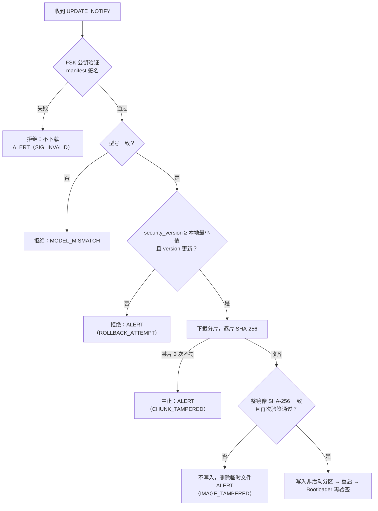

服务端收到 ALERT 后：界面红色告警，写审计日志（设备 ID、原因、哈希），发布按规则暂停。

## 13. 审计日志

- 每条日志含 `ts, level, category, actor, source, device_id, message, prev_hash, hash`，其中 `hash = SHA256(prev_hash ‖ 其余字段)`，首条 `prev_hash` 为全 0；
- 每 100 条和程序退出时，把最新 `hash` 写入单独的检查点文件，并显示在界面上供审计员抄录，防止整体重算哈希链；
- “校验日志完整性”从头重算，定位第一条不一致的记录；
- 分类：`CONN`、`AUTH`、`HB`、`ROLLOUT`、`UPGRADE`、`SECURITY`、`ADMIN`。

## 14. 拒绝服务防护

| 措施 | 参数 |
|---|---|
| 总连接数 / 单 IP 连接数 | 200 / 5 |
| TLS 握手 + 登录超时 | 10 秒 |
| 帧长度上限 | 1 MB，先检查后分配 |
| 登录失败锁定 | 同一设备 ID 或 IP 5 分钟内失败 5 次，锁定 10 分钟（`[server] login_fail_limit`、`login_fail_window_s`、`login_lock_s` 可配置）。设备 ID 取证书中的名称而不是 LOGIN 中自报的，避免冒名者把别的设备锁住 |
| 下载并发 / 分片请求窗口 | K 台（默认 5）/ 每次最多 16 片 |

## 15. 软件保护（3 种）

| 方法 | 实现 | 作用 |
|---|---|---|
| 程序数字签名 | 签发工具为 `fwds-client` 生成签名，启动时用内置 FSK 公钥校验自身 | 程序被修改后拒绝运行 |
| 许可证文件绑定 | `device.lic` 含设备 ID、硬件指纹哈希、有效期，由 FSK 签名 | 拷到别的机器无法运行 |
| 加壳 + 字符串加密 | Release 版 UPX 加壳；公钥指纹、关键提示用编译期异或加密 | 增加静态分析难度 |

## 16. 代码安全规范

- 长度字段先校验上限再分配或拷贝；用 `QByteArray`、`std::vector`，不对定长数组 `memcpy`；
- OpenSSL 只用 EVP 接口，对象用智能指针管理，每个调用检查返回值；
- 敏感数据用 SecureBuffer；
- 提交前运行 cppcheck、clang-tidy 和秘密扫描，修复高危告警。

## 17. 待定事项

| 编号 | 事项 | 当前假设 |
|---|---|---|
| TBD-1 | 通信安全方案 | 按 TLS 1.3 双向证书认证设计（任务书第 4 类）；v0.1 的自研握手已移除 |
| TBD-2 | 证书有效期上限 | 叶子 90 天、根 1 年；已做成配置项（`[tls] max_cert_days`、`max_ca_cert_days`），待课程给出上限后修改配置 |
| TBD-3 | 自启与守护的目标平台 | 以 Windows 为主，Linux 提供 systemd 单元 |
| TBD-4 | 金丝雀观察期时长 N | 默认 30 秒（演示用） |
| TBD-5 | 是否实现固件镜像加密 | 一期不做 |
