# 工业固件安全升级分发系统 —— 系统设计说明书

| 项 | 内容 |
|---|---|
| 项目编号 | 网络安全实践项目 第 3 题 |
| 文档版本 | v0.1（初稿） |
| 架构 | C/S（服务端 + 设备客户端 + 离线签名工具） |
| 技术栈 | C++17 / CMake / Qt 6 / OpenSSL 3 / SQLite |
| 配套文档 | [《通信协议文档》](通信协议文档.md)、[《测试验证报告》](测试验证报告.md) |

---

## 目录

1. [引言](#1-引言)
2. [需求概述](#2-需求概述)
3. [总体架构](#3-总体架构)
4. [模块设计](#4-模块设计)
5. [业务流程设计](#5-业务流程设计)
6. [安全设计](#6-安全设计)
7. [数据设计](#7-数据设计)
8. [界面设计](#8-界面设计)
9. [异常处理设计](#9-异常处理设计)
10. [部署与运行环境](#10-部署与运行环境)
11. [待定事项](#11-待定事项)

---

## 1. 引言

### 1.1 编写目的

本文档描述“工业固件安全升级分发系统”的总体架构、模块划分、业务流程、安全方案和数据设计，是后续编码、测试和验收的依据。

### 1.2 项目背景

工厂中分布着大量嵌入式设备（PLC、网关、传感器控制器等），需要由服务端统一推送固件升级，保证设备软件版本统一且最新。固件升级是高风险操作：

- 恶意或被篡改的固件一旦写入，设备可能被控制或停机；
- 升级过程中断网、断电，可能导致设备“变砖”；
- 一次性全量推送有缺陷的固件，会造成整条产线停工。

因此系统必须同时解决**可信**（固件来源可信、内容未被篡改、不能降级）、**可靠**（断点续传、失败回滚）和**可控**（灰度发布、实时状态反馈、审计）三类问题。

### 1.3 范围

本项目为教学原型。按课程要求：

- 硬件设备由**客户端程序模拟**，Flash 用本地目录模拟，“写入 Flash”“重启”通过界面动画与日志展示；
- 安全芯片（存放设备私钥）按原理模拟为“受口令保护的本地密钥文件”。

### 1.4 术语

| 术语 | 说明 |
|---|---|
| 固件包（.fwpkg） | 签名清单 manifest + 签名 + 固件镜像 组成的发布单元 |
| manifest | 固件元数据清单，含版本、哈希、分片哈希等，被 RSA 签名保护 |
| FSK | Firmware Signing Key，固件签名密钥（RSA-3072） |
| security_version | 安全版本号，单调递增，用于防降级（anti-rollback） |
| A/B 分区 | 设备上两个固件槽位，一个运行、一个用于写入新固件 |
| 灰度发布 | 先向少量设备（金丝雀组）发布，确认无误后再全量推送 |
| 分片（chunk） | 固件镜像按 64 KB 切分的传输单元 |

### 1.5 参考资料

- 《网络安全实践项目》任务书 第 3 题及“基础要求”“考核标准”
- RFC 8017（PKCS #1 v2.2：RSA-PSS / RSA-OAEP）
- RFC 7748（X25519）、RFC 5869（HKDF）、NIST SP 800-38D（GCM）
- RFC 9019（IoT 固件更新架构 SUIT），作为设计思路参考

---

## 2. 需求概述

### 2.1 功能需求

| 编号 | 需求 | 来源 |
|---|---|---|
| FR-1 | 基于 TCP 的分片传输，支持断点续传，适应不稳定网络 | 任务书 |
| FR-2 | 服务端用 RSA 私钥签名固件包，客户端用公钥验签，验签失败禁止写入 Flash | 任务书 |
| FR-3 | 灰度发布：按设备 ID 分组，先少量下发，确认后全量推送 | 任务书 |
| FR-4 | 客户端实时上报升级进度：下载中、校验中、写入中、重启成功/失败 | 任务书 |
| FR-5 | fallback：升级失败自动保留旧固件并重启，设备不变砖 | 任务书 |
| FR-6 | 服务端可视化显示所有客户端的在线状态、心跳、登录状态 | 基础要求 |
| FR-7 | 详细日志记录，安全事件告警 | 基础要求 |
| FR-8 | 设备注册与管理、固件库管理、发布管理 | 业务补充 |
| FR-9 | 服务端操作员登录，所有发布操作记录操作人 | 业务补充（抗抵赖） |

### 2.2 安全需求

| 编号 | 需求 | 对应威胁 |
|---|---|---|
| SR-1 | 固件来源可信、内容完整：篡改任意字节必须被发现并告警 | 篡改、恶意固件植入 |
| SR-2 | 防降级：不能安装比当前安全版本更旧的固件 | 回滚攻击 |
| SR-3 | 服务端与设备双向身份认证 | 伪造服务端、伪造设备、中间人 |
| SR-4 | 通信机密性与完整性 | 窃听、篡改 |
| SR-5 | 防重放 | 重放攻击 |
| SR-6 | 审计日志防篡改，可取证 | 抵赖、事后篡改日志 |
| SR-7 | 抵御基本拒绝服务 | DoS |
| SR-8 | 无硬编码密钥，使用安全随机数，敏感内存清零 | 密钥泄露 |
| SR-9 | 软件保护至少 2 种 | 逆向、破解 |

### 2.3 非功能需求

| 编号 | 需求 | 指标 |
|---|---|---|
| NFR-1 | 并发 | 服务端稳定支撑 ≥ 50 台设备同时在线，≥ 20 台同时下载 |
| NFR-2 | 实时性 | 状态变化到服务端界面刷新 < 1 秒 |
| NFR-3 | 可靠性 | 断网恢复后从断点续传；写入中断电后设备仍可启动 |
| NFR-4 | 可维护性 | 网络层、业务层、安全层分离，接口清晰 |

---

## 3. 总体架构

### 3.1 系统上下文

系统由三个程序组成：**离线签名工具**负责生成并签名固件包；**分发服务端**负责管理设备、固件和发布；**设备客户端**模拟现场嵌入式设备，负责下载、验证、写入和回滚。

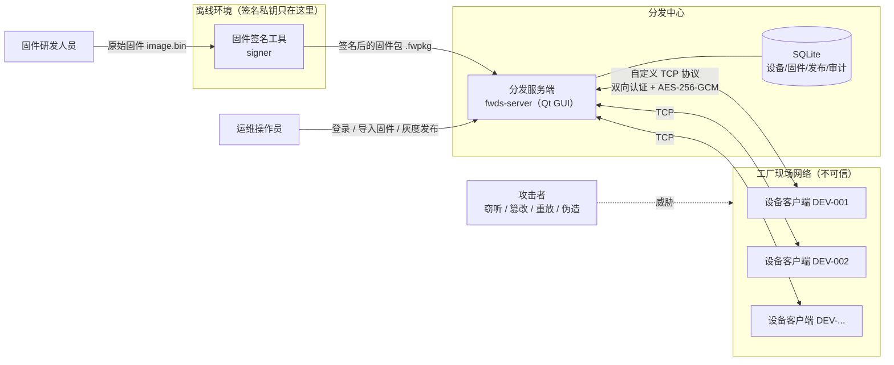

**信任边界**：

1. 签名工具与服务端之间：签名私钥不进入服务端，服务端被攻破也无法签出合法固件；
2. 服务端与设备之间的工厂网络：视为完全不可信，所有通信加密认证；
3. 设备本地：固件公钥内置于客户端程序，并受程序自签名校验保护。

### 3.2 部署视图

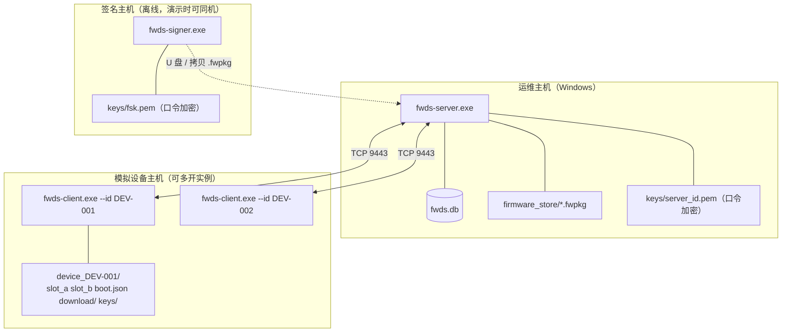

### 3.3 分层架构

服务端和客户端都采用四层结构，上层只依赖下层接口，**网络层不懂业务，业务层不直接调 OpenSSL**。

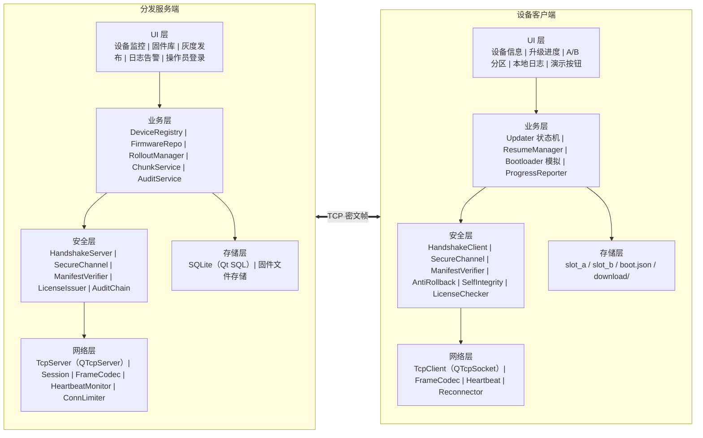

两端的安全层和网络层共同依赖 `common` 公共库（`protocol.h`、`FrameCodec`、`crypto/*` OpenSSL 封装、`SecureBuffer`、`Manifest`），保证双方对帧格式和密码算法的实现完全一致。

| 层 | 职责 | 不允许做的事 |
|---|---|---|
| UI 层 | 展示数据、接收操作，通过 Qt 信号槽与业务层交互 | 直接读写 socket、直接调用 OpenSSL |
| 业务层 | 设备、固件、发布、升级状态机等业务逻辑 | 关心字节如何加密、帧如何拆包 |
| 安全层 | 握手、加解密、签名验签、防重放、防降级、审计链 | 关心业务含义 |
| 网络层 | 连接管理、分帧/拆包、心跳、重连、连接限制 | 理解消息内容 |
| 存储层 | 数据库与文件读写 | — |

### 3.4 模块交互

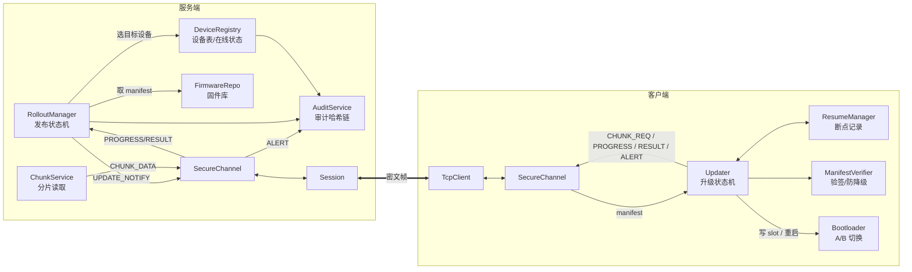

### 3.5 代码目录

```
firmware-distributive-system/
├── CMakeLists.txt
├── common/            公共库（服务端、客户端、签名工具共用）
│   ├── protocol.h         消息类型、状态码、帧头定义
│   ├── frame_codec.*      分帧 / 拆包
│   ├── manifest.*         manifest 解析与序列化
│   ├── secure_buffer.h    析构时自动清零的缓冲区
│   └── crypto/            OpenSSL EVP 封装：rsa_pss, ecdsa, x25519_hkdf, aead_gcm, sha256, rand
├── server/
│   ├── net/               TcpServer, Session, HeartbeatMonitor, ConnLimiter
│   ├── security/          HandshakeServer, SecureChannel, LicenseIssuer, AuditChain
│   ├── business/          DeviceRegistry, FirmwareRepo, RolloutManager, ChunkService, AuditService
│   ├── storage/           Database
│   └── ui/                MainWindow, DeviceTableModel, RolloutPanel, LogPanel, LoginDialog
├── client/
│   ├── net/               TcpClient, Reconnector
│   ├── security/          HandshakeClient, SecureChannel, ManifestVerifier, AntiRollback, SelfIntegrity, LicenseChecker
│   ├── business/          Updater, ResumeManager, Bootloader, ProgressReporter
│   ├── storage/           DeviceStorage（slot / boot.json / download）
│   └── ui/                MainWindow, SlotView, DemoPanel
├── signer/            离线签名工具（命令行 + 简单窗口）
├── attack_tools/      篡改、重放、伪造、MITM 代理等测试工具
├── tests/             GoogleTest 单元测试
└── docs/              设计说明书、协议文档、测试报告
```

---

## 4. 模块设计

### 4.1 公共库 common

| 模块 | 主要接口 | 说明 |
|---|---|---|
| FrameCodec | `QByteArray encode(const FrameHeader&, const QByteArray& body)`<br/>`std::optional<Frame> tryDecode(QByteArray& buffer)` | 处理粘包/拆包：缓冲区不足 17 字节或不足一整帧时返回空，继续等数据；Length 超过 1 MB 直接报错断开 |
| crypto::RsaPss | `sign(EVP_PKEY*, data)` / `verify(EVP_PKEY*, data, sig)` | RSA-3072，PSS 填充，SHA-256，salt 长度 = 摘要长度 |
| crypto::Ecdsa | `sign` / `verify` | 设备身份密钥，P-256 + SHA-256 |
| crypto::X25519 | `generate()` / `derive(priv, peerPub)` | 临时密钥对，每次连接新生成 |
| crypto::Hkdf | `derive(ikm, salt, info, len)` | HKDF-SHA256 |
| crypto::AeadGcm | `seal(key, nonce, aad, pt)` / `open(key, nonce, aad, ct)` | AES-256-GCM，`open` 标签校验失败返回空 |
| crypto::Rand | `bytes(n)` | 封装 `RAND_bytes`，失败直接终止 |
| SecureBuffer | RAII，析构调用 `OPENSSL_cleanse` | 存放会话密钥、口令、私钥明文 |
| Manifest | `fromJson(rawBytes)` / 字段访问 | 只在验签通过后调用 |

OpenSSL 对象统一用 `std::unique_ptr<EVP_PKEY, decltype(&EVP_PKEY_free)>` 这类智能指针管理。

### 4.2 服务端模块

| 模块 | 职责 |
|---|---|
| TcpServer / Session | 监听端口，每个连接一个 Session；非阻塞读写，按帧回调上层；维护发送队列 |
| ConnLimiter | 总连接数 ≤ 200，单 IP ≤ 5；握手 10 秒内未完成即断开；认证失败计数与锁定 |
| HeartbeatMonitor | 每秒扫描，15 秒无心跳判定离线，更新 DeviceRegistry 并写日志 |
| HandshakeServer | 完成第 6.4 节握手，输出会话密钥给 SecureChannel |
| SecureChannel | 帧加解密、序号检查（防重放）；握手完成前只放行握手消息 |
| DeviceRegistry | 设备注册（导入设备公钥）、在线状态、登录状态、当前版本、分组标签 |
| FirmwareRepo | 导入 .fwpkg 时**服务端也验签一次**，拒绝导入未签名或签名错误的包 |
| RolloutManager | 发布状态机（第 5.3 节），选择目标设备、控制并发数、根据结果决定暂停或继续 |
| ChunkService | 按 CHUNK_REQ 读取分片，每次最多回 16 片（窗口流控） |
| LicenseIssuer | 为设备签发 `device.lic` |
| AuditService / AuditChain | 写审计日志，维护哈希链，提供完整性校验 |
| OperatorAuth | 操作员登录，口令 PBKDF2-SHA256（10 万次迭代 + 随机盐）存储 |

### 4.3 客户端模块

| 模块 | 职责 |
|---|---|
| TcpClient / Reconnector | 连接服务端；断线后指数退避重连（1, 2, 4, 8, 16, 30 秒封顶） |
| Heartbeat | 每 5 秒发送一次 HEARTBEAT，携带当前状态 |
| HandshakeClient | 校验服务端签名（服务端公钥内置），用设备私钥签名证明身份 |
| ManifestVerifier | 用内置 FSK 公钥验 manifest 签名，校验型号 |
| AntiRollback | 比较 `security_version` 与本地 `min_security_version`，比较 version |
| Updater | 升级状态机（第 5.5 节），驱动下载、校验、写入、重启 |
| ResumeManager | 记录已完成分片，重连后计算续传起点，并重新校验已下载部分 |
| Bootloader | 模拟启动：启动前验签槽位固件、自检、失败计数、A/B 切换 |
| ProgressReporter | 状态变化或进度每变化 5% 上报一次 PROGRESS |
| SelfIntegrity | 启动时校验程序自身签名 |
| LicenseChecker | 启动时校验 `device.lic` 签名与硬件指纹 |

### 4.4 签名工具 signer

1. 生成 FSK 密钥对（首次），私钥用口令加密保存为 PKCS#8 PEM；
2. 读取 `image.bin`，按 64 KB 切片计算每片 SHA-256 和整镜像 SHA-256；
3. 生成 `manifest.json`，对其**原始字节**做 RSA-PSS 签名，得到 `manifest.sig`；
4. 打包为 `.fwpkg`；
5. 也用于给客户端程序生成 `client.exe.sig`（软件保护：程序签名）。

---

## 5. 业务流程设计

### 5.1 设备上线：连接、认证与心跳

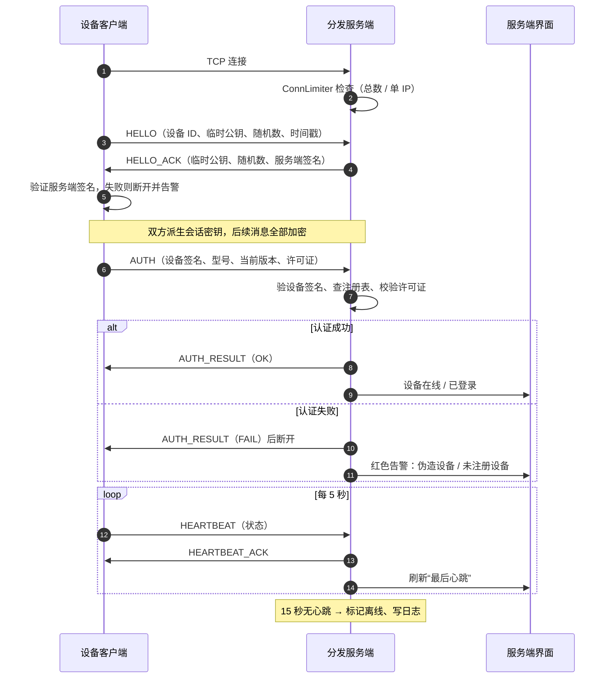

### 5.2 固件发布总流程

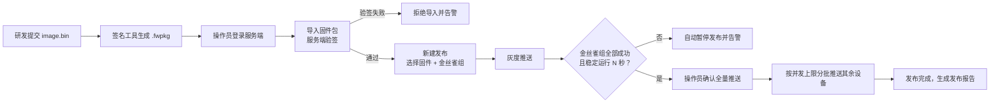

### 5.3 发布（灰度）状态机

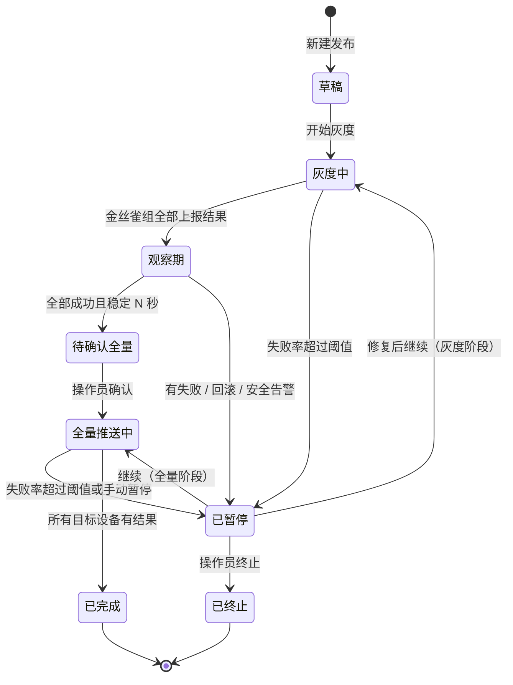

- 金丝雀组：按设备 ID 标签选定，例如 `canary` 组 2 台，也可以手动勾选设备 ID；
- 全量阶段并发上限 K（默认 5），一台完成再补一台；
- 离线设备记为“待推送”，上线后自动补推；
- 每次状态切换写审计日志，记录操作人。

### 5.4 下载、断点续传与写入

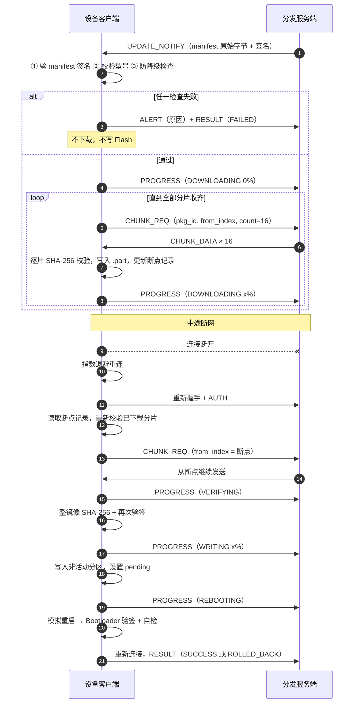

断点记录 `download/<pkg_id>.state.json`：

```json
{ "pkg_id": "…", "manifest_sha256": "…", "chunk_count": 160, "done": "位图的 base64" }
```

- 使用**位图**而不是“下一片序号”，能处理乱序和单片损坏重传；
- 每完成 16 片落盘一次断点记录（先写临时文件再重命名，防止写一半断电）；
- 恢复时若 `manifest_sha256` 与新收到的 manifest 不一致，说明固件已更换，丢弃旧进度重新下载。

### 5.5 设备升级状态机

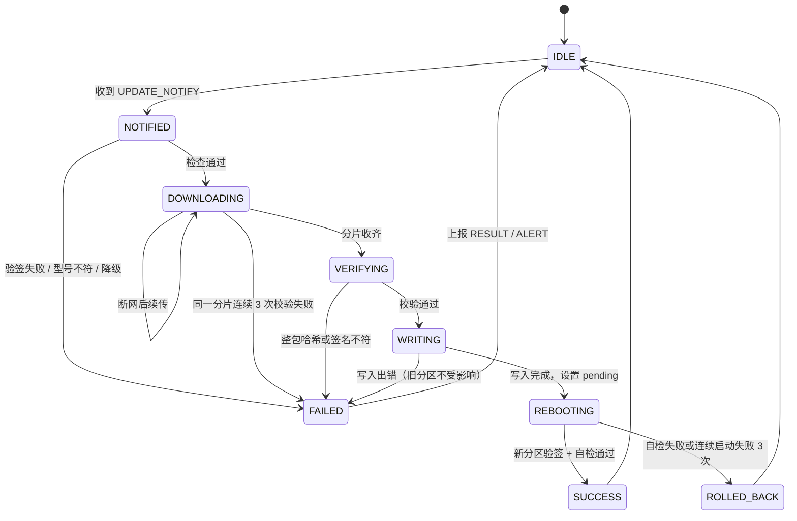

### 5.6 A/B 分区与 fallback（防变砖）

设备目录结构：

```
device_DEV-001/
├── slot_a/firmware.bin
├── slot_b/firmware.bin
├── boot.json       {"active":"a","pending":null,"boot_attempts":0,"min_security_version":5}
├── download/       断点续传临时文件
├── keys/           设备私钥（口令加密）、device.lic
└── logs/
```

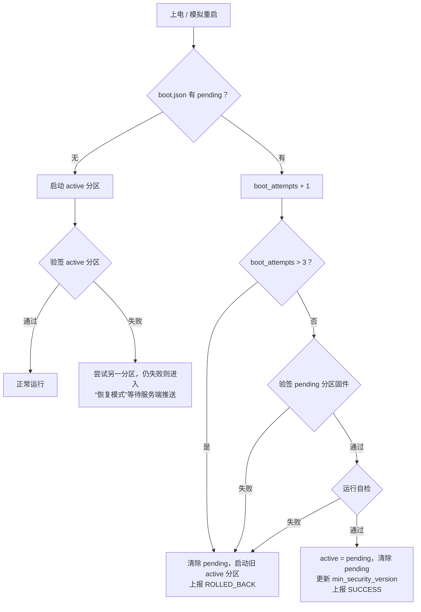

关键点：

- 新固件**只写非活动分区**，写入过程中断电，旧分区完整无损；
- `boot.json` 更新一律“写临时文件 → 刷盘 → 重命名”，保证原子性；
- 只有新固件**自检通过后**才提升 `min_security_version`，否则回滚后旧固件仍能运行；
- 演示用：签名工具可生成一个“签名合法但自检必定失败”的固件（镜像头 `selftest=fail`），专门演示自动回滚。

---

## 6. 安全设计

### 6.1 资产

| 资产 | 安全属性 |
|---|---|
| 固件签名私钥 FSK | 机密性（最高） |
| 服务端身份私钥、设备私钥 | 机密性 |
| 固件包 | 完整性、来源真实性（可选机密性） |
| 设备当前固件与启动配置 | 完整性、可用性 |
| 通信内容（状态、指令、分片） | 机密性、完整性、新鲜性 |
| 审计日志 | 完整性、不可抵赖 |
| 服务端可用性 | 可用性 |

### 6.2 威胁建模（STRIDE）

| 类别 | 威胁场景 | 防护措施 | 验证方式 |
|---|---|---|---|
| S 伪造 | 攻击者冒充服务端推送恶意固件 | 握手中服务端用身份私钥签名，客户端内置公钥校验；固件另有 FSK 签名 | 伪造服务端连接设备，设备断开并告警 |
| S 伪造 | 攻击者冒充设备接入，窃取固件或上报假状态 | 设备用私钥签名握手记录，服务端用注册公钥校验；许可证绑定硬件指纹 | 用未注册 ID / 错误私钥接入被拒 |
| T 篡改 | 传输中修改固件分片 | 会话 AES-GCM 完整性 + 分片 SHA-256 + manifest 签名 | 中间代理翻转一个比特 |
| T 篡改 | 修改固件包文件任意字节 | manifest 被 RSA-PSS 签名，manifest 含整镜像和每片哈希 | 十六进制编辑器修改后推送 |
| T 篡改 | 修改设备本地下载缓存 | 续传前重新校验已下载分片，写入前整包再验 | 手工修改 .part 文件 |
| T 篡改 | 用合法的旧固件回滚到有漏洞版本 | `security_version` 防降级 | 推送旧版本被拒 |
| R 抵赖 | 操作员否认做过发布 | 操作员登录，审计日志记录操作人，哈希链防篡改 | 修改日志后完整性校验能定位 |
| I 泄露 | 抓包获取固件或指令 | 全程 AES-256-GCM；可选固件镜像加密 | Wireshark 只能看到密文 |
| I 泄露 | 私钥被从磁盘读走 | 私钥 PKCS#8 + 口令加密存储，内存用后清零，不硬编码 | 代码审查、检查磁盘文件 |
| D 拒绝服务 | 大量连接、超大长度字段、慢速握手 | 连接数限制、帧长度上限、握手超时、认证失败锁定 | 压测脚本 |
| E 提权 | 未认证连接直接发送业务指令 | SecureChannel 状态机：认证前只接受握手消息 | 发送未认证的 CHUNK_REQ 被断开 |
| — 重放 | 重放抓到的握手或业务报文 | 每会话新临时密钥 + 随机数；帧序号严格递增，且在 AAD 中 | 重放脚本被拒绝并记录 |
| — 中间人 | 代理替换双方临时公钥 | 临时公钥包含在被双方签名的握手记录中 | MITM 代理导致握手失败 |

### 6.3 密钥体系

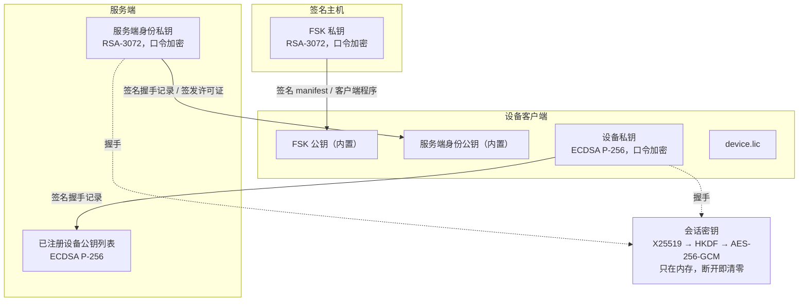

| 密钥 | 生成 | 存储 | 使用 | 生命周期 |
|---|---|---|---|---|
| FSK | 签名工具首次运行，`EVP_PKEY_keygen` | 签名主机，PKCS#8 + AES-256 口令加密 | 签 manifest、签客户端程序 | 长期；泄露时更换并发布新客户端 |
| 服务端身份密钥 | 服务端初始化 | 服务端，口令加密 | 握手签名、签发许可证 | 长期 |
| 设备密钥 | 设备初始化（模拟出厂） | 设备 `keys/`，口令加密（模拟安全芯片） | 握手签名 | 设备生命周期 |
| 会话密钥 | 每次连接 X25519 + HKDF | 仅内存 `SecureBuffer` | 帧加解密 | 单次连接 |

原则：签名密钥与服务端身份密钥**分离**；随机数一律来自 `RAND_bytes`；代码和配置文件中**不出现任何明文密钥**；口令运行时由操作员输入。

### 6.4 握手协议（双向认证 + 密钥协商）

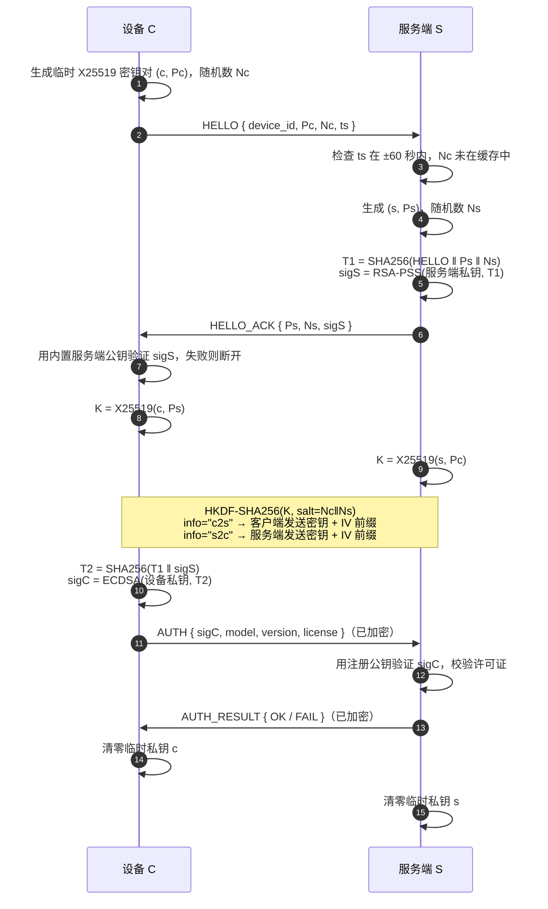

安全性说明：

- **防中间人**：临时公钥 Pc、Ps 都在被签名的握手记录 T1/T2 中，替换任一方都会导致签名校验失败；
- **前向安全**：会话密钥来自一次性临时密钥，长期私钥泄露也解不开历史流量；
- **防握手重放**：时间戳窗口 + 随机数缓存；即使重放 HELLO，攻击者没有设备私钥也无法完成 AUTH；
- **备选方案**：若改用 TLS 1.3 双向证书认证（OpenSSL `SSL_CTX`，自建 CA），应用层协议不变，见第 11 节。

### 6.5 会话加密与防重放

帧头（17 字节，明文，但作为 AAD 被认证）：

| 字段 | 长度 | 说明 |
|---|---|---|
| Magic | 2 | 固定 `0x46 0x57`（"FW"） |
| Version | 1 | 协议版本 1 |
| Type | 1 | 消息类型 |
| Flags | 1 | bit0 = 已加密 |
| Seq | 8 | 本方向帧序号，从 1 开始严格递增 |
| Length | 4 | Body 长度，上限 1 MB |

加密：

- `nonce = IV前缀(4 字节，HKDF 派生) ‖ Seq(8 字节)`，每帧唯一，不需要额外传输；
- `Body = AES-256-GCM(key, nonce, AAD = 帧头, 明文)`，末尾 16 字节为认证标签；
- 解密时必须检查 `EVP_DecryptFinal_ex` 返回值，失败即丢弃并断开。

防重放规则：接收方要求 `Seq == 上一帧 Seq + 1`，否则判定为重放或乱序注入，记录安全日志并断开连接。由于 Seq 参与 nonce 和 AAD，攻击者无法修改 Seq 而不破坏认证标签。

### 6.6 固件包格式与签名

```
xxx.fwpkg（简单容器：长度前缀 + 三段）
├── manifest.json   被签名的元数据（原始字节）
├── manifest.sig    RSA-3072-PSS-SHA256(manifest.json 原始字节)
└── image.bin       固件镜像
```

manifest 示例：

```json
{
  "format": 1,
  "pkg_id": "6f1c2b0e-...",
  "device_model": "PLC-X200",
  "version": "2.1.0",
  "security_version": 5,
  "image_size": 10485760,
  "image_sha256": "9a3f...",
  "chunk_size": 65536,
  "chunk_count": 160,
  "chunk_sha256": ["1b2c...", "..."],
  "build_time": "2026-11-05T10:00:00Z",
  "release_note": "修复温控模块越界问题"
}
```

设计要点：

- **只签 manifest，但 manifest 锁定了镜像**：镜像的整体哈希与每片哈希都在 manifest 中，修改镜像任何一个字节都会使哈希不符，而哈希本身受签名保护，攻击者无法同时改哈希；
- **对原始字节签名**：客户端先对收到的原始字节验签，通过后才解析 JSON，避免序列化差异和解析器漏洞被利用；
- **先验签再下载**：manifest 不可信就不下载，节省带宽、减少处理恶意数据的机会；
- **可选扩展（固件机密性）**：镜像用每次发布随机生成的 AES-256 密钥加密，该密钥用每台设备公钥分别包装后随 UPDATE_NOTIFY 下发；此时分片哈希针对密文计算。一期不做，作为加分项。

### 6.7 客户端验证流程

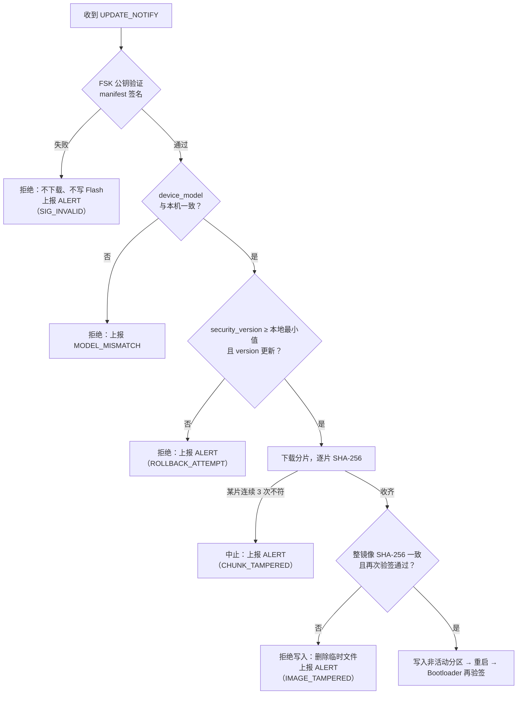

服务端收到 ALERT 后：界面红色告警、写审计日志（含设备 ID、原因、哈希值）、若处于发布中则按规则暂停发布。

### 6.8 审计日志

每条日志：`id, ts, level, category, actor, device_id, message, prev_hash, hash`

- `hash = SHA256(prev_hash ‖ ts ‖ level ‖ category ‖ actor ‖ device_id ‖ message)`，第一条的 `prev_hash` 为全 0；
- 定期（每 100 条或关闭程序时）用服务端身份私钥对最新 `hash` 签名，保存为检查点，防止攻击者整体重算哈希链；
- 界面“校验日志完整性”按钮：从头重算，定位第一条不一致的记录；
- 日志分类：`CONN`（连接/断开）、`AUTH`（认证）、`HB`（心跳超时）、`ROLLOUT`（发布操作）、`UPGRADE`（升级进度）、`SECURITY`（安全告警）。

### 6.9 拒绝服务防护

| 措施 | 参数 |
|---|---|
| 总连接数上限 | 200 |
| 单 IP 连接数上限 | 5 |
| 握手超时 | 10 秒 |
| 帧长度上限 | 1 MB，超出立即断开 |
| 认证失败锁定 | 同一设备 ID 或 IP 5 分钟内失败 5 次，锁定 10 分钟 |
| 下载并发上限 | 全量阶段同时下载设备数 K（默认 5） |
| 分片请求窗口 | 每次最多 16 片，防止一次请求拖垮服务端 |

### 6.10 软件保护（选 3 种）

| 方法 | 实现 | 作用 |
|---|---|---|
| 数字签名 | 签名工具对 `fwds-client.exe` 生成 `.sig`，客户端启动时用内置 FSK 公钥校验自身 | 程序被修改（如 patch 掉验签逻辑）后拒绝运行 |
| 许可证文件绑定 | `device.lic` = {device_id, 硬件指纹哈希, 有效期} + 服务端签名；指纹取网卡 MAC + 磁盘序列号的 SHA-256 | 客户端拷到别的机器无法运行 |
| 加壳 + 字符串加密 | Release 版 UPX 加壳；内置公钥指纹、关键提示用编译期 XOR 加密 | 增加静态分析难度 |

### 6.11 代码安全规范

- 所有长度字段先校验上限再分配或拷贝，使用 `QByteArray` / `std::vector`，不对定长数组做 `memcpy`；
- OpenSSL 只用 EVP 接口，对象用智能指针管理；
- 每个 OpenSSL 调用都检查返回值；
- 敏感数据用 `SecureBuffer`，用后清零；
- 提交前运行 cppcheck / clang-tidy，修复高危告警。

---

## 7. 数据设计

### 7.1 服务端数据库（SQLite）

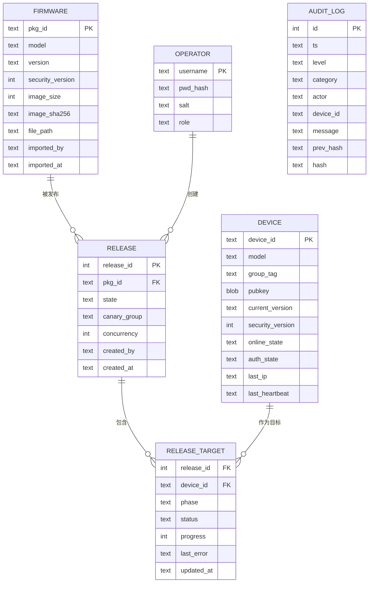

### 7.2 设备端文件

| 文件 | 内容 | 写入方式 |
|---|---|---|
| `boot.json` | active、pending、boot_attempts、min_security_version | 原子写（临时文件 + 重命名） |
| `slot_a/`、`slot_b/` | firmware.bin + manifest.json + manifest.sig | 只写非活动分区 |
| `download/<pkg_id>.part` | 下载中的镜像 | 按偏移写入 |
| `download/<pkg_id>.state.json` | 断点位图 | 原子写 |
| `keys/device_key.pem` | 设备私钥（口令加密） | 初始化时写入 |
| `keys/device.lic` | 许可证 | 服务端签发后导入 |

### 7.3 模拟固件镜像

```
| "IFW1" 4B | model 16B | version 16B | selftest 1B (0=pass, 1=fail) | payload（随机数据，可配大小） |
```

---

## 8. 界面设计

### 8.1 服务端

| 页面 | 内容 |
|---|---|
| 登录 | 操作员账号口令；解锁服务端身份私钥的口令 |
| 设备监控 | 表格：设备 ID、IP、在线/离线、登录状态、最后心跳、当前版本、分组、升级状态、进度条；离线行灰色，告警行红色 |
| 固件库 | 导入 .fwpkg，显示 manifest 内容和验签结果 |
| 灰度发布 | 新建发布、选择金丝雀组、开始灰度、确认全量、暂停/终止；显示各目标设备进度 |
| 日志与告警 | 按分类过滤；安全告警置顶红色；“校验日志完整性”按钮 |

### 8.2 客户端

| 区域 | 内容 |
|---|---|
| 设备信息 | 设备 ID、型号、连接状态、当前版本、min_security_version |
| A/B 分区 | 两个槽位的版本、哪个是 active、pending 状态 |
| 升级进度 | 当前状态 + 进度条 |
| 本地日志 | 实时滚动 |
| 演示面板 | 模拟断网 / 恢复、写入时模拟断电、开启“攻击模式”（例如本地篡改下载缓存） |

---

## 9. 异常处理设计

| 异常 | 检测 | 处理 |
|---|---|---|
| 网络断开 | socket 错误 / 心跳超时 | 客户端指数退避重连并续传；服务端标记离线 |
| 半包 / 粘包 | FrameCodec 缓冲区 | 数据不足则等待，多帧则循环解析 |
| 非法帧（Magic 错、Length 超限） | FrameCodec | 记录安全日志并断开 |
| 解密失败 / 序号异常 | SecureChannel | 记录安全日志并断开 |
| 认证失败 | HandshakeServer | 返回 FAIL，计数，达到阈值锁定 |
| 验签失败 / 降级 / 型号不符 | ManifestVerifier / AntiRollback | 不下载不写入，上报 ALERT |
| 分片哈希不符 | Updater | 重下该片，连续 3 次失败中止并告警 |
| 磁盘空间不足 / 写入失败 | DeviceStorage | 状态 FAILED，旧分区继续运行 |
| 写入过程中断电 | 下次启动检查 boot.json | pending 未设置则仍从旧分区启动 |
| 新固件启动失败 | Bootloader | 计数超限或自检失败自动回滚 |
| 服务端重启 | 数据库中发布状态 | 恢复为“已暂停”，由操作员继续 |
| 非法输入（界面） | UI 校验 | 提示错误，不提交 |

---

## 10. 部署与运行环境

| 项 | 版本 |
|---|---|
| 操作系统 | Windows 10/11（主），Linux 可编译 |
| 编译器 | MSVC 2022 或 MinGW 11+；GCC 11+ |
| Qt | 6.5 LTS 及以上（Widgets、Network、Sql 模块） |
| OpenSSL | 3.x（Windows 建议 vcpkg 安装） |
| 构建 | CMake 3.20+ |
| 测试 | GoogleTest |

演示部署：服务端、签名工具在一台机器；客户端可在同机或另一台机器多开（`--id DEV-001`、`--id DEV-002` …），每个实例使用独立的设备目录。

---

## 11. 待定事项

| 编号 | 事项 | 当前假设 |
|---|---|---|
| TBD-1 | 握手：自研（第 6.4 节）还是 TLS 1.3 双向证书认证 | 按自研设计；改 TLS 时应用层协议不变，安全层替换为 `QSslSocket` / `SSL_CTX` |
| TBD-2 | 是否实现固件镜像加密（第 6.6 节可选扩展） | 一期不做 |
| TBD-3 | 服务端网络层用 QTcpServer 还是原生 socket + select/epoll | 用 QTcpServer |
| TBD-4 | 金丝雀观察期时长 N | 默认 30 秒（演示用） |
