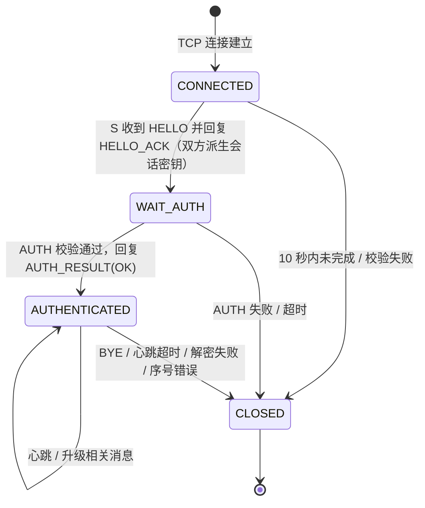
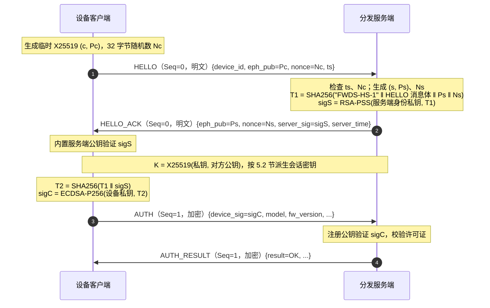
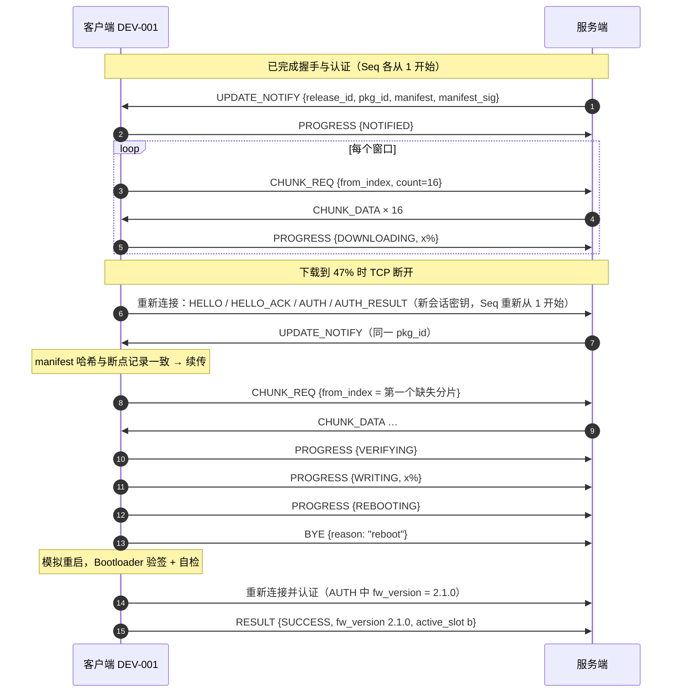
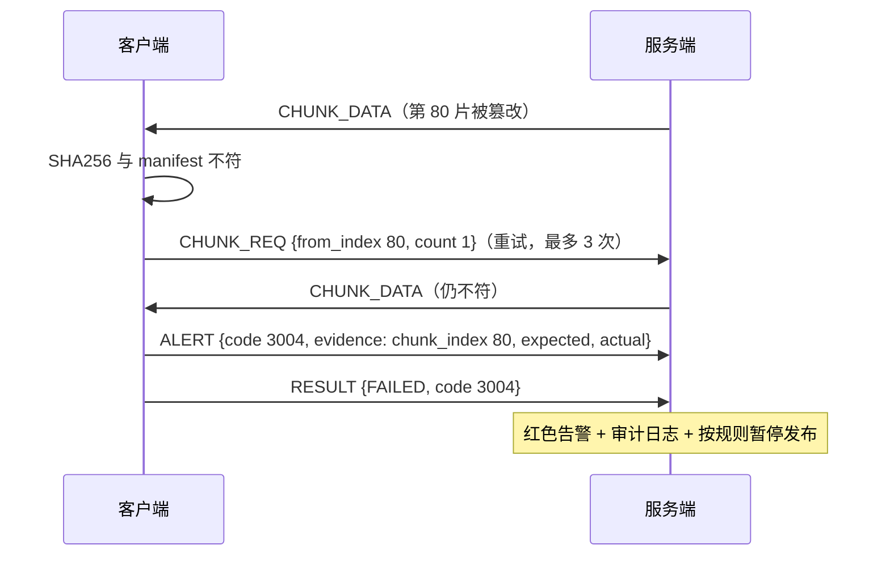

# 工业固件安全升级分发系统 —— 通信协议文档

| 项 | 内容 |
|---|---|
| 协议名称 | FWDS（Firmware Distribution Secure）应用层协议 |
| 协议版本 | 1 |
| 文档版本 | v0.1（设计阶段） |
| 传输层 | TCP，服务端默认端口 9443 |
| 依据 | 《系统设计说明书》v0.1 第 6 章 |

---

## 1. 约定

- 所有多字节整数采用**网络字节序（大端）**；
- 控制类消息体为 **UTF-8 JSON**，二进制字段在 JSON 中用 **Base64（标准字母表，带填充）** 表示；
- 分片数据消息体为**二进制**，避免 Base64 膨胀；
- 时间戳为 Unix 秒（`int64`）；
- 哈希一律为 SHA-256，JSON 中以小写十六进制字符串表示；
- “C”表示设备客户端，“S”表示分发服务端。

## 2. 帧格式

### 2.1 帧结构

每条消息封装为一帧，帧 = 17 字节帧头 + 消息体：

```
 0       2   3   4   5                      13              17
 +-------+---+---+---+-----------------------+---------------+---------------------+
 | Magic |Ver|Typ|Flg|         Seq           |    Length     |   Body (Length 字节) |
 +-------+---+---+---+-----------------------+---------------+---------------------+
   2B     1B  1B  1B           8B                   4B
```

| 字段 | 偏移 | 长度 | 说明 |
|---|---|---|---|
| Magic | 0 | 2 | 固定 `0x46 0x57`（ASCII "FW"） |
| Ver | 2 | 1 | 协议版本，当前为 `0x01` |
| Type | 3 | 1 | 消息类型，见第 3 节 |
| Flags | 4 | 1 | bit0 = 1 表示 Body 已加密；其余位保留，必须为 0 |
| Seq | 5 | 8 | 本方向帧序号，见 2.3 节 |
| Length | 13 | 4 | Body 长度（字节），加密时包含 16 字节认证标签 |
| Body | 17 | Length | 消息体 |

### 2.2 分帧与拆包规则

接收方为每个连接维护一个接收缓冲区，每次收到数据后循环执行：

1. 缓冲区不足 17 字节 → 等待更多数据；
2. 解析帧头，依次检查：
   - Magic ≠ "FW" → 错误 `1001 BAD_MAGIC`，断开；
   - Ver ≠ 1 → 错误 `1002 BAD_VERSION`，断开；
   - Flags 保留位非 0 → 错误 `1004 UNEXPECTED_MESSAGE`，断开；
   - Length > 1 048 576（1 MB）→ 错误 `1003 FRAME_TOO_LARGE`，**在分配内存之前**断开；
3. 缓冲区不足 17 + Length 字节 → 等待更多数据；
4. 取出完整一帧交给安全层，从缓冲区移除，回到第 1 步（处理粘包）。

### 2.3 序号（Seq）

- 握手明文阶段（HELLO、HELLO_ACK）Seq 固定为 0；
- 进入加密阶段后，**每个方向独立计数**，第一帧 Seq = 1，之后每帧加 1；
- 接收方要求 `Seq == 本方向上一帧 Seq + 1`，否则判定为重放或注入，记录安全日志，错误 `1007 SEQ_ERROR`，断开；
- Seq 达到 2^63 时必须断开重连（实际不会发生）。

## 3. 消息类型

| Type | 名称 | 方向 | 加密 | 消息体 | 说明 |
|---|---|---|---|---|---|
| `0x01` | HELLO | C→S | 否 | JSON | 握手第 1 步 |
| `0x02` | HELLO_ACK | S→C | 否 | JSON | 握手第 2 步 |
| `0x03` | AUTH | C→S | 是 | JSON | 设备身份认证 |
| `0x04` | AUTH_RESULT | S→C | 是 | JSON | 认证结果 |
| `0x10` | HEARTBEAT | C→S | 是 | JSON | 心跳，附带当前状态 |
| `0x11` | HEARTBEAT_ACK | S→C | 是 | JSON | 心跳应答 |
| `0x20` | UPDATE_NOTIFY | S→C | 是 | JSON | 升级通知，携带 manifest 与签名 |
| `0x22` | CHUNK_REQ | C→S | 是 | JSON | 请求分片 |
| `0x23` | CHUNK_DATA | S→C | 是 | 二进制 | 分片数据 |
| `0x30` | PROGRESS | C→S | 是 | JSON | 升级状态与进度 |
| `0x31` | RESULT | C→S | 是 | JSON | 升级最终结果 |
| `0x32` | ALERT | C→S | 是 | JSON | 安全告警 |
| `0x7E` | BYE | 双向 | 是 | JSON | 正常关闭 |
| `0x7F` | ERROR | 双向 | 视阶段 | JSON | 错误通知 |

握手完成前收到加密类消息、或认证完成前收到业务消息，一律返回 `1004 UNEXPECTED_MESSAGE` 并断开。

## 4. 连接状态机



| 状态 | 允许接收的消息（服务端视角） | 允许接收的消息（客户端视角） |
|---|---|---|
| CONNECTED | HELLO | HELLO_ACK |
| WAIT_AUTH | AUTH | AUTH_RESULT |
| AUTHENTICATED | HEARTBEAT、CHUNK_REQ、PROGRESS、RESULT、ALERT、BYE、ERROR | HEARTBEAT_ACK、UPDATE_NOTIFY、CHUNK_DATA、BYE、ERROR |

## 5. 握手与密钥派生

### 5.1 流程



- `HELLO 消息体` 指 HELLO 帧 Body 的**原始字节**，双方必须使用收到/发出的原始字节计算 T1，不重新序列化；
- 服务端检查 `|ts − 服务端时间| ≤ 60 秒`，并在 120 秒内缓存已见过的 Nc，重复则拒绝（`2003 NONCE_REUSED`）；
- 握手完成后双方立即用 `OPENSSL_cleanse` 清除临时私钥 c、s 和共享密钥 K。

### 5.2 密钥派生（HKDF-SHA256）

```
PRK         = HKDF-Extract(salt = Nc ‖ Ns, IKM = K)
key_c2s     = HKDF-Expand(PRK, "fwds v1 c2s key", 32)
iv_c2s      = HKDF-Expand(PRK, "fwds v1 c2s iv",  4)
key_s2c     = HKDF-Expand(PRK, "fwds v1 s2c key", 32)
iv_s2c      = HKDF-Expand(PRK, "fwds v1 s2c iv",  4)
```

客户端用 `key_c2s / iv_c2s` 加密发送、用 `key_s2c / iv_s2c` 解密接收；服务端相反。两个方向使用不同密钥，避免反射攻击。

### 5.3 帧加密（AES-256-GCM）

```
nonce (12B) = iv_方向 (4B) ‖ Seq (8B, 大端)
AAD         = 帧头 17 字节（Flags.bit0 = 1，Length = 密文长度 + 16）
Body        = 密文 ‖ tag (16B)
```

- 发送方先确定 Seq 与 Length，构造帧头，再以帧头为 AAD 加密；
- 接收方用帧头中的 Seq 构造 nonce，以收到的帧头为 AAD 解密；`EVP_DecryptFinal_ex` 返回失败 → `1006 DECRYPT_FAILED`，断开；
- 由于每个方向的 Seq 严格递增且不复用，nonce 在一个密钥下永不重复。

## 6. 消息体定义

### 6.1 HELLO（0x01）

```json
{
  "proto": 1,
  "device_id": "DEV-001",
  "eph_pub": "<Base64, 32 字节 X25519 公钥>",
  "nonce": "<Base64, 32 字节随机数>",
  "ts": 1793952000
}
```

| 字段 | 类型 | 必填 | 说明 |
|---|---|---|---|
| proto | int | 是 | 协议版本，等于 1 |
| device_id | string | 是 | 设备 ID，`^[A-Z0-9-]{3,32}$` |
| eph_pub | string | 是 | 临时公钥 |
| nonce | string | 是 | 客户端随机数 Nc |
| ts | int64 | 是 | 客户端当前时间 |

### 6.2 HELLO_ACK（0x02）

```json
{
  "eph_pub": "<Base64, 32 字节>",
  "nonce": "<Base64, 32 字节>",
  "server_sig": "<Base64, 384 字节 RSA-3072-PSS 签名>",
  "server_time": 1793952001
}
```

### 6.3 AUTH（0x03）

```json
{
  "device_sig": "<Base64, DER 编码 ECDSA 签名>",
  "model": "PLC-X200",
  "fw_version": "2.0.0",
  "security_version": 4,
  "active_slot": "a",
  "license": "<Base64, device.lic 文件内容>"
}
```

### 6.4 AUTH_RESULT（0x04）

```json
{ "result": "OK", "code": 0, "session_id": "5c1d…", "heartbeat_interval": 5 }
```

失败时 `result` 为 `"FAIL"`，`code` 为第 7 节认证类错误码，服务端发送后关闭连接。为防止信息泄露，“未注册”和“签名错误”对客户端统一返回 `2005`，详细原因只写服务端日志。

### 6.5 HEARTBEAT（0x10） / HEARTBEAT_ACK（0x11）

```json
{ "state": "DOWNLOADING", "progress": 47, "uptime": 3600 }
```

```json
{ "server_time": 1793955600 }
```

客户端每 5 秒发送一次；服务端 15 秒未收到判定离线；客户端 15 秒未收到 ACK 主动断开重连。

### 6.6 UPDATE_NOTIFY（0x20）

```json
{
  "release_id": 12,
  "pkg_id": "6f1c2b0e-8d7a-4a51-9b3e-2c4f6d8e0a11",
  "manifest": "<Base64, manifest.json 原始字节>",
  "manifest_sig": "<Base64, 384 字节>"
}
```

客户端收到后先 Base64 解码得到 manifest 原始字节，**先验签、再解析 JSON**，然后按《系统设计说明书》6.7 节检查型号和防降级。通过则回复 PROGRESS（NOTIFIED），否则回复 ALERT + RESULT（FAILED）。

manifest 字段见第 9.1 节。

### 6.7 CHUNK_REQ（0x22）

```json
{ "pkg_id": "6f1c2b0e-…", "from_index": 75, "count": 16 }
```

| 字段 | 说明 |
|---|---|
| from_index | 起始分片序号，从 0 开始；断点续传时为第一个缺失分片 |
| count | 请求连续分片数，1 ≤ count ≤ 16 |

服务端校验：`pkg_id` 必须是当前下发给该设备的包（否则 `3009 PKG_NOT_FOUND`），`from_index + count ≤ chunk_count`（否则 `3010 CHUNK_OUT_OF_RANGE`）。

流控：客户端收齐本窗口（或超时 10 秒）后再发下一个 CHUNK_REQ，服务端不主动推送，天然限速。

### 6.8 CHUNK_DATA（0x23，二进制）

| 字段 | 长度 | 说明 |
|---|---|---|
| pkg_id | 16 | UUID 的 16 字节二进制形式 |
| chunk_index | 4 | 分片序号 |
| data_len | 4 | 数据长度，除最后一片外等于 chunk_size（65 536） |
| data | data_len | 分片数据 |

客户端校验：`17 + 24 + data_len + 16 == 帧总长`，`data_len ≤ chunk_size`，`SHA256(data) == manifest.chunk_sha256[chunk_index]`。哈希不符则重新请求该片，同一片连续 3 次不符发送 ALERT（`3004 CHUNK_TAMPERED`）并中止。

### 6.9 PROGRESS（0x30）

```json
{ "pkg_id": "6f1c2b0e-…", "state": "DOWNLOADING", "progress": 47, "detail": "75/160" }
```

`state` 取值见 7.1 节。发送时机：状态变化时立即发送；DOWNLOADING、WRITING 阶段每变化 5% 发送一次。

### 6.10 RESULT（0x31）

```json
{
  "release_id": 12,
  "pkg_id": "6f1c2b0e-…",
  "result": "SUCCESS",
  "code": 0,
  "fw_version": "2.1.0",
  "security_version": 5,
  "active_slot": "b"
}
```

`result` 取值：`SUCCESS`、`FAILED`、`ROLLED_BACK`。设备重启后重新连接，在认证成功后立即补发上一轮升级的 RESULT。

### 6.11 ALERT（0x32）

```json
{
  "pkg_id": "6f1c2b0e-…",
  "code": 3005,
  "detail": "image sha256 mismatch",
  "evidence": {
    "expected_sha256": "9a3f…",
    "actual_sha256": "1c7e…",
    "chunk_index": null
  }
}
```

服务端收到 ALERT：界面红色告警，写 `SECURITY` 类审计日志（含 evidence），如果该设备属于进行中的发布则按规则暂停发布。

### 6.12 BYE（0x7E） / ERROR（0x7F）

```json
{ "reason": "user_shutdown" }
```

```json
{ "code": 1007, "message": "sequence error" }
```

ERROR 在握手完成前以明文发送（Seq = 0），之后加密发送。发送 ERROR 后，致命类错误（1xxx、2xxx）随即关闭连接。

## 7. 状态码与错误码

### 7.1 设备升级状态（state）

| 值 | 含义 |
|---|---|
| `IDLE` | 空闲 |
| `NOTIFIED` | 已收到升级通知且检查通过 |
| `DOWNLOADING` | 下载中 |
| `VERIFYING` | 整包校验中 |
| `WRITING` | 写入非活动分区 |
| `REBOOTING` | 重启中 |
| `SUCCESS` | 升级成功 |
| `FAILED` | 升级失败（原分区未受影响） |
| `ROLLED_BACK` | 新固件启动失败，已回滚 |

### 7.2 错误码

| 码 | 名称 | 类别 | 处理 |
|---|---|---|---|
| 0 | OK | — | — |
| 1001 | BAD_MAGIC | 协议 | 断开 |
| 1002 | BAD_VERSION | 协议 | 断开 |
| 1003 | FRAME_TOO_LARGE | 协议 | 断开，记安全日志 |
| 1004 | UNEXPECTED_MESSAGE | 协议 | 断开，记安全日志 |
| 1005 | BAD_JSON | 协议 | 返回 ERROR，不断开（认证后） |
| 1006 | DECRYPT_FAILED | 协议/安全 | 断开，记安全日志 |
| 1007 | SEQ_ERROR | 协议/安全 | 断开，记安全日志（疑似重放） |
| 2001 | HANDSHAKE_TIMEOUT | 认证 | 断开 |
| 2002 | TS_OUT_OF_WINDOW | 认证 | 断开 |
| 2003 | NONCE_REUSED | 认证/安全 | 断开，记安全日志（疑似重放） |
| 2004 | SERVER_SIG_INVALID | 认证/安全 | 客户端断开并本地告警（疑似中间人或伪造服务端） |
| 2005 | DEVICE_AUTH_FAILED | 认证/安全 | 断开，服务端日志区分：签名错误 / 未注册 |
| 2006 | LICENSE_INVALID | 认证 | 断开 |
| 2007 | DEVICE_LOCKED | 认证 | 断开（认证失败次数超限） |
| 2008 | TOO_MANY_CONNECTIONS | 认证 | 断开 |
| 3001 | SIG_INVALID | 升级/安全 | 不下载，ALERT |
| 3002 | MODEL_MISMATCH | 升级 | 不下载，RESULT FAILED |
| 3003 | ROLLBACK_ATTEMPT | 升级/安全 | 不下载，ALERT |
| 3004 | CHUNK_TAMPERED | 升级/安全 | 中止，ALERT |
| 3005 | IMAGE_TAMPERED | 升级/安全 | 不写入，ALERT |
| 3006 | WRITE_FAILED | 升级 | RESULT FAILED |
| 3007 | SELFTEST_FAILED | 升级 | 回滚，RESULT ROLLED_BACK |
| 3008 | BOOT_FAILED | 升级 | 回滚，RESULT ROLLED_BACK |
| 3009 | PKG_NOT_FOUND | 升级 | 返回 ERROR |
| 3010 | CHUNK_OUT_OF_RANGE | 升级 | 返回 ERROR |
| 3011 | DISK_FULL | 升级 | RESULT FAILED |

## 8. 典型交互时序

### 8.1 一次完整升级（含断点续传）



### 8.2 发现篡改



## 9. 文件格式

### 9.1 manifest.json 字段

| 字段 | 类型 | 说明 |
|---|---|---|
| format | int | manifest 格式版本，当前为 1 |
| pkg_id | string | UUID |
| device_model | string | 适用型号 |
| version | string | 语义化版本号 `主.次.修订` |
| security_version | int | 安全版本号，单调递增 |
| image_size | int64 | 镜像字节数 |
| image_sha256 | string | 整镜像 SHA-256 |
| chunk_size | int | 分片大小，固定 65 536 |
| chunk_count | int | 分片数 = ⌈image_size / chunk_size⌉ |
| chunk_sha256 | string[] | 每片 SHA-256，长度等于 chunk_count |
| build_time | string | ISO 8601 时间 |
| release_note | string | 发布说明 |

### 9.2 .fwpkg 容器

| 字段 | 长度 | 说明 |
|---|---|---|
| magic | 4 | ASCII "FWPK" |
| format | 2 | 容器格式版本 1 |
| manifest_len | 4 | manifest.json 字节数（≤ 1 MB） |
| manifest | manifest_len | manifest.json 原始字节 |
| sig_len | 2 | 签名字节数（RSA-3072 为 384） |
| sig | sig_len | RSA-PSS-SHA256(manifest) |
| image_len | 8 | 镜像字节数，必须等于 manifest.image_size |
| image | image_len | 固件镜像 |

解析时每个长度字段都先检查上限和剩余文件长度，任何不一致直接拒绝。

### 9.3 device.lic

```json
{
  "body": "<Base64, 下面 JSON 的原始字节>",
  "sig": "<Base64, 服务端身份私钥 RSA-PSS 签名>"
}
```

body 内容：

```json
{ "device_id": "DEV-001", "hw_fingerprint": "<SHA-256 十六进制>", "issued_at": 1793952000, "expires_at": 1825488000 }
```

## 10. 定时器与参数

| 参数 | 值 | 说明 |
|---|---|---|
| 握手超时 | 10 秒 | 连接建立到 AUTH_RESULT |
| 时间戳窗口 | ±60 秒 | HELLO.ts |
| 随机数缓存 | 120 秒 | 防握手重放 |
| 心跳间隔 | 5 秒 | 客户端发送 |
| 离线判定 | 15 秒 | 服务端未收到心跳 |
| 分片大小 | 64 KB | |
| 请求窗口 | 16 片 | 单次 CHUNK_REQ 最大 count |
| 窗口超时 | 10 秒 | 未收齐则重发 CHUNK_REQ |
| 单片重试 | 3 次 | 超过则告警中止 |
| 重连退避 | 1、2、4、8、16、30 秒 | 30 秒封顶 |
| 帧长上限 | 1 MB | |
| 连接上限 | 总 200 / 单 IP 5 | |
| 认证失败锁定 | 5 分钟内 5 次 → 锁 10 分钟 | 按设备 ID 和 IP 分别计数 |

## 11. 业务场景覆盖检查

| 业务场景 | 使用的消息 |
|---|---|
| 设备上线、登录 | HELLO、HELLO_ACK、AUTH、AUTH_RESULT |
| 在线监控、心跳 | HEARTBEAT、HEARTBEAT_ACK |
| 推送升级 | UPDATE_NOTIFY |
| 分片下载、断点续传 | CHUNK_REQ、CHUNK_DATA |
| 实时状态上报 | PROGRESS |
| 升级结果、回滚结果 | RESULT |
| 安全事件上报 | ALERT |
| 正常下线、重启 | BYE |
| 异常处理 | ERROR |
| 灰度发布 | 服务端内部逻辑，对设备表现为是否收到 UPDATE_NOTIFY |

## 12. 安全性分析

| 攻击 | 协议层面的防护 |
|---|---|
| 窃听 | 握手后全部 AES-256-GCM 加密；握手明文中只有临时公钥、随机数和签名，不含敏感信息 |
| 篡改 | GCM 认证覆盖帧头与消息体；固件另有 manifest 签名与分片哈希 |
| 重放 | 会话内 Seq 严格递增；跨会话因临时密钥与随机数不同而失效；握手有时间戳窗口与随机数缓存 |
| 中间人 | 临时公钥被双方长期私钥签名覆盖 |
| 伪造身份 | 服务端：RSA-PSS 签名；设备：ECDSA 签名 + 注册公钥 + 许可证 |
| 反射 | 两个方向使用不同密钥 |
| 拒绝服务 | 帧长上限先于内存分配检查、握手超时、连接数限制、认证失败锁定、拉取式流控 |
| 信息泄露 | 认证失败对外统一错误码 |

## 13. 版本兼容

- 帧头 Ver 字段用于协议升级，接收方只接受自己支持的版本；
- JSON 消息体中出现未知字段时忽略，缺少必填字段返回 `1005 BAD_JSON`；
- 新增消息类型使用未占用的 Type 值，旧版本收到未知 Type 返回 `1004`。
