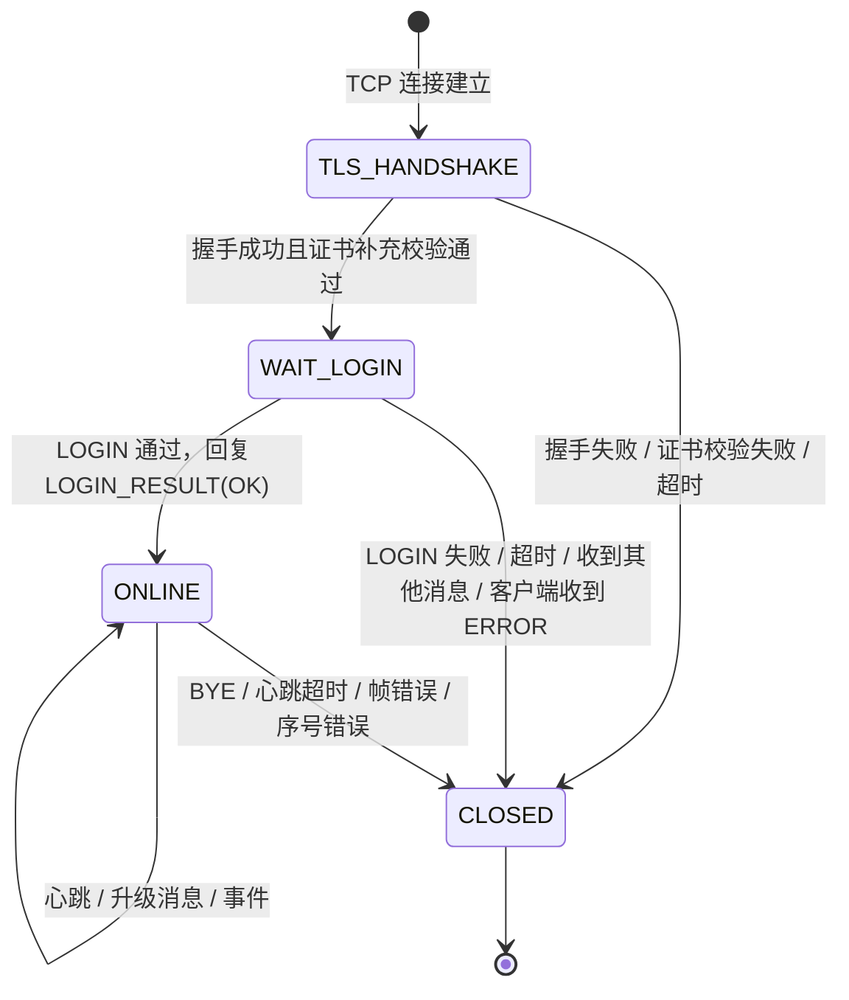
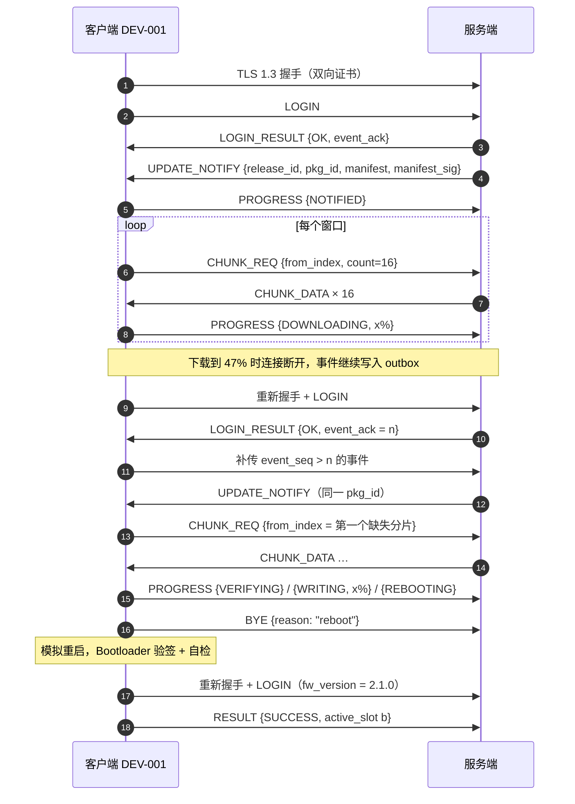

# 工业固件安全升级分发系统 —— 通信协议设计文档

| 项 | 内容 |
|---|---|
| 协议名称 | FWDS（Firmware Distribution Secure）应用层协议 |
| 协议版本 | 2 |
| 文档版本 | v0.2（按《项目落地要求任务书》调整：安全信道改为 TLS 1.3 双向证书认证） |
| 传输 | TCP → TLS 1.3 → FWDS 帧；服务端默认端口 9443（可配置） |
| 配套 | [设计文档](系统设计说明书.md)第 10 章说明安全设计的理由，本文只定义线上格式和规则 |

## 1. 协议栈与约定

```
+--------------------------------------------+
| FWDS 应用层：帧头 16 字节 + 消息体          |
+--------------------------------------------+
| TLS 1.3：双向证书认证，TLS_AES_256_GCM_SHA384 |
+--------------------------------------------+
| TCP                                        |
+--------------------------------------------+
```

- 多字节整数用网络字节序（大端）；
- 控制类消息体为 UTF-8 JSON，二进制字段用标准 Base64；分片数据消息体为二进制；
- 时间戳为 Unix 毫秒（`int64`，UTC）；哈希为 SHA-256，JSON 中用小写十六进制；
- “C”为设备客户端，“S”为分发服务端；
- JSON 中的未知字段忽略，缺少必填字段返回 `1005 BAD_JSON`。

## 2. 安全信道（TLS 1.3）

所有 FWDS 帧都在 TLS 内传输，网络上没有任何明文业务数据。

| 项 | 规定 |
|---|---|
| 协议版本 | 仅 TLS 1.3，低版本握手直接失败 |
| 套件 | 仅 `TLS_AES_256_GCM_SHA384`（带认证加密，16 字节标签） |
| 密钥交换 | X25519 临时密钥（前向安全） |
| 证书 | 双方必须出示由自建 CA 签发的证书（ECDSA P-256）；只信任自建 CA 根证书 |
| 0-RTT、会话复用 | 禁用，每次连接完整握手 |
| 服务端证书名称 | 等于客户端配置的服务端主机名或 IP（证书的“使用者可选名称”）；扩展用途 `serverAuth` |
| 设备证书名称 | 等于设备 ID（证书持有者 CN）；扩展用途 `clientAuth` |
| 证书有效期 | 总时长不超过配置的上限（默认根证书 365 天、其余 90 天） |

握手完成后、处理任何 FWDS 帧之前，双方各做一次补充校验：复查协商结果为 TLS 1.3 和上表的套件；用只含自建 CA 与 CRL 的信任库重新校验对端证书的链、有效期、用途和名称；对端证书序列号不在 CRL 中；有效期总时长不超过上限；服务端另查证书指纹与设备注册表一致。任一项失败即关闭连接并记安全日志，不发送任何 FWDS 帧。

CRL 必须由自建 CA 签名且未过期，并带有递增的序号；序号小于当前使用值的 CRL 不被接受。没有可用 CRL 时拒绝所有连接。

没有不加密的工作模式：程序中不存在明文信道，缺少证书、私钥或口令时不启动网络。

## 3. 帧格式

### 3.1 结构

```
 0       2   3   4                      12              16
 +-------+---+---+-----------------------+---------------+---------------------+
 | Magic |Ver|Typ|         Seq           |    Length     |  Body（Length 字节） |
 +-------+---+---+-----------------------+---------------+---------------------+
   2B     1B  1B           8B                   4B
```

| 字段 | 偏移 | 长度 | 说明 |
|---|---|---|---|
| Magic | 0 | 2 | 固定 `0x46 0x57`（ASCII "FW"） |
| Ver | 2 | 1 | 协议版本，当前 `0x02` |
| Type | 3 | 1 | 消息类型，见第 4 节 |
| Seq | 4 | 8 | 本方向帧序号 |
| Length | 12 | 4 | Body 字节数，上限 1 048 576 |
| Body | 16 | Length | 消息体 |

### 3.2 拆包规则

接收方对 TLS 解密后的字节流循环执行：

1. 不足 16 字节 → 等待；
2. 检查帧头：Magic 错 → `1001`；Ver 不是 2 → `1002`；Length 超过 1 MB → `1003`（**在分配内存之前**）；任一错误即断开；
3. 不足 16 + Length 字节 → 等待；
4. 取出一帧交给上层，回到第 1 步（处理粘包）。

### 3.3 序号

- 每个方向独立计数，连接建立后第一帧 Seq = 1，之后每帧加 1；
- 接收方要求 `Seq == 上一帧 Seq + 1`，否则返回 `1007 SEQ_ERROR`，断开并记“疑似重放”；
- 重连后序号重新从 1 开始。

TLS 记录层已能发现重放和乱序，帧序号是应用层的第二道检查，同时用于日志定位。

## 4. 消息类型与连接状态

| Type | 名称 | 方向 | 消息体 | 说明 |
|---|---|---|---|---|
| `0x01` | LOGIN | C→S | JSON | 设备登录 |
| `0x02` | LOGIN_RESULT | S→C | JSON | 登录结果 |
| `0x10` | HEARTBEAT | C→S | JSON | 心跳，附带当前状态 |
| `0x11` | HEARTBEAT_ACK | S→C | JSON | 心跳应答，附带事件确认序号 |
| `0x20` | UPDATE_NOTIFY | S→C | JSON | 升级通知，携带 manifest 与签名 |
| `0x21` | UPDATE_CANCEL | S→C | JSON | 取消升级（终止发布、紧急停止） |
| `0x22` | CHUNK_REQ | C→S | JSON | 请求分片 |
| `0x23` | CHUNK_DATA | S→C | 二进制 | 分片数据 |
| `0x30` | PROGRESS | C→S | JSON | 事件：升级状态与进度 |
| `0x31` | RESULT | C→S | JSON | 事件：升级最终结果 |
| `0x32` | ALERT | C→S | JSON | 事件：安全告警 |
| `0x7E` | BYE | 双向 | JSON | 正常关闭 |
| `0x7F` | ERROR | 双向 | JSON | 错误通知 |



| 状态 | 服务端可接收 | 客户端可接收 |
|---|---|---|
| WAIT_LOGIN | LOGIN | LOGIN_RESULT、ERROR |
| ONLINE | HEARTBEAT、CHUNK_REQ、PROGRESS、RESULT、ALERT、BYE、ERROR | HEARTBEAT_ACK、UPDATE_NOTIFY、UPDATE_CANCEL、CHUNK_DATA、BYE、ERROR |

收到当前状态不允许的消息，返回 `1004 UNEXPECTED_MESSAGE` 并断开。从 TCP 连接建立到 LOGIN_RESULT 限时 10 秒。

客户端在 WAIT_LOGIN 状态收到 ERROR（例如服务端登录限时到期发出的 `2001`，或帧级错误 1xxx）时，不回复任何消息，直接关闭连接并按退避序列重连。

## 5. 消息体定义

### 5.1 LOGIN（0x01）

```json
{
  "device_id": "DEV-001",
  "model": "PLC-X200",
  "fw_version": "2.0.0",
  "security_version": 4,
  "active_slot": "a",
  "license": "<Base64, device.lic 内容>",
  "ts": 1793952000000,
  "event_base": 41
}
```

`event_base` 是设备已收到确认、已从 outbox 删除的最大事件序号（新设备为 0），服务端用它对账，见 5.7 节；缺省或格式不对按 0 处理。

`fw_version`、`security_version`、`active_slot` 取自设备本次启动的结果（Bootloader 选定的分区和其中已验签的 manifest）。设备处于恢复模式（没有可启动的固件）时 `fw_version` 为空串、`security_version` 为 0。

服务端依次检查：`ts` 与服务端时间相差不超过 60 秒（`2002`）；`device_id` 等于对端证书名称（`2003`）；设备已注册、未停用、证书指纹一致（`2005`）；许可证签名和设备 ID 有效（`2006`）；未被锁定（`2007`）。

`2003`、`2005`、`2006` 每发生一次，服务端分别给“对端证书中的设备 ID”和“对端 IP”各记一次失败；任一个在 5 分钟内累计 5 次即锁定 10 分钟，锁定期内的登录一律返回 `2007`。计数用证书中的设备 ID 而不是 LOGIN 中自报的 `device_id`，冒用他人设备 ID 的失败不会记到被冒用的设备上。

### 5.2 LOGIN_RESULT（0x02）

```json
{ "result": "OK", "code": 0, "session_id": "5c1d…", "heartbeat_interval": 5, "server_time": 1793952000120, "event_ack": 41 }
```

失败时 `result` 为 `"FAIL"`，`code` 为 2xxx 错误码，服务端发送后关闭连接。“未注册”“已停用”“指纹不符”对客户端统一返回 `2005`，详细原因只写服务端日志。`event_ack` 见 5.7 节。

### 5.3 HEARTBEAT（0x10）/ HEARTBEAT_ACK（0x11）

```json
{ "state": "DOWNLOADING", "progress": 47, "uptime": 3600 }
```

```json
{ "server_time": 1793955600000, "event_ack": 57 }
```

客户端每 5 秒发送一次；服务端 15 秒未收到判定离线；客户端 15 秒未收到应答则主动断开重连。客户端用 `server_time` 检查时钟偏差，超过 30 秒本地告警。

### 5.4 UPDATE_NOTIFY（0x20）/ UPDATE_CANCEL（0x21）

```json
{
  "device_id": "DEV-001",
  "release_id": 12,
  "pkg_id": "6f1c2b0e-8d7a-4a51-9b3e-2c4f6d8e0a11",
  "manifest": "<Base64, manifest.json 原始字节>",
  "manifest_sig": "<Base64, 384 字节>"
}
```

客户端先确认 `device_id` 是自己（不是则忽略并记安全日志），再对 manifest 原始字节**先验签、后解析**，然后检查型号和防降级。通过则发 PROGRESS（NOTIFIED），否则发 ALERT 和 RESULT（FAILED）。验签失败为 `3001`；签名正确但 manifest 内容不合规（格式版本不支持、字段缺失或互相矛盾，或通知里的 `pkg_id` 与 manifest 里的不一致）为 `3014`；型号不符为 `3002`；降级为 `3003`。

服务端只向在线设备发送 UPDATE_NOTIFY，离线设备不缓存、不补发。已收到通知的设备断线重连并登录后，服务端把同一个包的 UPDATE_NOTIFY 再发一次（时机见下一段），设备以这条通知为准：同一个包且 manifest 未变则从断点续传，否则丢弃旧进度按新通知处理。

设备在同一条连接上正在升级时收到通知：同一个包的重复通知忽略；另一个包回复 ERROR `3013 BUSY`。VERIFYING、WRITING、REBOOTING 期间同样处理。

服务端对已下发、还没收到结果的设备，在它重新登录后的**第一个 HEARTBEAT** 到达时重发同一个包的 UPDATE_NOTIFY，设备据此续传。不在 LOGIN_RESULT 之后立刻发：设备登录后先补传 outbox 里的事件，再按周期发心跳，同一条连接上按序到达，所以心跳到时补传的 RESULT 已经处理、下发记录已经删除，升级完重启回来或已经回滚的设备不会再收到这个包的通知；续传因此最多晚一个心跳间隔开始。

设备重新登录后收到的重发通知，有两种情况直接忽略、只记本地日志：`pkg_id` 就是当前正在运行的固件（升级已经成功）；`pkg_id` 是本次运行中刚因启动失败被回滚的包（否则会反复写入、重启、回滚）。升级结果由 RESULT 事件告知服务端。

```json
{ "device_id": "DEV-001", "release_id": 12, "pkg_id": "6f1c2b0e-…", "reason": "emergency_stop" }
```

`reason` 取 `emergency_stop`（推送阶段的紧急停止）或 `release_aborted`（终止草稿或已暂停的发布），只用于记日志，设备对两者的处理相同。

设备在 NOTIFIED、DOWNLOADING、VERIFYING 状态收到 UPDATE_CANCEL：停止升级，删除临时文件，发 RESULT（FAILED，`3012 CANCELLED`）。已进入 WRITING 之后收到：忽略，按正常流程完成或回滚。

### 5.5 CHUNK_REQ（0x22）

```json
{ "pkg_id": "6f1c2b0e-…", "from_index": 75, "count": 16 }
```

`from_index` 从 0 开始，为第一个缺失分片；`count` 为从它开始连续缺失的片数，`1 ≤ count ≤ 16`。服务端依次校验：消息格式（`1005`）；`pkg_id` 必须是当前下发给该设备的包，设备身份取自已登录的会话而不是请求内容（`3009`）；`count` 在 1 ~ 16 之内且 `from_index + count ≤ chunk_count`（`3010`）。客户端收齐本窗口或等待 10 秒后才发下一个请求，服务端不主动推送。

流控：服务端为每条连接最多缓存两个窗口的待发分片。上一批还没发完又收到 CHUNK_REQ 时，这个请求直接丢弃、不回复（只记日志）；正常客户端收齐一个窗口才发下一个请求，不会遇到。

客户端收到 `3009` 或 `3010` 后停止请求，本次升级记为失败（断点保留）。

### 5.6 CHUNK_DATA（0x23，二进制）

| 字段 | 长度 | 说明 |
|---|---|---|
| pkg_id | 16 | UUID 的二进制形式 |
| chunk_index | 4 | 分片序号 |
| data_len | 4 | 数据长度，除最后一片外等于 65 536 |
| data | data_len | 分片数据 |

客户端校验：`24 + data_len == Length` 且 `data_len ≤ 65 536`（先核对长度再取数据）；`pkg_id` 是当前下载的包、`chunk_index` 在当前请求的窗口之内；`SHA256(data)` 等于 manifest 中该片的哈希。格式不对、不属于当前窗口的 CHUNK_DATA 直接丢弃。哈希不符的分片不写盘，下一个 CHUNK_REQ 从它开始重新请求；同一片连续 3 次不符发 ALERT（`3004`）并中止，删除临时文件。

### 5.7 事件：PROGRESS（0x30）、RESULT（0x31）、ALERT（0x32）

三种事件共用以下字段：

| 字段 | 说明 |
|---|---|
| event_seq | 设备内单调递增的事件序号，持久化保存 |
| ts | 事件产生时间 |
| pkg_id | 相关固件包 |

```json
{ "event_seq": 58, "ts": 1793955601000, "pkg_id": "6f1c2b0e-…", "state": "DOWNLOADING", "progress": 47 }
```

```json
{ "event_seq": 71, "ts": 1793955800000, "pkg_id": "6f1c2b0e-…", "release_id": 12,
  "result": "SUCCESS", "code": 0, "detail": "", "fw_version": "2.1.0", "security_version": 5, "active_slot": "b" }
```

```json
{ "event_seq": 72, "ts": 1793955900000, "pkg_id": "6f1c2b0e-…", "code": 3005,
  "detail": "image sha256 mismatch" }
```

- `event_seq` 从 1 开始，是不超过 2^53 的正整数；`ts` 为设备产生事件时的 UTC 毫秒时间；
- PROGRESS 的 `state` 为 NOTIFIED、DOWNLOADING、VERIFYING、WRITING、REBOOTING 之一（6.1 节），进入这些状态时立即发送一次，DOWNLOADING 和 WRITING 阶段进度每涨 5% 再发送一次。最终状态 SUCCESS、FAILED、ROLLED_BACK 只用 RESULT 报告；
- RESULT 的 `result` 取值：`SUCCESS`、`FAILED`、`ROLLED_BACK`；`fw_version`、`security_version`、`active_slot` 是升级结束后设备实际运行的固件（失败、回滚时是原来的固件）。写完分区后断电、下次上电由 Bootloader 补完的升级，设备已不知道是哪次发布，`release_id` 为 0，服务端按 `(device_id, pkg_id)` 匹配；此时若是回滚，`pkg_id` 为空串，服务端按这台设备当前“已通知”状态的那条发布目标匹配；
- 通知没通过检查时（验签失败、降级等），`pkg_id` 取通知里明文带的值，仅用于说明是哪条通知；
- `detail` 为简短说明，设备截取前 200 个字符。

服务端只检查格式：消息体不超过 4096 字节、是 JSON 对象、公共字段齐全且类型正确，PROGRESS 的 `progress` 在 0 ~ 100 之间，RESULT 的 `result` 是上面三个值之一、`release_id` 和 `code` 是非负整数，ALERT 的 `code` 是非负整数。不合格的回复 `1005` 并丢弃，不断开。

**补传与对账**：

1. 客户端把事件追加到本地 outbox（`outbox/events.jsonl`）并刷盘后再发送；最近分配的序号另存在 `outbox/seq`，事件全部确认、outbox 清空后序号也不回退；不在线时只落盘、不发送；
2. 服务端以 `(device_id, event_seq)` 为主键入库，重复的直接忽略，在 LOGIN_RESULT 和 HEARTBEAT_ACK 的 `event_ack` 中返回“从 1 开始已连续收到的最大序号”；
3. 客户端删除 `event_seq ≤ event_ack` 的事件；
4. 重新登录后，客户端按序号从小到大重发所有 `event_seq > event_ack` 的事件；
5. 服务端收到序号不连续的事件时入库暂存，不推进 `event_ack`，等待客户端补齐；`event_seq` 超过 `event_ack + 1000` 的不入库（只记安全日志），防止用很大的序号把事件表撑满；
6. `event_ack` 每推进一格，服务端才把这一格的事件交给业务处理（设备监控显示、告警、发布目标的结果），所以业务看到的事件严格按序号、每个只处理一次，补传的也一样；
7. **对账**：登录时设备报告 `event_base`。若服务端的 `event_ack` 小于它，说明服务端丢了设备早已确认过的事件（例如数据库回滚到旧备份），这些事件设备上也已删除、无法补传。服务端记一条告警写明缺失的序号段，把 `event_ack` 直接推进到 `event_base`（暂存的事件照常接上），然后在 LOGIN_RESULT 中返回；
8. 反过来，LOGIN_RESULT 的 `event_ack` 大于设备分配过的最大序号，说明设备的序号被重置过（例如数据目录被清空）。这时 outbox 里的事件都会被当成重复，设备把它们从 `event_ack + 1` 起重新编号后再发送。

### 5.8 BYE（0x7E）/ ERROR（0x7F）

```json
{ "reason": "reboot" }
```

```json
{ "code": 1007, "message": "sequence error" }
```

1xxx、2xxx 错误在发送 ERROR 后关闭连接；3xxx 错误不关闭连接。两个例外：`1005 BAD_JSON` 发送 ERROR 后不关闭连接；`2008 TOO_MANY_CONNECTIONS` 不发送 ERROR，服务端在 TLS 握手之前直接关闭连接，只记日志。

## 6. 状态码与错误码

### 6.1 设备升级状态

`IDLE`（空闲）、`NOTIFIED`（通知已通过检查）、`DOWNLOADING`、`VERIFYING`、`WRITING`、`REBOOTING`、`SUCCESS`、`FAILED`（原分区未受影响）、`ROLLED_BACK`（新固件启动失败，已回滚）。

### 6.2 错误码

| 码 | 名称 | 处理 |
|---|---|---|
| 0 | OK | — |
| 1001 | BAD_MAGIC | 断开 |
| 1002 | BAD_VERSION | 断开 |
| 1003 | FRAME_TOO_LARGE | 断开，记安全日志 |
| 1004 | UNEXPECTED_MESSAGE | 断开，记安全日志 |
| 1005 | BAD_JSON | 返回 ERROR，不断开 |
| 1007 | SEQ_ERROR | 断开，记安全日志（疑似重放） |
| 2001 | LOGIN_TIMEOUT | 断开 |
| 2002 | TS_OUT_OF_WINDOW | 断开 |
| 2003 | ID_CERT_MISMATCH | 断开，记安全日志（设备 ID 与证书不符） |
| 2005 | DEVICE_AUTH_FAILED | 断开；服务端日志区分未注册、已停用、指纹不符 |
| 2006 | LICENSE_INVALID | 断开 |
| 2007 | DEVICE_LOCKED | 断开（失败次数超限） |
| 2008 | TOO_MANY_CONNECTIONS | 握手前直接断开，不发 ERROR；只写服务端日志（超限连接不值得再付握手成本） |
| 3001 | SIG_INVALID | 不下载，ALERT |
| 3002 | MODEL_MISMATCH | 不下载，RESULT FAILED |
| 3003 | ROLLBACK_ATTEMPT | 不下载，ALERT |
| 3004 | CHUNK_TAMPERED | 中止，ALERT |
| 3005 | IMAGE_TAMPERED | 不写入，ALERT |
| 3006 | WRITE_FAILED | RESULT FAILED |
| 3007 | SELFTEST_FAILED | 回滚，RESULT ROLLED_BACK |
| 3008 | BOOT_FAILED | 回滚，RESULT ROLLED_BACK |
| 3009 | PKG_NOT_FOUND | 返回 ERROR |
| 3010 | CHUNK_OUT_OF_RANGE | 返回 ERROR |
| 3011 | DISK_FULL | RESULT FAILED |
| 3012 | CANCELLED | RESULT FAILED |
| 3013 | BUSY | 返回 ERROR |
| 3014 | MANIFEST_INVALID | 不下载，RESULT FAILED（签名正确但 manifest 内容不合规） |

TLS 握手阶段的失败（证书链、有效期、名称、协议版本、套件）由 TLS 告警表达，不占用应用层错误码，原因记入本地安全日志。

## 7. 文件格式

### 7.1 manifest.json

| 字段 | 类型 | 说明 |
|---|---|---|
| format | int | manifest 格式版本，当前为 1；其他值拒绝 |
| pkg_id | string | UUID 第 4 版，小写，`8-4-4-4-12` 格式（由 `RAND_bytes` 生成；设备用它命名断点文件，所以字符集卡死） |
| device_model | string | 适用型号：字母、数字、`.`、`_`、`-`，1 ~ 64 个字符 |
| version | string | 版本号 `主.次.修订`，三段十进制数字，每段 0 ~ 9999，无前导零；比较时按数值逐段比较 |
| security_version | int | 安全版本号，1 ~ 2 147 483 647，单调递增 |
| image_size | int64 | 镜像字节数，1 ~ 268 435 456（256 MB） |
| image_sha256 | string | 整镜像 SHA-256，64 个小写十六进制字符 |
| chunk_size | int | 分片大小，固定 65 536 |
| chunk_count | int | 分片数，必须等于 image_size ÷ chunk_size 向上取整 |
| chunk_sha256 | string[] | 每片 SHA-256（格式同上），个数必须等于 chunk_count，下标即分片序号 |
| build_time | string | 签发时间，ISO 8601（UTC） |
| release_note | string | 发布说明，不超过 1024 个字符 |

- manifest 是 UTF-8 编码的紧凑 JSON，12 个字段都必填，类型不对或取值越界即拒绝；数字必须是整数（`1.5`、`1e300` 这样的值不接受）。
- 第 `i` 片是镜像的第 `i × 65 536` 字节起的 65 536 字节；最后一片长度为 `image_size −（chunk_count − 1）× 65 536`，可以不满。
- manifest 原始字节不超过 **512 KB**。UPDATE_NOTIFY 把 manifest 做成 Base64 放进一帧，Base64 膨胀到 4/3 倍后约 683 KB，加上签名仍在 1 MB 帧长上限之内；256 MB 镜像有 4096 片，manifest 约 275 KB。
- 签名针对 manifest 的**原始字节**。签发之后任何环节都原样保存、原样转发，不重新序列化。

### 7.2 .fwpkg 容器

多字节整数为大端。

| 字段 | 长度 | 说明 |
|---|---|---|
| magic | 4 | ASCII "FWPK" |
| format | 2 | 容器格式版本 1 |
| manifest_len | 4 | manifest 字节数（1 ~ 512 KB） |
| manifest | manifest_len | manifest.json 原始字节 |
| sig_len | 2 | 签名字节数（RSA-3072 为 384；解析时上限 1024） |
| sig | sig_len | RSA-PSS-SHA256(manifest) |
| image_len | 8 | 镜像字节数，必须等于 manifest.image_size，也必须正好等于文件剩余的字节数 |
| image | image_len | 固件镜像 |

解析时每个长度字段都先检查上限和剩余文件长度，不一致直接拒绝；镜像之后不允许再有多余数据。

签名参数：RSA-3072，PSS 填充，摘要 SHA-256，掩码生成函数 MGF1-SHA256，盐长 32 字节（每次签名由 `RAND_bytes` 新生成）。验签方只接受这一组参数：密钥不是 RSA-3072、签名不是 384 字节、填充或盐长不同，一律判为验签失败。

整包检查顺序（服务端导入、签发工具 `verify-fw` 共用）：容器结构 → manifest 验签 → 解析 manifest → `image_len` 等于 `image_size` → 逐片 SHA-256 → 整镜像 SHA-256。`image_len` 本身不受签名保护，所以必须和受签名保护的 `image_size` 核对。

### 7.3 device.lic

```json
{ "body": "<Base64, 下面 JSON 的原始字节>", "sig": "<Base64, FSK 对 \"FWDS-LIC-1\" ‖ body 的 RSA-PSS 签名>" }
```

```json
{ "device_id": "DEV-001", "hw_fingerprint": "<SHA-256>", "issued_at": 1793952000000, "expires_at": 1825488000000 }
```

签名前缀 `FWDS-LIC-1` 用于和 manifest 签名做用途区分；客户端程序签名同理使用前缀 `FWDS-EXE-1`。

## 8. 参数表

| 参数 | 值 |
|---|---|
| 连接到登录完成的超时 | 10 秒 |
| LOGIN 时间戳窗口 | ±60 秒 |
| 心跳间隔 / 离线判定 | 5 秒 / 15 秒 |
| 时钟偏差告警 | 30 秒 |
| 分片大小 / 请求窗口 / 窗口超时 | 64 KB / 16 片（`chunk_window`，只能调小）/ 10 秒（`chunk_window_timeout_ms`） |
| 单片重试 | 3 次（`chunk_retry_limit`） |
| 重连退避 | 1、2、4、8、16、30 秒（封顶） |
| 帧长上限 | 1 MB（`max_frame_body`，只能调小，且不得小于 65 560 字节：CHUNK_DATA 的 24 字节头加一片 64 KB） |
| 连接上限 | 总 200 / 单 IP 5 |
| 登录失败锁定 | 5 分钟内 5 次 → 锁 10 分钟 |

以上参数均来自配置文件，表中为默认值。分片大小例外：它写在 manifest 里并受签名保护，固定为 64 KB。

## 9. 典型时序



发现篡改时：分片哈希不符 → 重新请求该片（最多 3 次）→ ALERT `3004` → RESULT（FAILED）→ 服务端红色告警、写审计日志、发布按规则暂停。

## 10. 安全性对照

| 任务书检查项 | 协议中的落实 |
|---|---|
| 1-1 指令不得明文 | 所有帧在 TLS 1.3 内传输（第 2 节） |
| 4-1 双向证书认证 | 双方必须出示自建 CA 签发的证书（第 2 节） |
| 4-2 完整证书校验 | 链、有效期、名称在握手中校验；吊销和指纹在握手后校验（第 2 节） |
| 4-3 / 1-4 带认证加密 | 仅 `TLS_AES_256_GCM_SHA384` |
| 4-4 随机数唯一 | TLS 记录 nonce 由记录序号派生；每次连接新密钥；禁用会话复用 |
| 4-5 抗重放 | TLS 记录序号、帧 Seq（3.3 节）、LOGIN 时间窗口（5.1 节）、事件序号去重（5.7 节） |
| 4-6 上下文绑定 | 设备 ID = 证书名称；UPDATE_NOTIFY 带目标设备 ID、发布号、包 ID；CHUNK_REQ 限定当前包 |
| 第 6 类 数据闭环 | 事件序号、确认、补传、登录时按 `event_base` 对账（5.1、5.7 节） |
| 指令控制类：紧急停止 | UPDATE_CANCEL（5.4 节） |

拒绝服务方面：帧长上限先于内存分配检查、CHUNK_DATA 的 `data_len` 先核对再使用、连接到登录限时、连接数限制、登录失败锁定、拉取式分片流控（每连接最多缓存两个窗口）。
